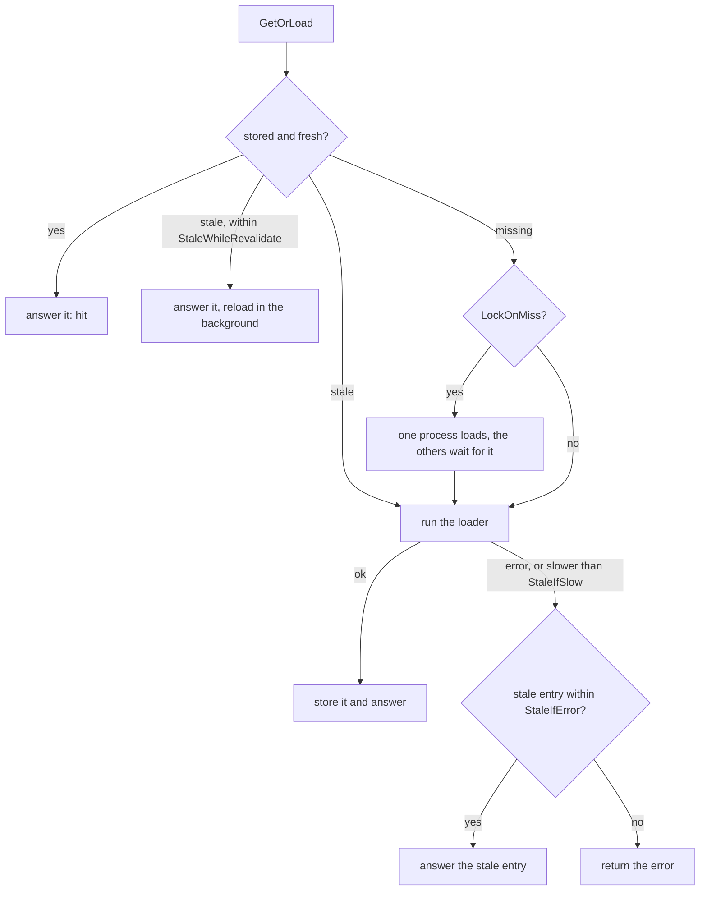

<p align="center">
  
</p>

<h1 align="center">gashe</h1>

<p align="center">Caching for Go services that run as many processes.</p>

<p align="center">
  <a href="https://pkg.go.dev/github.com/eugeneliukindev/gashe"></a>
  <a href="https://github.com/eugeneliukindev/gashe/tags"></a>
  <a href="go.mod"></a>
  <a href="LICENSE"></a>
</p>

One `*gashe.Cache` stores results of expensive calls, keeps answering when a dependency is slow or
down, and guards dependencies with locks, rate limits and circuit breakers. Over Redis all of it is
shared by every pod.

```bash
go get github.com/eugeneliukindev/gashe
go get github.com/eugeneliukindev/gashe/backend/redis # Redis backend, on go-redis v9
go get github.com/eugeneliukindev/gashe/codec/msgpack # MessagePack codec, optional
```

Go 1.23 or newer. The core module has no third-party dependencies and no global state.

## Two ways to use it

Both run on one `*gashe.Cache` and take a `gashe.Policy`: how long a result is fresh, and what to
do when the source is slow or down.

```go
c := gashe.New(gasheredis.New(client), gashe.Options{})

cachedUsers := gashe.Policy[User]{
	TTL:          10 * time.Minute, // fresh for 10 minutes
	StaleIfError: time.Hour,        // the database is down: answer the old user for up to an hour
	LockOnMiss:   5 * time.Second,  // a cold key loads once for all pods
}
```

**Call it from your code** when you decide what to cache and under which key: `GetOrLoad`,
`GetOrLoadMany` and `Reload`, plus `InvalidateTags`, `Lock`, `RateLimit` and `CircuitBreaker`. See
[Direct calls](#direct-calls).

```go
u, err := gashe.GetOrLoad(ctx, c, "user:42", cachedUsers, loadUser) // loadUser runs on a miss only
```

**Wrap a handler** to cache whole HTTP responses without changing it, with `ETag`, `304` and
`Cache-Status`. See [HTTP middleware](#http-middleware).

```go
cached := httpcache.New(c, httpcache.Options{Policy: gashe.Policy[httpcache.Response]{TTL: time.Minute}})
mux.Handle("GET /products/", cached(http.HandlerFunc(listProducts)))
```

## Contents

[Configuration](#configuration) - [Backends](#backends) - [Keys and TTL](#keys-and-ttl) -
[Basic API](#basic-api) - [Direct calls](#direct-calls) - [HTTP middleware](#http-middleware) -
[Errors](#errors) - [Testing your code](#testing-your-code)

## Configuration

Every option struct works empty; a field you leave out gets its default.

```go
mem := memory.New(memory.Options{
	MaxEntries:    10_000,      // 0 means 1000
	MaxBytes:      256 << 20,   // bytes of keys and values; 0 means no limit
	PurgeInterval: time.Minute, // how often expired entries are purged; 0 means every second
})
defer mem.Close()

c := gashe.New(mem, gashe.Options{
	Codec:            gashe.JSON{},          // the default
	OnError:          onError,               // errors the cache works around instead of returning
	OnResult:         onResult,              // how every GetOrLoad was answered and how long it loaded
	LockPollInterval: 20 * time.Millisecond, // how often Lock and LockOnMiss check; 0 means 100ms
	Namespace:        "orders:gashe:",       // where the cache keeps its own keys; "" means "gashe:"
})
defer c.Shutdown(ctx) // runs before mem.Close: waits for background reloads
```

Create one `Cache` at startup and share it; it is safe for concurrent use. It does not close the
backend: close it where you created it.

## Backends

### Memory

`backend/memory` is an LRU in process memory with a TTL per entry. Each process has its own; use
Redis to share data. Bytes are copied in and out, so changing a value after `Set` or `Get` never
changes the cache.

> [!WARNING]
> `MaxEntries` counts entries, not bytes: 10,000 entries of 1 MB are 10 GB. Set `MaxBytes` too,
> with headroom, since it does not count the overhead of Go. A value larger than `MaxBytes` is not
> stored: `Set` returns `memory.ErrTooLarge`.

### Redis

`backend/redis` is a separate module on [go-redis v9](https://github.com/redis/go-redis), so the
core stays dependency-free. You build and close the client; timeouts, pool, TLS, Sentinel and
Cluster are go-redis options. Valkey, Dragonfly and KeyDB pass the same tests.

```go
client := goredis.NewUniversalClient(&goredis.UniversalOptions{
	Addrs:        []string{"localhost:6379"},
	ReadTimeout:  100 * time.Millisecond, // a slow cache must not slow the service down
	WriteTimeout: 100 * time.Millisecond,
})
defer client.Close()
c := gashe.New(gasheredis.New(client), gashe.Options{})
```

- Every entry is a plain Redis string; [Direct calls](#direct-calls) show what each one stores.
  Read them with `redis-cli`, but do not write `GetOrLoad` entries by hand: the format is internal.
  `DEL` is always safe.
- On a Cluster, multi-key calls go one key at a time, and `Keys`, `All` and `DeleteMatch` visit
  every master.
- Errors are wrapped as `gashe/redis: <op>: <error>`; a missing key is `gashe.ErrNotFound`.

> [!CAUTION]
> `Keys`, `All`, `DeleteMatch` and `redis-cli KEYS *` walk the whole database. On a large Redis
> prefer `InvalidateTags`, and look around with `redis-cli --scan --pattern 'user:*'`.

### Near cache backend

`backend/nearcache` puts a memory cache in front of Redis, see [Near cache](#near-cache).

### Your own backend

Implement `gashe.Backend`, which works with bytes only; the method comments in `backend.go` are the
contract. To change one behavior, embed `gashe.Backend` in a struct and override that method. Check
it with the suite the bundled backends pass:

```go
func TestContract(t *testing.T) {
	backendtest.Run(t, func(t *testing.T) gashe.Backend {
		return newEmptyBackend(t) // a fresh backend for every subtest
	})
}
```

## Keys and TTL

The key that reaches the backend has up to three parts:

```go
c := gashe.New(gashe.WithPrefix(gasheredis.New(client), "orders:prod:"), gashe.Options{}) // per service
cachedUsers := gashe.Policy[User]{TTL: time.Hour, Prefix: "users:v2:"}                    // per kind
gashe.GetOrLoad(ctx, c, "42", cachedUsers, load) // stored as "orders:prod:users:v2:42"
```

Prefixes are used as is, separator included. The cache keeps its own keys under
`Options.Namespace`, `gashe:` by default: `gashe:tag:<tag>`, `gashe:load:<key>` and
`gashe:refresh:<key>` for the locks of an entry, `gashe:rate:sliding:<key>:<window>` and
`gashe:rate:fixed:<key>` for rate limits. Change the namespace when these could collide with your
keys or when Redis ACLs grant keys by pattern.

In `GetOrLoad`, `TTL` is how long a result is fresh; the entry is kept `TTL` plus the longer of
`StaleWhileRevalidate` and `StaleIfError`. In the basic API a TTL of 0 means "never expires" and a
negative one returns `ErrInvalidTTL`.

> [!WARNING]
> Two call sites that read one key as different types make each other miss on every call. Give
> every type its own key or `Prefix`.

## Basic API

A map with TTL. `GetOrLoad` and the strategies below are built on the same entries.

<details>
<summary>Every call of the basic API</summary>

```go
c.Set(ctx, "key", v, time.Hour)          // ttl 0 = no expiry; replaces the old TTL
c.SetIfAbsent(ctx, "key", v, time.Hour)  // (bool, error)
c.SetIfPresent(ctx, "key", v, time.Hour) // (bool, error)
c.SetMany(ctx, map[string]any{"a": 1}, time.Hour)

c.Get(ctx, "key", &dst)                 // gashe.ErrNotFound on a miss
values, err := c.GetMany(ctx, "a", "b") // values[i].Found(), values[i].Decode(&dst)
for key, err := range c.Keys(ctx, "user:*") {}
for v, err := range c.All(ctx, "user:*") {} // v.Key(), v.Decode(&dst)

c.Incr(ctx, "counter", 1, time.Minute) // ttl only when the counter is created
c.Exists(ctx, "key")
c.Delete(ctx, "key")
c.Expire(ctx, "key", time.Minute)
c.TTL(ctx, "key") // gashe.NoExpiry for no expiry
```

</details>

Patterns are Redis globs: `*`, `?`, `[abc]`, `[^a]`, `[a-z]`, `\` to escape. Values are anything
the codec can encode; with JSON, exported fields only. `GetOrLoad` returns the value as it reads
back from the cache, so a field that is lost shows up on the first call, not only on a hit.

## Direct calls

Each section names a problem caches run into and the call or option that solves it. Most are fields of one
`gashe.Policy[V]` and can be combined. Over `memory` everything stays inside one process; over Redis
it is shared by every process that uses that Redis, unless a section says otherwise. Most
sections end with what the example stores in Redis. `loadUser`, `s.repo` and the like stand for
your own code.

| Problem | Solution |
|---|---|
| The same expensive call again and again | [`GetOrLoad`](#cache-aside) |
| Every request waits when a popular key expires | [`StaleWhileRevalidate`](#stale-while-revalidate) |
| The database is down and the cache is empty | [`StaleIfError`](#stale-if-error) |
| The database is slow, and every request waits for it | [`StaleIfSlow`](#stale-if-error) |
| Lookups of missing ids always reach the database | [`Negative`](#negative-caching) |
| A heavy page is rendered on every request | [`httpcache`](#http-middleware) |
| One change makes many entries stale | [`Tags`, `InvalidateTags`](#invalidation-by-tag) |
| A cold key: a thousand identical queries | built in for one process, [`LockOnMiss`](#cache-stampede-across-processes) for all pods |
| N+1 queries on a list page | [`GetOrLoadMany`](#batch-loading) |
| Keys stored together expire together | [`Jitter`](#ttl-jitter) |
| A hot key costs a round trip on every read | [`nearcache`](#near-cache) |
| Work must run once at a time across pods | [`Lock`, `TryLock`](#distributed-lock) |
| A client calls far too often | [`RateLimit`](#rate-limiting) |
| A failing dependency drags the service down | [`CircuitBreaker`](#circuit-breaker) |
| Redis is down, and every request waits for its timeout | [`WithBreaker`](#cache-failure) |
| A deploy changed a cached type | built in: [shapes](#type-changes) |

If the cache itself fails, `GetOrLoad` serves from the loader and reports the error to `OnError`.

How `GetOrLoad` answers, with the options that change each step:



### Caching

#### Cache-aside

The same expensive call is made again and again. `GetOrLoad` returns the stored result while it is
fresh; otherwise it calls your loader, stores the result for `TTL` and returns it. A loader error
is returned as is and never stored.

```go
var cachedUsers = gashe.Policy[User]{TTL: time.Hour}

u, err := gashe.GetOrLoad(ctx, c, "user:42", cachedUsers, func(ctx context.Context) (User, error) {
	return loadUser(ctx, 42) // runs only when the cache cannot answer
})
```

Use the `ctx` the loader receives, not the one around it: a background reload calls the loader
after the request has ended. Three more fields fit most cases:

```go
gashe.Policy[[]Item]{TTL: time.Minute, CacheIf: func(v []Item) bool { return len(v) > 0 }} // skip empty results
gashe.Policy[Token]{TTLFunc: func(t Token) time.Duration { return time.Until(t.ExpiresAt) - time.Minute }}
gashe.Policy[User]{TTL: time.Hour, Prefix: "users:v2:"} // stores "users:v2:42"
```

Stored as one string under `user:42` for an hour: `at` is when the result stops being fresh,
`v` is the result, `t` is the shape of `User` (see [type changes](#type-changes)).

<details>
<summary>The stored value</summary>

```
{"at":"2026-11-02T21:42:44.923656871+03:00","v":{"ID":42,"Name":"Ann","Email":"ann@example.com"},"t":12739442919671864151}
```

</details>

#### Stale-while-revalidate

A popular key expires, and every request waits for the slow loader. `StaleWhileRevalidate` works as
the directive of [RFC 5861](https://www.rfc-editor.org/rfc/rfc5861#section-3): for this long after
`TTL` the stale result is answered at once while one caller reloads it in the background; with
Redis, one caller across all processes.

```go
var cachedFeeds = gashe.Policy[[]Item]{TTL: 5 * time.Minute, StaleWhileRevalidate: 30 * time.Minute}
```

Stored like a cache-aside entry, but for `TTL + StaleWhileRevalidate` (35 minutes). While one
process reloads it, `gashe:refresh:feed:u1` holds the random id of that process, such as
`f4fefbc6731d4abccff956cae8ca012f`, for at most a minute.

> [!CAUTION]
> The background reload runs after the request has ended: its `ctx` keeps the values of the
> request but not its cancellation, and gets a one-minute deadline. Do not use request-scoped
> resources, such as an open transaction, inside the loader.

#### Stale-if-error

The database or an API is down, and expired entries leave nothing to answer with. `StaleIfError`
works as the directive of [RFC 5861](https://www.rfc-editor.org/rfc/rfc5861#section-4): for this
long after `TTL` a stale result answers a loader error; the error goes to `OnError`. `StaleIf`
picks which errors count.

```go
var cachedRates = gashe.Policy[Rates]{
	TTL:          time.Minute,
	StaleIfError: 6 * time.Hour,
	StaleIf:      func(err error) bool { return errors.Is(err, ErrAPIDown) }, // nil = any error
}
```

Stored for `TTL + StaleIfError` (6 hours and a minute), though fresh only for the minute in `at`.

A source that is slow rather than down is covered by `StaleIfSlow`: when the loader takes longer,
the call answers with the stale result at once (`ResultStaleIfSlow`), and the load goes on in the
background and stores what it gets. While it runs, other calls also get the stale result instead of
starting more loads, with Redis across all pods.

```go
var cachedRates = gashe.Policy[Rates]{TTL: time.Minute, StaleIfError: 6 * time.Hour, StaleIfSlow: 200 * time.Millisecond}
```

> [!WARNING]
> An answer can be up to `TTL + StaleIfError` old. Do not use it where a stale answer is wrong
> rather than late: permissions, balances, prices at checkout.

#### Negative caching

Requests for data that does not exist (a scraper walking ids) are never cached, so all of them
reach the database. `Negative` caches "not found" for a short while and returns the error you chose
while it is cached.

```go
var cachedUsers = gashe.Policy[User]{
	TTL: time.Hour,
	Negative: gashe.Negative{
		If:  func(err error) bool { return errors.Is(err, sql.ErrNoRows) }, // which errors mean "no such data"
		Err: sql.ErrNoRows,                                                 // returned while cached
		TTL: 30 * time.Second,
	},
}
```

Stored under `user:999` for `Negative.TTL`, as an entry with `"neg":true`:

<details>
<summary>The stored value</summary>

```
{"at":"2026-11-02T20:43:14.923731132+03:00","v":{"ID":0,"Name":"","Email":""},"neg":true,"t":12739442919671864151}
```

</details>

> [!WARNING]
> Data created after a negative answer stays "not found" until `Negative.TTL` ends. Keep it short,
> or `Delete` the key when you create the data.

### Invalidation

#### Invalidation by tag

One change makes many entries stale, and deleting them by pattern scans the whole of Redis. Give
entries `Tags`; `InvalidateTags` makes every entry with the tag a miss with one write per tag.

```go
cachedProfiles := gashe.Policy[Profile]{TTL: time.Hour, Tags: []string{"user:42"}}
cachedOrders := gashe.Policy[[]Order]{TTL: time.Hour, Tags: []string{"user:42", "orders"}}

_, err = db.ExecContext(ctx, "UPDATE users SET name = $1 WHERE id = 42", name)
err = c.InvalidateTags(ctx, "user:42") // after the write, not before
```

An entry stores the generations of its tags in `g`, in the order of `Tags`:

<details>
<summary>The stored value</summary>

```
{"at":"2026-11-02T21:42:44.923741491+03:00","v":[{"ID":7}],"g":[2979883199008293202,1244849662261960931],"t":7073818895893918877}
```

</details>

A tag is a counter under `gashe:tag:<tag>` that starts at a random number on first use and never
expires: `InvalidateTags(ctx, "user:42")` raises `gashe:tag:user:42` from `2979883199008293202` to
`...203`. Entries with an older `g` are misses and expire by their TTL. If Redis evicts a counter, it
starts again at a new random number, so evicted counters never bring invalidated entries back.

Tags also close the race where a slow read stores an old value after a write: the read takes the
generations before it loads, so its late entry is stored with the old `g` and is a miss at once.
For data that must not be stale after a write, give each item its own tag and invalidate it after
the write:

```go
cachedUser := func(id string) gashe.Policy[User] {
	return gashe.Policy[User]{TTL: time.Hour, Tags: []string{"user:" + id}}
}
u, err := gashe.GetOrLoad(ctx, c, "user:"+id, cachedUser(id), loadUser)
// after UPDATE users ... WHERE id = $1:
err = c.InvalidateTags(ctx, "user:"+id)
```

The price is one more key read per lookup.

> [!NOTE]
> Tag counters never expire: every tag name is one small key forever. Tags per user are fine;
> tags per request are not.

#### Other ways to invalidate

```go
gashe.Reload(ctx, c, "user:42", cachedUsers, loadUser) // load and store a new result now
c.Delete(ctx, "user:42")
c.DeleteMatch(ctx, "user:*")                      // scans the whole backend: avoid on a large Redis
```

`Delete` leaves the race above open: a read that loaded before the write can store its old value
after the `Delete`. Use a tag where that matters.

To drop everything of one kind, change its `Prefix`. Every key then misses at once: expect the load
of a cold cache after such a deploy. A changed type does not need it, see
[type changes](#type-changes).

### Load on the source

#### Cache stampede inside a process

A key is missing and a thousand goroutines ask for it at once. Built in: concurrent `GetOrLoad`
calls with the same key and type in one process share one lookup and one load. This sharing lives
in process memory and writes nothing to Redis; with 50 pods the key still loads 50 times.

#### Cache stampede across processes

The same with 50 pods: 50 identical queries. With `LockOnMiss`, on a miss one process takes a lock
in Redis and loads; the others wait and read its result. The key loads once for all pods. The value
is the longest the lock is held, in case its holder dies.

```go
var cachedStats = gashe.Policy[Stats]{TTL: 10 * time.Minute, LockOnMiss: time.Minute}
```

While one pod loads, `gashe:load:stats:2026-11-02` holds the random id of that pod for at most
`LockOnMiss`; it is deleted once the result is stored.

> [!WARNING]
> Make `LockOnMiss` longer than the slowest load, or a second pod starts loading when the lock
> expires. Waiting calls wait as long as their `ctx` allows.

#### Batch loading

A page shows 50 products: 50 cache round trips and, on a cold cache, 50 queries. `GetOrLoadMany`
reads all keys in one call and calls the loader once with the missing ones; keys the loader leaves
out are not stored. It shares entries with `GetOrLoad` and supports `TTL`, `TTLFunc`, `Jitter`,
`Tags`, `CacheIf` and `Prefix`; the other options return `ErrInvalidOptions`.

```go
var cachedCatalog = gashe.Policy[Product]{TTL: time.Hour, Prefix: "product:"}

products, err := gashe.GetOrLoadMany(ctx, c, ids, cachedCatalog,
	func(ctx context.Context, missing []string) (map[string]Product, error) {
		return s.repo.ProductsByID(ctx, missing) // SELECT ... WHERE id = ANY($1)
	})
```

Concurrent calls are not shared: two requests for the same cold list both call the loader.

#### TTL jitter

Keys stored together (after a deploy or a warm-up) expire together, and the database gets all of
their loads at once (cache avalanche). `Jitter` spreads every TTL randomly by up to this share.

```go
var cachedProducts = gashe.Policy[Product]{TTL: time.Hour, Jitter: 0.2} // 48 to 72 minutes
```

Products stored at the same moment get TTLs such as 3009, 4183 and 3263 seconds instead of 3600
each.

#### Near cache

A hot key is read thousands of times a second, each read a network round trip to one Redis node.
`nearcache` keeps a copy in process memory for `LocalTTL`; writes and deletes go to Redis and drop
the local copy. Locks, counters and TTLs always use Redis.

With a `Bus`, a pod that changes a key tells the others, and they drop their copies at once instead
of after `LocalTTL`. Only the key name is sent; the next read takes the new value from Redis.
`InvalidateTags` becomes instant on every pod too.

```go
local := memory.New(memory.Options{MaxBytes: 64 << 20})
defer local.Close()
near := nearcache.New(local, gasheredis.New(client), nearcache.Options{
	LocalTTL: time.Minute,
	Bus:      gasheredis.NewBus(client, "orders:invalidate"), // one channel per service
})
defer near.Close() // stops listening to the bus
c := gashe.New(near, gashe.Options{})
```

> [!WARNING]
> Every pod keeps its own copy, so with 50 pods the local cache takes RAM 50 times: bound it with
> `MaxBytes`. The bus sees only changes made through gashe; a key changed by `redis-cli` or another
> service stays stale up to `LocalTTL`. While a pod is disconnected from Redis it may miss
> messages; it drops all its copies when it reconnects.

### Storage

#### Key prefixes

Several services or environments share one Redis and their keys collide. `WithPrefix` keeps every
key of a backend under a prefix; inside the service keys stay as they are.

```go
c := gashe.New(gashe.WithPrefix(gasheredis.New(client), "orders:staging:"), gashe.Options{})
```

Every key is stored with the prefix: `order:1` becomes `orders:staging:order:1`.

#### Type changes

A deploy renames a field of a cached type, and `encoding/json` reads old entries without an error,
leaving the new field empty until they expire. Built in: every entry keeps `t`, a hash of the shape
of its type (exported field names, json tags and types), and an entry of another shape is a miss
that loads again. Only types that changed reload; changing values does not change the shape.

```go
type User struct{ Name string }     // stored with "t":1273...
type User struct{ FullName string } // after the deploy: another shape, so old entries are misses
```

Entries stored by gashe v0.1.0 have no `t` and are read as they are, so an upgrade does not empty
the cache.

#### Large values

Big values take memory in Redis and network on every read. `Gzip` compresses what another codec
encodes; `codec/msgpack` is a smaller binary format; `Raw` stores `[]byte` and `string` as they are
in the basic API.

```go
c := gashe.New(backend, gashe.Options{Codec: gashe.Gzip{}}) // a 320 KB page takes 2 KB in Redis
```

> [!CAUTION]
> Changing the codec, like changing `Prefix`, makes every stored entry a miss at once. `Incr` does
> not work on compressed or MessagePack values.

### Protecting dependencies

#### Distributed lock

Some work must never run twice at once across your pods: a daily report, a payment. `Lock` and
`TryLock` take a lock in Redis; the TTL frees it if the holder dies, `Extend` keeps it longer.

```go
lease, ok, err := c.TryLock(ctx, "job:reindex", time.Minute) // Lock waits instead
if err != nil || !ok {
	return err // Redis is down, or another pod holds it
}
defer lease.Unlock(ctx)              // releases it only if it is still yours
err = lease.Extend(ctx, time.Minute) // for long work; gashe.ErrLockLost if it expired
```

Stored under `job:reindex`: the random id of the holder, such as
`621708739092f7d5ef73f2358d22a804`, for the lock TTL.

> [!CAUTION]
> Locks are advisory: a holder paused longer than the TTL (GC, a frozen VM) can overlap with the
> next one. Make writes that guard money idempotent too.

#### Rate limiting

A client or a bug calls an expensive endpoint far too often. `RateLimit` counts a call and returns
`ErrRateLimited` once the key is over its limit; with Redis the limit is shared by all pods, with
`memory` each pod counts only its own calls. If the backend fails, the call is let through.

```go
err := c.RateLimit(ctx, "api-key:"+key, gashe.PerMinute(600)) // sliding window
err = c.RateLimit(ctx, "login:"+ip, gashe.FixedWindow{Calls: 5, Per: time.Minute, BanFor: 15 * time.Minute})
if errors.Is(err, gashe.ErrRateLimited) {
	http.Error(w, "too many requests", http.StatusTooManyRequests)
}
```

A sliding window stores a plain counter per span of `Per`, such as `3` under
`gashe:rate:sliding:api-key:k1:29893701`, each for twice `Per`. A fixed window is one counter under
`gashe:rate:fixed:login:1.2.3.4`; the first call over the limit sets its TTL to `BanFor`.

`SlidingWindow` is an estimate and can let slightly more through under bursts; `FixedWindow` can
let up to twice `Calls` through around the border of two windows.

#### Circuit breaker

A dependency starts failing, every request still waits for it, and the failure spreads. The breaker
counts calls of the last `Window`; once `FailurePercent` of them fail, it refuses calls with
`ErrCircuitOpen` for `OpenFor`, then lets `HalfOpenCalls` test calls through. It lives in process
memory: each pod judges the dependency by its own calls, and Redis holds nothing.

```go
done, err := c.CircuitBreaker("payments-api", gashe.BreakerOptions{
	FailurePercent: 50, MinCalls: 10, Window: 30 * time.Second, OpenFor: 15 * time.Second,
})
if err != nil {
	return err // gashe.ErrCircuitOpen: answer at once instead of waiting for a timeout
}
done(provider.Charge(ctx, p)) // report once: nil or the error
```

> [!WARNING]
> The state of every key is kept for the life of the `Cache`: use a few fixed keys, not user ids
> or URLs.

### Operations

#### Cache failure

Built in: if the backend fails, `GetOrLoad` returns the loader result without storing it,
`RateLimit` lets the call through, and the error goes to `OnError`. Bound how long a slow Redis can
hold a request with go-redis `ReadTimeout` and `WriteTimeout`.

When Redis is down, every call still waits for that timeout before it goes to the loader.
`WithBreaker` stops calling a failing backend for a while: calls then fail at once with
`ErrCircuitOpen`, and `GetOrLoad` goes straight to the loader. Misses do not count as failures,
and `Ping` always reaches Redis.

```go
backend := gashe.WithBreaker(gasheredis.New(client), gashe.BreakerOptions{
	FailurePercent: 50, MinCalls: 20, Window: 10 * time.Second, OpenFor: 5 * time.Second, HalfOpenCalls: 1,
})
c := gashe.New(backend, gashe.Options{})
```

> [!WARNING]
> With Redis down, `LockOnMiss` no longer holds other pods back, and every pod sends its misses to
> the database. Put a `CircuitBreaker` in front of the database for that case.

#### Monitoring

`OnResult` receives an `Outcome` for every `GetOrLoad` and every key of `GetOrLoadMany`: the
key, how it was answered (hit, miss, stale-while-revalidate, stale-if-error, stale-if-slow or
negative-hit) and how long the loader ran, 0 on a hit. It sees the calls of this process; sum the
metrics of all pods.

```go
c := gashe.New(backend, gashe.Options{
	OnResult: func(ctx context.Context, o gashe.Outcome) {
		results.WithLabelValues(o.Result.String()).Inc()
		if o.Load > 0 {
			loads.Observe(o.Load.Seconds()) // what a miss costs: pick TTLs by it
		}
	},
	OnError:  func(ctx context.Context, err error) { slog.WarnContext(ctx, "cache degraded", "error", err) },
})
```

Both run synchronously on every call: keep them fast.

#### Graceful shutdown

A background reload may still run when the service stops and write to a closed backend.
`Shutdown` stops starting reloads and waits for the running ones; call it before closing Redis.

```go
_ = srv.Shutdown(ctx) // the HTTP server first
_ = c.Shutdown(ctx)
_ = client.Close()
```

#### Known limits

- **Cache-aside race with `Delete`.** A read can load an old value, a write can update the
  database and delete the key, and then the read stores its old value until its TTL ends. Tags do
  not have this race, see [invalidation by tag](#invalidation-by-tag).
- **Locks are advisory**, see [distributed lock](#distributed-lock).
- **Clocks.** Freshness compares the clock of the reading process with the time the writer stored.
  Keep clocks in sync (NTP).

## HTTP middleware

`httpcache` caches whole responses of a handler: a hit sends the stored status, headers and body
without calling the handler. It runs on `GetOrLoad`, so every `Policy` field works for pages: a 5xx
with `StaleIfError` gets the last good page, `LockOnMiss` renders a cold page once for all pods.

```go
cached := httpcache.New(c, httpcache.Options{Policy: gashe.Policy[httpcache.Response]{
	Prefix:       "http:",
	TTL:          time.Minute,
	StaleIfError: time.Hour,
	Tags:         []string{"catalog"}, // c.InvalidateTags(ctx, "catalog") after an edit
}})
mux.Handle("GET /products/", cached(http.HandlerFunc(listProducts)))
```

It follows the HTTP standards a shared cache must:

- **What is stored**, as [RFC 9111](https://www.rfc-editor.org/rfc/rfc9111#section-3) asks of a
  shared cache: only `GET` and `HEAD` without `Range`, never responses with `Set-Cookie`, `Vary` or
  `Cache-Control` `no-store`, `private` or `no-cache`, and never requests with `Authorization`
  unless your `Key` includes the user. Hop-by-hop headers are not stored
  ([RFC 9110](https://www.rfc-editor.org/rfc/rfc9110#section-7.6.1)).
- **Conditional requests**: every response gets an `ETag`, and a matching `If-None-Match` gets
  `304 Not Modified` without a body, with the weak comparison of
  [RFC 9110](https://www.rfc-editor.org/rfc/rfc9110#section-13.1.2).
- **`Cache-Status`** ([RFC 9211](https://www.rfc-editor.org/rfc/rfc9211)) says how the request was
  handled: `gashe; hit`, `gashe; fwd=uri-miss; stored`, `gashe; fwd=uri-miss`, `gashe; fwd=method`
  or `gashe; fwd=request`. A hit also gets `Age`.

Two rules are stricter on purpose: request `Cache-Control` and `Pragma` are ignored, so clients
cannot make the handler run on every request, and how long a page is fresh comes from `Policy`, not
from `max-age`.

> [!CAUTION]
> A response must be the same for everyone who gets its key. If a page depends on a cookie, set
> `Key` and put the user in it, or do not wrap that route.

## Errors

Check them with `errors.Is`.

<details>
<summary>Every error</summary>

| Error | When |
|---|---|
| `ErrNotFound` | `Get`, `TTL`, `Value.Decode` on a miss |
| `ErrInvalidTTL` | a negative TTL, or a non-positive one where a lock or `Expire` needs it |
| `ErrInvalidOptions` | a `Policy`, `Limit` or `BreakerOptions` that cannot work |
| `ErrWrongType` | `Incr` on a value that is not an integer |
| `ErrLockLost` | `Lease.Extend` of a lock that expired |
| `ErrRateLimited` | `RateLimit` refuses a call |
| `ErrCircuitOpen` | `CircuitBreaker` or a `WithBreaker` backend refuses a call |

</details>

Loader errors are returned unchanged. `GetOrLoad` and `RateLimit` never return backend errors:
they work around them and send them to `OnError`. `Lock`, `TryLock`, `Extend` and
`InvalidateTags` do return them.

## Testing your code

Use the memory backend with the purge off, so no goroutine outlives the test:

```go
func newCache(t *testing.T) *gashe.Cache {
	mem := memory.New(memory.Options{PurgeInterval: -1})
	t.Cleanup(func() { _ = mem.Close() })
	return gashe.New(mem, gashe.Options{})
}
```

TTLs follow `time.Now`, so on Go 1.25+ `testing/synctest` runs them in fake time; `synctest.Wait()`
lets background reloads finish. Leave `Jitter` out where a test checks exact TTLs. To simulate a
failing backend, embed a real one and override a method:

```go
type downBackend struct{ gashe.Backend }

func (downBackend) Get(context.Context, string) ([]byte, error) { return nil, errDown }
```

## More

- [API reference](https://pkg.go.dev/github.com/eugeneliukindev/gashe) on pkg.go.dev, and
  [REFERENCE.md](REFERENCE.md) in the repository.
- [Changelog](CHANGELOG.md) of every release.
- [Glossary](GLOSSARY.md) of the terms used here, and [Contributing](CONTRIBUTING.md).

Under the [MIT license](LICENSE). The gopher in the logo is based on the Go gopher by
[Renee French](https://reneefrench.blogspot.com/), licensed under
[CC BY 4.0](https://creativecommons.org/licenses/by/4.0/), and was redrawn for gashe.
