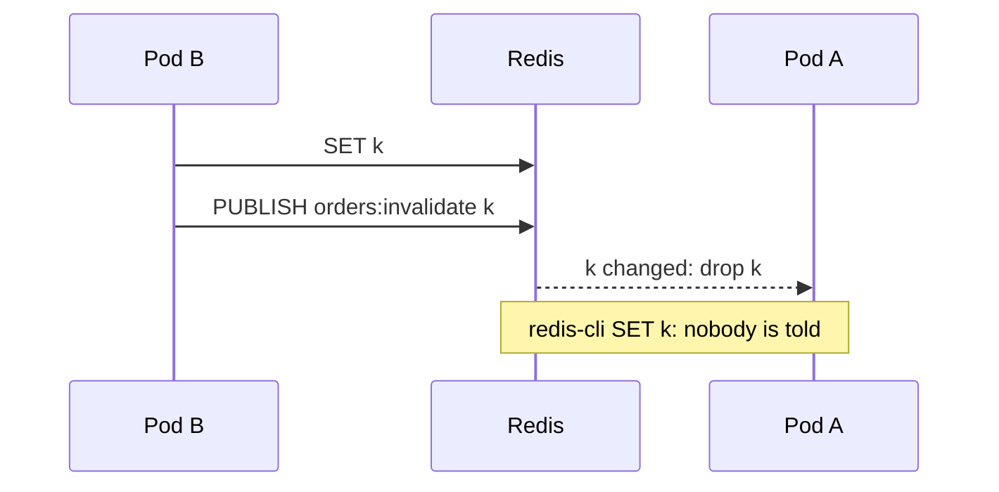
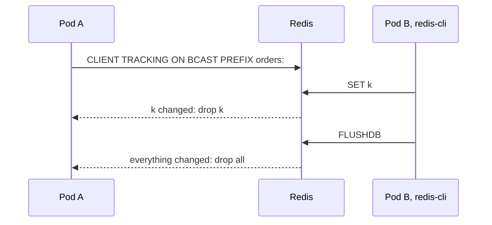

# Backends { #backends }

## `backend/memory` { #backendmemory }

```go
backend := memory.New(memory.Options{
	MaxEntries:    10_000,      // entries, not bytes; the least recently used goes first; 0 means 1000
	MaxBytes:      256 << 20,   // bytes of keys and values, without the overhead of Go; 0 means no limit
	PurgeInterval: time.Minute, // how often expired entries are purged; 0 means every second, negative never
})
defer backend.Close() // stops the background purge
```

An LRU in process memory with a TTL per entry, one per process.

| What | How |
|---|---|
| Errors | `memory.ErrTooLarge` - a value over `MaxBytes` |
| Values | copied in and out; set `MaxBytes` with headroom |

## `backend/redis` { #backendredis }

```go
client := goredis.NewUniversalClient(&goredis.UniversalOptions{
	Addrs:        []string{"localhost:6379"},
	ReadTimeout:  100 * time.Millisecond, // a slow cache must not slow the service down
	WriteTimeout: 100 * time.Millisecond,
})
defer client.Close()
backend := gasheredis.New(client)
```

A backend on [go-redis v9](https://github.com/redis/go-redis), shared by every process; a separate
module. Timeouts, pool and TLS are options of the client.

| What | How |
|---|---|
| Errors | `gashe/redis: <op>: <error>`; a missing key is `gashe.ErrNotFound` |
| Entries | read them with `redis-cli --scan`, never write them by hand |

| Server | Status |
|---|---|
| Redis 7.0 and newer, Valkey 8 | tested on every release |
| Dragonfly, KeyDB | pass the same tests; Dragonfly lacks `CLIENT KILL`, so the reconnect test of `Bus` is skipped there |
| Redis Cluster and Sentinel | through `UniversalClient`; on a Cluster, calls on several keys go key by key, and `SCAN` visits every master |
| managed Redis and Valkey (ElastiCache, MemoryDB, Azure Cache for Redis, Memorystore, Upstash) | not tested; they need `SET` with `NX`, `XX` and `PX`, `UNLINK`, `SCAN`, `MULTI`, Lua scripts for locks, pub/sub for `Bus` and `CLIENT TRACKING` for `TrackingBus` |

## `backend/nearcache` { #backendnearcache }

Keeps a copy of what it reads from the shared backend in process memory, so a hot key costs no round
trip.

```go
local := memory.New(memory.Options{MaxBytes: 64 << 20})
defer local.Close()

backend := nearcache.New(local, gasheredis.New(client), nearcache.Options{
	LocalTTL: time.Minute,
	Bus:      gasheredis.NewBus(client, "orders:invalidate"), // one channel per service
})
defer backend.Close() // stops listening to the bus
```

**Default:** without a `Bus`, a copy lives 5 seconds in each process, so a change made by another pod
is seen after at most 5 seconds.

**Options** (`nearcache.Options`):

| Field | Default | What it does |
|---|---|---|
| `LocalTTL` | 5s | how long a copy stays in memory; also how long another pod may see an old value |
| `Bus` | nil: copies expire after `LocalTTL` | tells pods which keys changed: see [Which bus](#which-bus) |

- **Errors:** `New` panics on a negative `LocalTTL`.

!!! warning
    Every pod keeps its own copy, so with 50 pods the memory is taken 50 times: bound it with
    `MaxBytes`.

A read and a write, with two pods and a `Bus`:


| Call | Local memory | Shared backend | Other pods |
|---|---|---|---|
| `Get`, `GetMany` | read first, filled on a miss | read on a local miss | - |
| `Set`, `SetMany`, `SetIfAbsent`, `SetIfPresent`, `IncrBy`, `Expire` | the copy dropped | written | told by the bus |
| `Delete`, `DeleteMany`, `Unlock` | the copy dropped | written | told by the bus |
| `DeleteMatch` | matching copies dropped | written | drop all their copies |
| `Exists`, `TTL`, `Scan`, locks | not read | read | - |
| a reconnect to the `Bus`, or a failed read from it | all copies dropped: messages may be lost | - | - |

### Which bus { #which-bus }

A bus only tells pods which keys changed; a pod drops its copy and reads the new value on the next
request.

| Bus | Sees changes | Needs | Cluster |
|---|---|---|---|
| `gasheredis.NewTrackingBus(client, "orders:")` | every change of a key under the prefix: gashe, `redis-cli`, other services, `FLUSHDB` | Redis 6+ or Valkey, a `*redis.Client` | no |
| `gasheredis.NewBus(client, "orders:invalidate")` | changes made through gashe; a key changed by `redis-cli` stays old up to `LocalTTL` | pub/sub, one channel per service | yes |

Use `NewTrackingBus` on a single node or Sentinel, `NewBus` on a Cluster.

`NewBus`: gashe publishes the keys it changed, so a change made by `redis-cli` reaches nobody.



`NewTrackingBus`: Redis itself reports every change under the prefix, `FLUSHDB` included.



| What | How |
|---|---|
| `TrackingBus` | opens a connection of its own; `""` means every key; nothing is published, Redis reports the writes of gashe too |
| Redis refuses `CLIENT TRACKING`, as an ACL may | the bus retries every second, and copies live up to `LocalTTL` |

- **Example:** [examples/nearcache](https://github.com/eugeneliukindev/gashe/blob/main/examples/nearcache/main.go)

??? example "examples/nearcache/main.go"

    ```go
    --8<-- "examples/nearcache/main.go"
    ```

## Your own backend { #your-own-backend }

```go
func TestContract(t *testing.T) {
	backendtest.Run(t, func(t *testing.T) gashe.Backend {
		return newEmptyBackend(t) // a fresh backend for every subtest
	})
}
```

Implement `gashe.Backend`, whose contract is the comments in `backend.go`, and check it with the suite
the bundled backends pass. To change one method, embed `gashe.Backend` and override it.

## Testing your code { #testing-your-code }

```go
func newCache(t *testing.T) *gashe.Cache {
	backend := memory.New(memory.Options{PurgeInterval: -1}) // no purge goroutine: nothing to close
	return gashe.New(backend, gashe.Options{})
}

type downBackend struct{ gashe.Backend } // a failing backend: embed a real one, override a method

func (downBackend) Get(context.Context, string) ([]byte, error) { return nil, errDown }
```

A cache for tests, and a backend that fails.

| What | How |
|---|---|
| Fake time | on Go 1.25+ `testing/synctest` runs TTLs in fake time, and `synctest.Wait()` lets background reloads finish |
| Exact TTLs | leave `Jitter` out where a test checks them |
