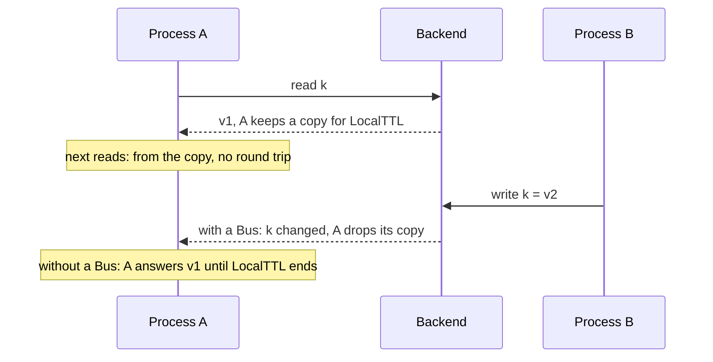
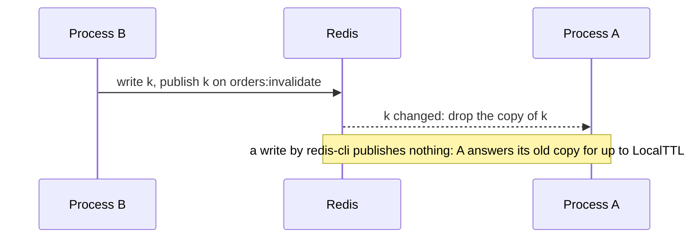
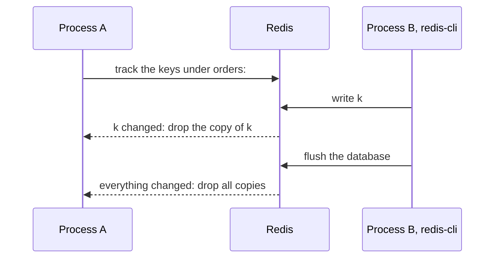

# Backends { #backends }

This page shows where your entries live. In this section, we will go through
[`backend/memory`](#backendmemory), [`backend/redis`](#backendredis),
[`backend/nearcache`](#backendnearcache) with [its bus](#which-bus),
[a backend of your own](#backendtestrun) and [testing your code](#testing-your-code).

## Memory of the process { #backendmemory }

One process, or a test, needs no server. With [`backend/memory`](../reference/memory.md), entries live in process memory, with
a TTL each, and the least recently used ones go first; every process has its own.

```go hl_lines="12-17"
--8<-- "examples/docs/backends/memory-options/main.go"
```

1. Counted in entries, not bytes; the least recently used entry goes first. 0 means 1000.
2. Bytes of keys and values, without the overhead of Go. 0 means no limit.
3. How often expired entries are purged. 0 means every second, a negative value never.

**Signature:** `func New(o Options) *Backend` · Every field: [`memory.Options`](../reference/memory.md#Options)

- `New` panics on a negative [`MaxEntries`](../reference/memory.md#Options) or [`MaxBytes`](../reference/memory.md#Options).
- Values are copied in and out.

!!! warning
    A value over [`MaxBytes`](../reference/memory.md#Options) alone returns [`memory.ErrTooLarge`](../reference/memory.md#ErrTooLarge): it is not stored, and the old value
    under the key is gone.

---

## Redis and Valkey { #backendredis }

Several processes must see the same entries. With [`backend/redis`](../reference/redis.md), they share one Redis through
[go-redis v9](https://github.com/redis/go-redis); it is a separate module.

```go hl_lines="14-19"
--8<-- "examples/docs/backends/redis-client/main.go"
```

1. A slow cache must not slow the service down.

**Signature:** `func New(client goredis.UniversalClient) *Backend`

- A stopped Redis takes longer than `ReadTimeout` to fail a call: see
  [outages](outages.md#circuitbreaker).
- `*redis.Ring` is not supported: `SCAN` sees one shard only, so [`Keys`](../reference/gashe.md#Cache.Keys), `All` and [`DeleteMatch`](../reference/gashe.md#Cache.DeleteMatch)
  miss keys.
- Timeouts, pool and TLS are options of the client; you own the client and close it.
- Errors read `gashe/redis: <op>: <error>`. A missing key is [`gashe.ErrNotFound`](../reference/gashe.md#ErrNotFound); a key of another
  Redis type, or `INCRBY` on a value that is not an integer, is [`gashe.ErrWrongType`](../reference/gashe.md#variables).
- Redis 7.0 and newer and Valkey 8 are tested on every release.
- Dragonfly and KeyDB pass the same tests.
- Redis Cluster and Sentinel work through `UniversalClient`. On a Cluster, calls on several keys go
  key by key, and `SCAN` visits every master.
- Managed Redis and Valkey (ElastiCache, MemoryDB, Azure Cache for Redis, Memorystore, Upstash) are
  not tested. They need `SET` with `NX`, `XX`, `EX` and `PX`, `UNLINK`, `SCAN`, `MULTI`, Lua scripts
  for locks, pub/sub for `Bus` and `CLIENT TRACKING` for [`TrackingBus`](../reference/redis.md#TrackingBus).

!!! tip
    Give the client short timeouts, as above: a slow cache must not slow the service down.

!!! warning
    Read the entries with `redis-cli --scan`, but never write them by hand.

??? note "Technical details"

    - go-redis sends `SET ... EX` for a TTL of whole seconds and `SET ... PX` otherwise.
    - Dragonfly lacks `CLIENT KILL`, so the reconnect test of `Bus` is skipped there.

---

## A near cache in front of Redis { #backendnearcache }

A hot key costs a round trip to Redis on every read. With [`backend/nearcache`](../reference/nearcache.md), each process keeps a
copy of what it reads from the shared backend in its own memory, and answers the next read from it.

```go hl_lines="19-26"
--8<-- "examples/docs/backends/redis-nearcache/main.go"
```

**Signature:** `func New(local, shared gashe.Backend, o Options) *Backend` · Every field: [`nearcache.Options`](../reference/nearcache.md#Options)

A keeps a copy of k for one minute: the bus makes it drop the copy at once; without a
bus, A answers the old value until the copy ends.



- A read that raced a change keeps no copy, but its reply may hold the value from before the change.
- While Redis is down, the bus keeps the copies until it reconnects.
- On a reconnect of the bus, or a message it cannot read, as after `FLUSHDB`, the process drops all
  its copies, since messages may be lost.
- `New` panics on a negative [`LocalTTL`](../reference/nearcache.md#Options).

!!! tip
    Bound the local backend with [`MaxBytes`](../reference/memory.md#Options): every process keeps its own copies, so with 50 processes
    the memory is taken 50 times.

!!! warning
    A copy lives [`LocalTTL`](../reference/nearcache.md#Options) even after the shared entry expired. [`GetOrLoad`](../reference/gashe.md#GetOrLoad) entries are safe, they
    carry their own expiry; a basic API value with a TTL shorter than [`LocalTTL`](../reference/nearcache.md#Options) is answered past its
    TTL.

??? note "Technical details"

    - `Get` and [`GetMany`](../reference/gashe.md#Cache.GetMany) read the copy first, and fill it from the shared backend on a local miss.
    - `Set`, [`SetMany`](../reference/gashe.md#Cache.SetMany), [`SetIfAbsent`](../reference/gashe.md#Cache.SetIfAbsent), [`SetIfPresent`](../reference/gashe.md#Cache.SetIfPresent), [`IncrBy`](../reference/gashe.md#Cache.IncrBy), [`Expire`](../reference/gashe.md#Cache.Expire), `Delete`, [`DeleteMany`](../reference/gashe.md#Cache.DeleteMany) and
      [`Unlock`](../reference/gashe.md#Lease.Unlock) write the shared backend, drop the local copy, and the bus tells the other processes.
    - [`DeleteMatch`](../reference/gashe.md#Cache.DeleteMatch) drops the matching local copies, and the other processes drop all of theirs.
    - [`Exists`](../reference/gashe.md#Cache.Exists), `TTL`, `Scan` and locks always read the shared backend.

```go hl_lines="18-21"
--8<-- "examples/nearcache/main.go"
```

---

### Which bus { #which-bus }

A copy in memory goes stale when another process changes the key. A bus tells every process which
keys changed; the process drops its copy and reads the new value on the next request. Use
[`NewTrackingBus`](../reference/redis.md#NewTrackingBus) on a single node or Sentinel, [`NewBus`](../reference/redis.md#NewBus) on a Cluster.

- [`gasheredis.NewTrackingBus(client, "orders:")`](#newtrackingbus) sees every change of a key under
  the prefix: by gashe, `redis-cli`, other services, `FLUSHDB`. It needs Redis 6+ or Valkey and a
  `*redis.Client`, not a Cluster.
- [`gasheredis.NewBus(client, "orders:invalidate")`](#newbus) sees only the changes made through
  gashe: a key changed by `redis-cli` stays stale up to [`LocalTTL`](../reference/nearcache.md#Options). It needs pub/sub and one channel
  per service, and works on a Cluster.

---

### Invalidation over pub/sub { #newbus }

Your processes run on a Redis Cluster. With [`NewBus`](../reference/redis.md#NewBus), gashe publishes every key it changed on a
channel; a change made by `redis-cli` reaches nobody.

A change through gashe reaches every process; a change by `redis-cli` reaches none of them.



- It takes any `UniversalClient`, a Cluster too.
- [`NewBus`](../reference/redis.md#NewBus) panics on an empty channel.

??? note "Technical details"

    In Redis: `PUBLISH <channel>` with the changed keys as a JSON list; every process `SUBSCRIBE`s to
    the channel.

---

### Invalidation reported by Redis { #newtrackingbus }

!!! version "Added in v0.5"

A key changed by `redis-cli` or another service stays stale in the copies of [`NewBus`](../reference/redis.md#NewBus). With
[`NewTrackingBus`](../reference/redis.md#NewTrackingBus), Redis itself reports every change under the prefix, `FLUSHDB` included.

```go hl_lines="24"
--8<-- "examples/docs/backends/redis-tracking-bus/main.go"
```

1. A `*redis.Client`, not a Cluster: on a Cluster, use [`NewBus`](../reference/redis.md#NewBus).
2. Redis reports every change of a key under `orders:`.

Once A starts tracking, Redis reports every write under the prefix, whoever makes it.



- It needs a `*redis.Client`; on a Cluster, use [`NewBus`](../reference/redis.md#NewBus).
- A prefix of `""` means every key. Nothing is published: Redis reports the writes of gashe too.

!!! warning
    If Redis refuses `CLIENT TRACKING`, as an ACL may, the bus retries every second, and copies live
    up to [`LocalTTL`](../reference/nearcache.md#Options).

??? note "Technical details"

    - It opens a connection of its own with the options of the client, and sets its own `OnConnect`
      on it.
    - In Redis: `CLIENT TRACKING ON REDIRECT <id> BCAST PREFIX <prefix>` and `SUBSCRIBE
      __redis__:invalidate` on its own connection.

---

## Testing your own backend { #backendtestrun }

Your storage is not one of the bundled backends. Implement [`gashe.Backend`](../reference/gashe.md#Backend), whose contract is the
comments in `backend.go`, and check it with [`backendtest.Run`](../reference/backendtest.md#Run), the suite the bundled backends pass.

```go hl_lines="17-21"
--8<-- "examples/docs/backends/contract/backend_test.go"
```

1. A fresh backend for every subtest.

!!! tip
    To change one method only, embed [`gashe.Backend`](../reference/gashe.md#Backend) and override it.

---

## Testing your code { #testing-your-code }

Your tests need a cache without a server, and a backend that fails on purpose. Here are both.

```go hl_lines="14-23"
--8<-- "examples/docs/backends/testing/cache_test.go"
```

1. No purge goroutine: nothing to close.
2. A failing backend: embed a real one, override a method.

!!! tip
    On Go 1.25+, `testing/synctest` runs TTLs in fake time, and `synctest.Wait()` lets background
    reloads finish.

!!! warning
    Leave [`TTL.Jitter`](../reference/gashe.md#TTL) out where a test checks exact TTLs.
