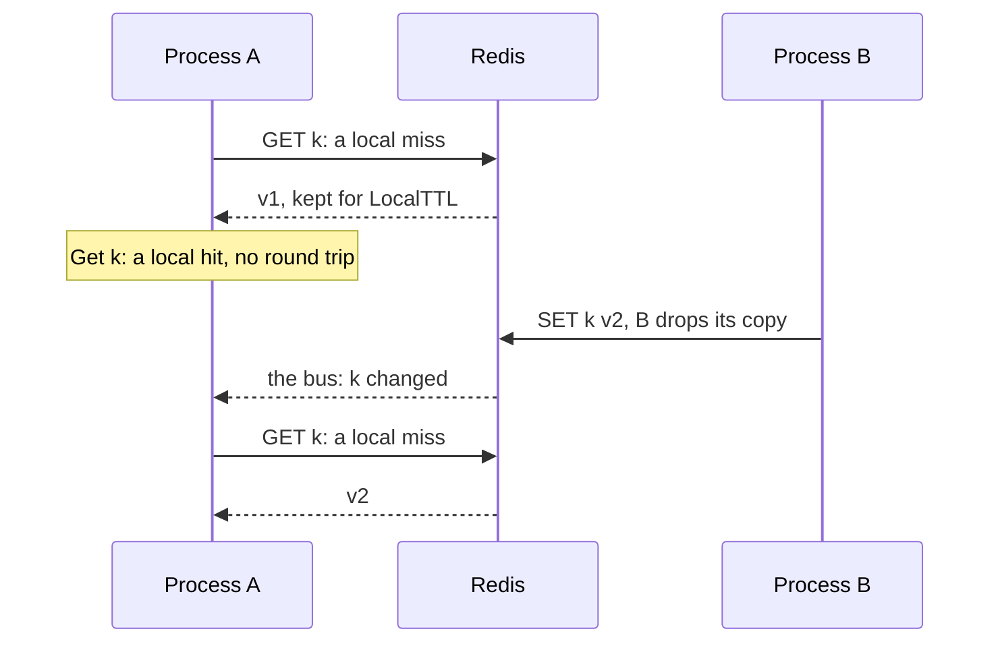
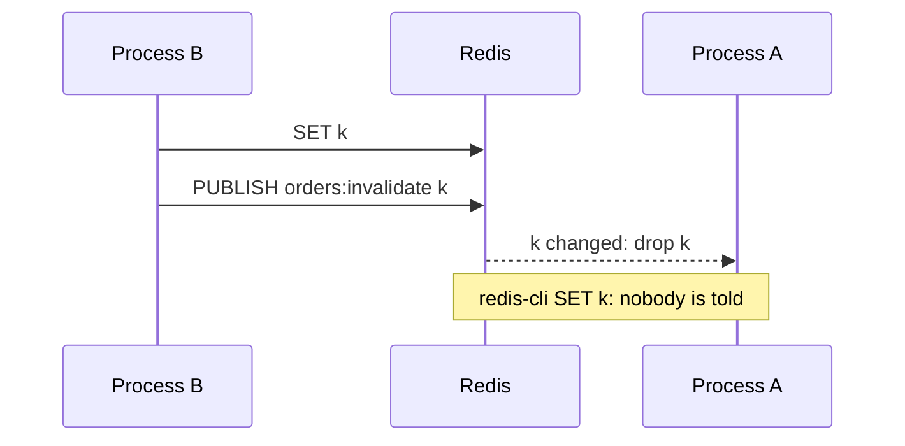

# Backends { #backends }

Where entries live: in process memory, in Redis, or in a near cache in front of Redis.

## `backend/memory`: entries in process memory { #backendmemory }

An LRU in process memory with a TTL per entry; every process has its own.

API: [`memory.New`](https://pkg.go.dev/github.com/eugeneliukindev/gashe/backend/memory#New), [`memory.Options`](https://pkg.go.dev/github.com/eugeneliukindev/gashe/backend/memory#Options)

```go
backend := memory.New(memory.Options{
	MaxEntries:    10_000,      // entries, not bytes; the least recently used goes first; 0 means 1000
	MaxBytes:      256 << 20,   // bytes of keys and values, without the overhead of Go; 0 means no limit
	PurgeInterval: time.Minute, // how often expired entries are purged; 0 means every second, negative never
})
defer backend.Close() // stops the background purge
```

**Options** (`memory.Options`):

| Field | Type | Default | What it does |
|---|---|---|---|
| `MaxEntries` | `int` | 0: 1000 | the most entries, not bytes; the least recently used one is evicted first |
| `MaxBytes` | `int64` | 0: no limit | the most bytes keys and values take together, without the overhead of the Go runtime: leave headroom |
| `PurgeInterval` | `time.Duration` | 0: 1 second | how often expired entries are purged in the background; negative: never, expired entries are still never returned |

| What | How |
|---|---|
| Errors | `memory.ErrTooLarge` - a value over `MaxBytes` alone: it is not stored, and the old value under the key is gone. `New` panics on a negative `MaxEntries` or `MaxBytes` |
| Values | copied in and out |

---

## `backend/redis`: entries shared by every process { #backendredis }

A backend on [go-redis v9](https://github.com/redis/go-redis), shared by every process; a separate
module.

API: [`redis.New`](https://pkg.go.dev/github.com/eugeneliukindev/gashe/backend/redis#New)

```go
client := goredis.NewUniversalClient(&goredis.UniversalOptions{
	Addrs:        []string{"localhost:6379"},
	ReadTimeout:  100 * time.Millisecond, // a slow cache must not slow the service down
	WriteTimeout: 100 * time.Millisecond,
})
defer client.Close()
backend := gasheredis.New(client)
```

| What | How |
|---|---|
| Errors | `gashe/redis: <op>: <error>`; a missing key is `gashe.ErrNotFound`; a key of another Redis type, or `INCRBY` on a value that is not an integer, is `gashe.ErrWrongType` |
| Client | timeouts, pool and TLS are options of the client; the caller owns it and closes it. A stopped Redis takes longer than `ReadTimeout`: see [outages](outages.md#circuitbreaker-keep-working-when-the-backend-is-down) |
| TTLs | go-redis sends `SET ... EX` for whole seconds and `PX` otherwise |
| `*redis.Ring` | not supported: `SCAN` sees one shard only, so `Keys`, `All` and `DeleteMatch` miss keys |
| Entries | read them with `redis-cli --scan`, never write them by hand |

| Server | Status |
|---|---|
| Redis 7.0 and newer, Valkey 8 | tested on every release |
| Dragonfly, KeyDB | pass the same tests; Dragonfly lacks `CLIENT KILL`, so the reconnect test of `Bus` is skipped there |
| Redis Cluster and Sentinel | through `UniversalClient`; on a Cluster, calls on several keys go key by key, and `SCAN` visits every master |
| managed Redis and Valkey (ElastiCache, MemoryDB, Azure Cache for Redis, Memorystore, Upstash) | not tested; they need `SET` with `NX`, `XX`, `EX` and `PX`, `UNLINK`, `SCAN`, `MULTI`, Lua scripts for locks, pub/sub for `Bus` and `CLIENT TRACKING` for `TrackingBus` |

---

## `backend/nearcache`: hot keys without a round trip { #backendnearcache }

Keeps a copy of what it reads from the shared backend in process memory, so a hot key costs no round
trip.

API: [`nearcache.New`](https://pkg.go.dev/github.com/eugeneliukindev/gashe/backend/nearcache#New), [`nearcache.Options`](https://pkg.go.dev/github.com/eugeneliukindev/gashe/backend/nearcache#Options), [`nearcache.Bus`](https://pkg.go.dev/github.com/eugeneliukindev/gashe/backend/nearcache#Bus)

```go
local := memory.New(memory.Options{MaxBytes: 64 << 20})
defer local.Close()

backend := nearcache.New(local, gasheredis.New(client), nearcache.Options{
	LocalTTL: time.Minute,
	Bus:      gasheredis.NewBus(client, "orders:invalidate"), // one channel per service
})
defer backend.Close() // stops listening to the bus
```

A read and a write, with two processes and a `Bus`:



**Options** (`nearcache.Options`):

| Field | Type | Default | What it does |
|---|---|---|---|
| `LocalTTL` | `time.Duration` | 0: 5 seconds | how long a copy stays in memory; also how long another process may answer with a value already changed |
| `Bus` | `nearcache.Bus` | nil: copies expire after `LocalTTL` | tells the other processes which keys changed: see [Which bus](#which-bus) |

| Call | Local memory | Shared backend | Other processes |
|---|---|---|---|
| `Get`, `GetMany` | read first, filled on a miss | read on a local miss | - |
| `Set`, `SetMany`, `SetIfAbsent`, `SetIfPresent`, `IncrBy`, `Expire` | the copy dropped | written | told by the bus |
| `Delete`, `DeleteMany`, `Unlock` | the copy dropped | written | told by the bus |
| `DeleteMatch` | matching copies dropped | written | drop all their copies |
| `Exists`, `TTL`, `Scan`, locks | not read | read | - |
| a reconnect to the `Bus`, or a message it cannot read, as after `FLUSHDB` | all copies dropped: messages may be lost | - | - |

| What | How |
|---|---|
| Memory | every process has its own memory and keeps its own copies: with 50 processes the memory is taken 50 times, so bound it with `MaxBytes` |
| Redis is down | the bus keeps the copies until it reconnects |
| A read that raced a change | keeps no copy: the reply may hold the value from before the change |
| Errors | `New` panics on a negative `LocalTTL` |

!!! warning
    A copy lives `LocalTTL` even after the shared entry expired. `GetOrLoad` entries are safe, they
    carry their own expiry; a basic API value with a TTL shorter than `LocalTTL` is answered past its
    TTL.

- **Example:** [examples/nearcache](https://github.com/eugeneliukindev/gashe/blob/main/examples/nearcache/main.go)

???+ example "examples/nearcache/main.go"

    ```go hl_lines="31-33"
    --8<-- "examples/nearcache/main.go"
    ```

---

### Which bus { #which-bus }

A bus only tells processes which keys changed; a process drops its copy and reads the new value on
the next request.

| Bus | Sees changes | Needs | Cluster |
|---|---|---|---|
| [`gasheredis.NewTrackingBus(client, "orders:")`](#newtrackingbus) | every change of a key under the prefix: gashe, `redis-cli`, other services, `FLUSHDB` | Redis 6+ or Valkey, a `*redis.Client` | no |
| [`gasheredis.NewBus(client, "orders:invalidate")`](#newbus) | changes made through gashe; a key changed by `redis-cli` stays stale up to `LocalTTL` | pub/sub, one channel per service | yes |

Use `NewTrackingBus` on a single node or Sentinel, `NewBus` on a Cluster.

---

### `gasheredis.NewBus`: changes made through gashe { #newbus }

gashe publishes the keys it changed, so a change made by `redis-cli` reaches nobody.

API: [`redis.NewBus`](https://pkg.go.dev/github.com/eugeneliukindev/gashe/backend/redis#NewBus)



| What | How |
|---|---|
| Client | any `UniversalClient`, a Cluster too |
| Errors | `NewBus` panics on an empty channel |

---

### `gasheredis.NewTrackingBus`: every change Redis sees { #newtrackingbus }

<span class="version-badge">Added in v0.5</span>

Redis itself reports every change under the prefix, `FLUSHDB` included.

API: [`redis.NewTrackingBus`](https://pkg.go.dev/github.com/eugeneliukindev/gashe/backend/redis#NewTrackingBus)

```go hl_lines="6"
client := goredis.NewClient(&goredis.Options{Addr: "localhost:6379"}) // a *redis.Client, not a Cluster
defer client.Close()

backend := nearcache.New(local, gasheredis.New(client), nearcache.Options{
	LocalTTL: time.Minute,
	Bus:      gasheredis.NewTrackingBus(client, "orders:"), // every change of a key under orders:
})
```


| What | How |
|---|---|
| Client | a `*redis.Client`; on a Cluster use `NewBus` |
| Connection | opens one of its own with the options of the client, and sets its own `OnConnect` on it |
| Prefix | `""` means every key; nothing is published, Redis reports the writes of gashe too |
| Redis refuses `CLIENT TRACKING`, as an ACL may | the bus retries every second, and copies live up to `LocalTTL` |

---

## `backendtest.Run`: check a backend of your own { #your-own-backend }

Implement `gashe.Backend`, whose contract is the comments in `backend.go`, and check it with the
suite the bundled backends pass.

API: [`backendtest.Run`](https://pkg.go.dev/github.com/eugeneliukindev/gashe/backendtest#Run), [`gashe.Backend`](https://pkg.go.dev/github.com/eugeneliukindev/gashe#Backend)

```go
func TestContract(t *testing.T) {
	backendtest.Run(t, func(t *testing.T) gashe.Backend {
		return newEmptyBackend(t) // a fresh backend for every subtest
	})
}
```

| What | How |
|---|---|
| One method changed | embed `gashe.Backend` and override it |

---

## Testing your code { #testing-your-code }

A cache for tests, and a backend that fails.

```go
func newCache(t *testing.T) *gashe.Cache {
	backend := memory.New(memory.Options{PurgeInterval: -1}) // no purge goroutine: nothing to close
	return gashe.New(backend, gashe.Options{})
}

type downBackend struct{ gashe.Backend } // a failing backend: embed a real one, override a method

func (downBackend) Get(context.Context, string) ([]byte, error) { return nil, errDown }
```

| What | How |
|---|---|
| Fake time | on Go 1.25+ `testing/synctest` runs TTLs in fake time, and `synctest.Wait()` lets background reloads finish |
| Exact TTLs | leave `Jitter` out where a test checks them |
