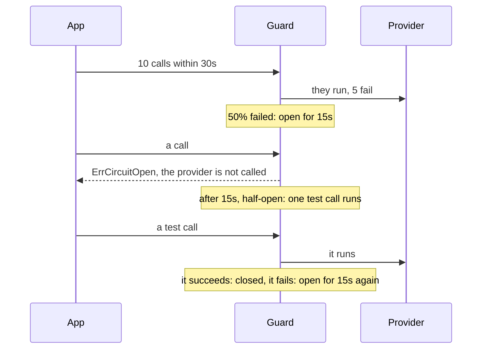

# Protect a dependency { #breakers }

This page shows how you stop calling a failing dependency for a while. In this section, we will go
through [`gashe.Guard`](#gasheguard) and [`Cache.CircuitBreaker`](#ccircuitbreaker).

!!! note
    These breakers guard your calls. The breaker that guards the cache from its own backend is
    [`Options.CircuitBreaker`](../reference/gashe.md#Options), on [When Redis is down](outages.md#circuitbreaker).

## Guarding a call { #gasheguard }

A payment provider is down, and every call waits for its timeout and fails. With [`gashe.Guard`](../reference/gashe.md#Guard), you
run each call through the circuit breaker of a key: once too many calls fail, the dependency is not
called for a while.

```go hl_lines="3-11"
--8<-- "examples/docs/breakers/guard/main.go:example"
```

??? example "Full program"

    ```go
    --8<-- "examples/docs/breakers/guard/main.go"
    ```

**Signature:** `func Guard[T any](c *Cache, key string, o CircuitBreaker, call func() (T, error)) (T, error)` · Every field: [`CircuitBreaker`](../reference/gashe.md#CircuitBreaker)

With the options above, the provider fails, the breaker opens for 15 seconds, and then lets calls
through again:



- The breaker lives in process memory, and each process judges by its own calls.
- While the breaker is closed, calls run and are counted. While it is open, calls get
  [`ErrCircuitOpen`](../reference/gashe.md#variables) and do not run. Half-open, [`HalfOpenCalls`](../reference/gashe.md#CircuitBreaker) calls run, and the rest get
  [`ErrCircuitOpen`](../reference/gashe.md#variables); when no test call reports within one [`Window`](../reference/gashe.md#CircuitBreaker), it closes.
- It returns what the call returned, [`ErrCircuitOpen`](../reference/gashe.md#variables) when the breaker is open and the call did not
  run, or [`ErrInvalidOptions`](../reference/gashe.md#variables) when the options cannot work.

!!! tip
    Use one key per dependency, with the same options everywhere, and count with `IsFailure` only
    the errors that mean the dependency is down: a "not found" or a bad request of the caller is
    not a failure.

!!! warning
    The state of every key lives as long as the [`Cache`](../reference/gashe.md#Cache): use a few fixed keys, not user ids.

??? note "Technical details"
    - [`Window`](../reference/gashe.md#CircuitBreaker) is counted in 10 parts and slides by one part at a time; opening clears the counts.
    - In Redis: nothing; checking the breaker costs no round trip.

```go hl_lines="11-12 16"
--8<-- "examples/breaker/main.go:example"
```

??? example "Full program"

    ```go
    --8<-- "examples/breaker/main.go"
    ```

---

## Checking and reporting by hand { #ccircuitbreaker }

Sometimes the call does not fit one function. With [`Cache.CircuitBreaker`](../reference/gashe.md#Cache.CircuitBreaker), you check the breaker before
the call and report its result yourself; otherwise use [`Guard`](../reference/gashe.md#Guard).

```go hl_lines="27-31"
--8<-- "examples/docs/breakers/check-and-report/main.go"
```

1. Call `done` once, with nil or the error of the call.

**Signature:** `func (c *Cache) CircuitBreaker(key string, o CircuitBreaker) (DoneFunc, error)`

- It returns a [`DoneFunc`](../reference/gashe.md#DoneFunc): call it once with the result of the call.
- Its errors are those of [`gashe.Guard`](../reference/gashe.md#Guard).

!!! warning
    Call `done` on every path after the check, early returns included: a half-open test call that
    never reports keeps the breaker half-open until one [`Window`](../reference/gashe.md#CircuitBreaker) passes.

??? note "Technical details"
    - In Redis: nothing.
