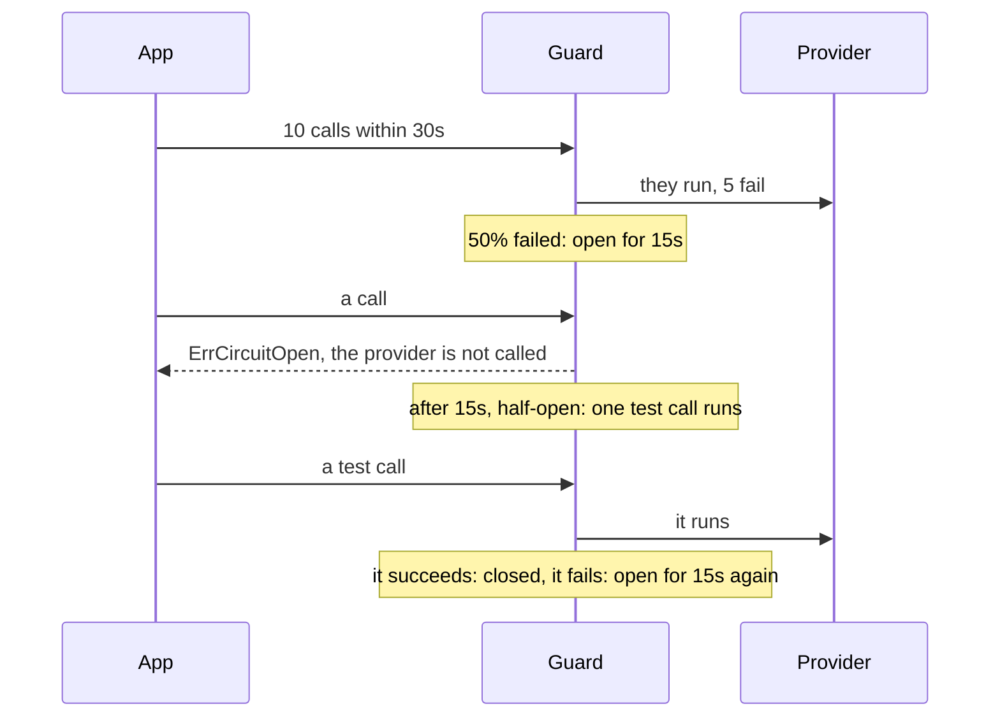

# Circuit breakers { #breakers }

This page shows how you stop calling a failing dependency for a while. In this section, we will go
through [`gashe.Guard`](#gasheguard) and [`Cache.CircuitBreaker`](#ccircuitbreaker).

!!! note
    These breakers guard your calls. The breaker that guards the cache from its own backend is
    `Options.CircuitBreaker`, on [Outages](outages.md#circuitbreaker).

## `gashe.Guard` { #gasheguard }

A payment provider is down, and every call waits for its timeout and fails. With `gashe.Guard`, you
run each call through the circuit breaker of a key: once too many calls fail, the dependency is not
called for a while.

??? api "API documentation"

    [`gashe.Guard`](../reference/gashe.md#Guard)<br>
    [`gashe.CircuitBreaker`](../reference/gashe.md#CircuitBreaker)<br>

```go hl_lines="27-35"
--8<-- "examples/docs/breakers/guard/main.go"
```

With the options above, the provider fails, the breaker opens for 15 seconds, and then lets calls
through again:



**Options** (`gashe.CircuitBreaker`):

| Field | Default | What it does |
|---|---|---|
| `FailurePercent` | required | opens once this share of calls failed |
| `Window` | required | the recent span calls are counted over, in 10 parts |
| `OpenFor` | required | how long the open breaker refuses calls |
| `MinCalls` | 0: 1 | calls the window needs before it may open |
| `HalfOpenCalls` | 0: it just closes | half-open calls after `OpenFor`: the first that succeeds closes the breaker, one that fails opens it again |
| `IsFailure` | nil: any error | which errors count as failures |

- The breaker lives in process memory, and each process judges by its own calls.
- While the breaker is closed, calls run and are counted. While it is open, calls get
  `ErrCircuitOpen` and do not run. Half-open, `HalfOpenCalls` calls run, and the rest get
  `ErrCircuitOpen`; when no test call reports within one `Window`, it closes.
- It returns what the call returned, `ErrCircuitOpen` when the breaker is open and the call did not
  run, or `ErrInvalidOptions` when the options cannot work.

!!! tip
    Use one key per dependency, with the same options everywhere, and count with `IsFailure` only
    the errors that mean the dependency is down: a "not found" or a bad request of the caller is
    not a failure.

!!! warning
    The state of every key lives as long as the `Cache`: use a few fixed keys, not user ids.

??? note "Technical details"
    - `Window` is counted in 10 parts and slides by one part at a time; opening clears the counts.
    - In Redis: nothing; checking the breaker costs no round trip.

```go hl_lines="28-29 33"
--8<-- "examples/breaker/main.go"
```


---

## `Cache.CircuitBreaker` { #ccircuitbreaker }

Sometimes the call does not fit one function. With `Cache.CircuitBreaker`, you check the breaker before
the call and report its result yourself; otherwise use `Guard`.

??? api "API documentation"

    [`Cache.CircuitBreaker`](../reference/gashe.md#Cache.CircuitBreaker)<br>
    [`gashe.DoneFunc`](../reference/gashe.md#DoneFunc)<br>

```go hl_lines="27-31"
--8<-- "examples/docs/breakers/check-and-report/main.go"
```

1. Call `done` once, with nil or the error of the call.

- It returns a `DoneFunc`: call it once with the result of the call.
- Its errors are those of `gashe.Guard`.

!!! warning
    Call `done` on every path after the check, early returns included: a half-open test call that
    never reports keeps the breaker half-open until one `Window` passes.

??? note "Technical details"
    - In Redis: nothing.
