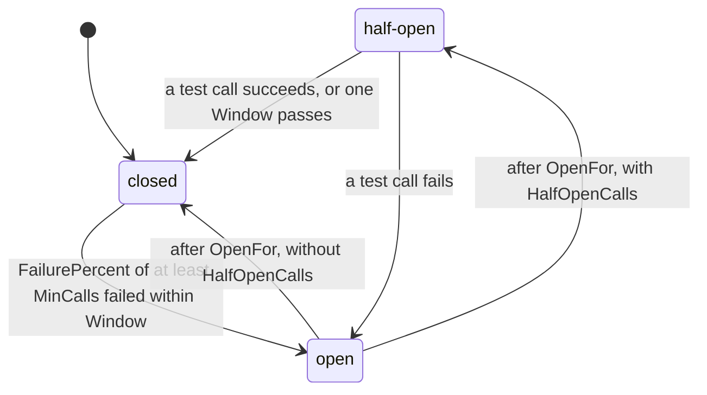

# Circuit breakers { #breakers }

Stop calling a failing dependency for a while.

## `gashe.Guard` { #gasheguard }

Runs one call through the circuit breaker of a key: a failing dependency is not called for a while.

```go
payments := gashe.CircuitBreakerOptions{
	FailurePercent: 50,
	MinCalls:       10,
	Window:         30 * time.Second,
	OpenFor:        15 * time.Second,
}
receipt, err := gashe.Guard(c, "payments-api", payments, func() (Receipt, error) {
	return provider.Charge(ctx, p)
})
```

**Default:** none: `FailurePercent`, `Window` and `OpenFor` are required.

Calls are counted over the last `Window`, in 10 parts; a failure is an error `IsFailure` accepts.



| State | Calls |
|---|---|
| closed | run and are counted |
| open | get `ErrCircuitOpen` and do not run |
| half-open | `HalfOpenCalls` test calls run; the rest get `ErrCircuitOpen` |

**Options** (`gashe.CircuitBreakerOptions`):

| Field | Default | What it does |
|---|---|---|
| `FailurePercent` | required | opens once this share of calls failed, from 1 to 99 |
| `MinCalls` | 1 | calls the window needs before it may open |
| `Window` | required | the recent span calls are counted over |
| `OpenFor` | required | how long the open breaker refuses calls |
| `HalfOpenCalls` | 0: it just closes | test calls after `OpenFor` |
| `IsFailure` | nil: any error | which errors count as failures |

| What | How |
|---|---|
| Returns | what the call returned |
| Errors | `ErrCircuitOpen` - the breaker is open, and the call did not run. `ErrInvalidOptions` - the options cannot work |
| Redis | none: the breaker lives in process memory, and each pod judges by its own calls |
| Keys | the state of every key lives as long as the `Cache`: use a few fixed keys, not user ids |

- **Example:** [examples/breaker](https://github.com/eugeneliukindev/gashe/blob/main/examples/breaker/main.go)

??? example "examples/breaker/main.go"

    ```go
    --8<-- "examples/breaker/main.go"
    ```

    Output:

    ```text
    --8<-- "docs/snippets/examples/breaker.txt"
    ```

---

## `c.CircuitBreaker` { #ccircuitbreaker }

```go
done, err := c.CircuitBreaker("payments-api", payments)
if err != nil {
	return err
}
done(provider.Refund(ctx, p)) // once: nil or the error of the call
```

Checks the breaker before a call you report yourself; use it when the call does not fit one
function, otherwise use `Guard`.

| What | How |
|---|---|
| Returns | a `DoneFunc` to call once with the result |
| Errors | as `gashe.Guard` |
| Redis | none |
