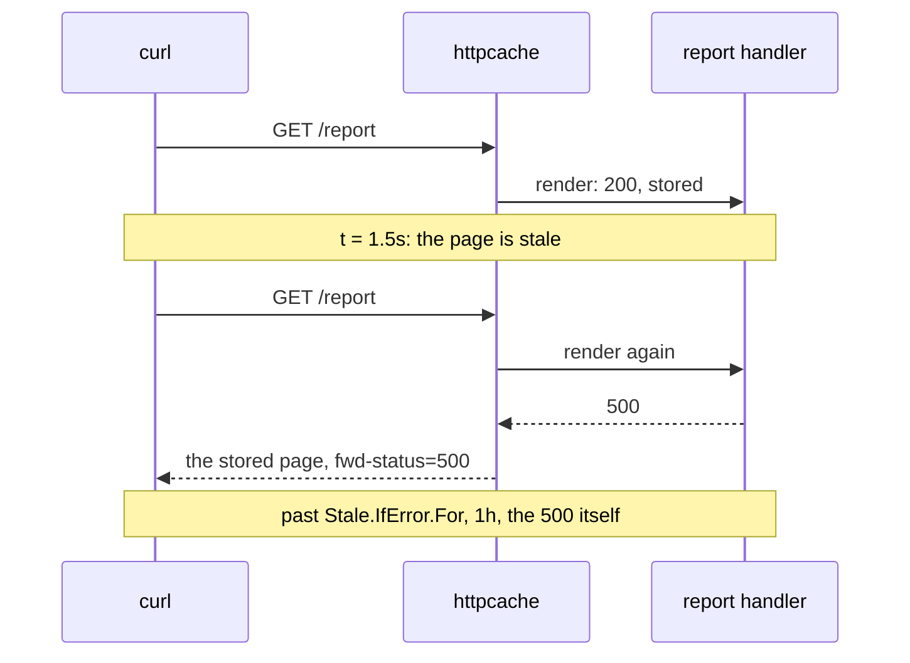
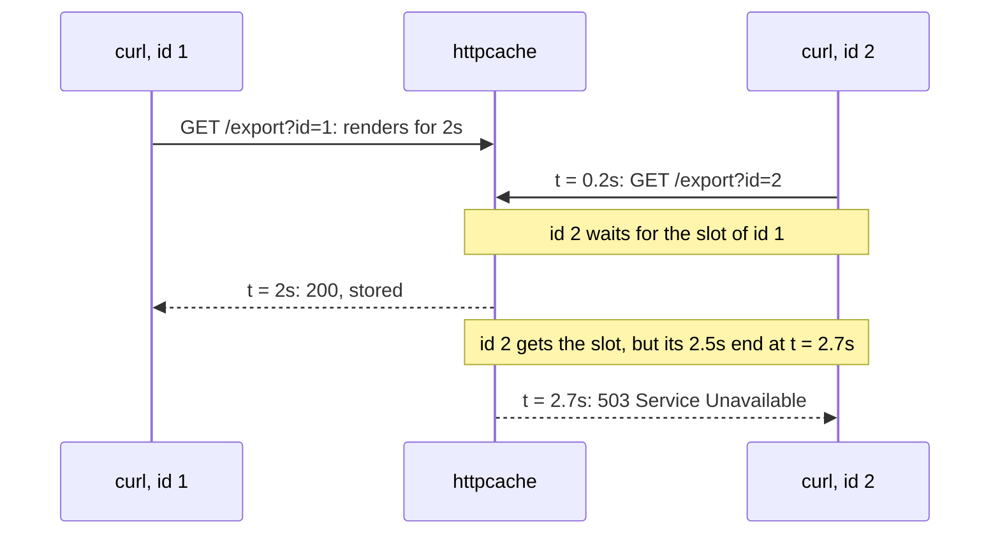

# HTTP caching { #httpcache-whole-http-responses }

This page shows how you cache whole responses of a handler, so a hit sends the stored status,
headers and body without calling the handler. In this section, we will go through
[`httpcache.New`](#httpcachenew), [requests and responses](#try-it-with-curl),
[how the key is made](#how-the-key-is-made), [headers](#headers) and
[running behind a reverse proxy](#behind-a-reverse-proxy).

## Caching the pages of a handler { #httpcachenew }

Many requests get the same page, and each one runs your handler again. With [`httpcache.New`](../reference/httpcache.md#New), you
wrap the handler in a middleware that stores its responses in a [`*gashe.Cache`](../reference/gashe.md#Cache) and answers hits
without calling it.

```go hl_lines="23-33"
--8<-- "examples/docs/httpcache/options/main.go"
```

**Signature:** `func New(c *gashe.Cache, o Options) func(http.Handler) http.Handler` · Every field: [`httpcache.Options`](../reference/httpcache.md#Options), [`Vary`](../reference/httpcache.md#Vary)

What a request gets; its key is the host, the path and what [`Vary`](../reference/httpcache.md#Vary) names, see
[how the key is made](#how-the-key-is-made):

- A hit: the stored response with [`ETag`](../reference/httpcache.md#Response), `Age` and `Cache-Status: gashe; hit`. A matching
  `If-None-Match` gets `304 Not Modified`.
- A miss: the handler runs, as `GET` also for `HEAD`; with
  [`Stampede.SingleFlight`](stampedes.md#singleflight), once for all concurrent requests of the key.
- Stale, within [`Stale.WhileRevalidate`](../reference/gashe.md#Stale): the stale page, marked `Cache-Status: gashe; hit` only; one
  request renders it again in the background.
- A 5xx is a loader error. Within [`Stale.IfError.For`](../reference/gashe.md#Stale), the request gets the last stored page with
  `Cache-Status: gashe; fwd=stale; fwd-status=500`. Otherwise it gets the 5xx, which is sent to every
  waiting request too, unless a header keeps it to one client.
- Your [`Stale.IfError.IsFailure`](../reference/gashe.md#Stale) still picks the failures; `httpcache` wraps it, so a response it
  must not share is never answered with a stale page.
- A response the [rules of its headers](#headers) do not store is sent only to
  the request that made it; the other waiting requests run the handler themselves.
- Held back by [`Policy.Stampede.MaxLoads`](../reference/gashe.md#Policy), or past its `ctx` deadline while it waits for a render:
  `503 Service Unavailable`.
- Another method, `Range`, `Authorization` without [`Vary.User`](../reference/httpcache.md#Vary), or `Cookie` without [`Vary.Cookies`](../reference/httpcache.md#Vary)
  or [`Vary.User`](../reference/httpcache.md#Vary): the request goes past the cache.
- By default, `GET` and `HEAD` requests without `Authorization`, `Cookie` and `Range` are cached
  under their host, path and query. A `200` of at most 1 MB, without `Set-Cookie`, a [`Vary`](../reference/httpcache.md#Vary) header
  and `Cache-Control` `no-store`, `private` or `no-cache`, is stored for [`Policy.TTL.For`](../reference/gashe.md#Policy).
- `New` panics on a negative [`MaxBodyBytes`](../reference/httpcache.md#Options) and on [`Policy.Negative`](../reference/gashe.md#Policy).

!!! tip
    Give [`Policy`](../reference/gashe.md#Policy) a [`Stale.IfError`](../reference/gashe.md#Stale): while the handler fails, requests get the last stored page
    instead of a 5xx, see [a failing handler](#a-failing-handler-gets-the-last-good-page).

!!! danger
    A response must be the same for everyone who gets its key: every part of a request the handler
    builds a page from, a cookie, `X-Forwarded-Host`, `Accept-Language`, must be in [`Vary`](../reference/httpcache.md#Vary), or one
    request's page leaks to others (web cache deception, web cache poisoning).

!!! warning
    The whole body is buffered before it is sent, however large: a streaming response, such as
    server-sent events, reaches the client only when the handler returns. Keep such routes out of
    the cache.

??? note "Technical details"
    - The handler writes into a buffer first: [`MaxBodyBytes`](../reference/httpcache.md#Options) decides what is stored, not how much
      memory a render takes.

```go hl_lines="20-23"
--8<-- "examples/httpserver/main.go"
```

---

## Requests and responses { #try-it-with-curl }

The requests below go to three small servers, one per cached page, each on `localhost:8080`. Every
response is from a real run, with JSON formatted for reading. "In the backend" is what the backend
holds after the request: the keys of the page, and how long they live.

| Page | Policy |
|---|---|
| `/products` | `TTL` 1m, [`Vary`](../reference/httpcache.md#Vary) `Accept-Language` and `?page` |
| `/report` | `TTL` 1s, [`Stale.IfError.For`](../reference/gashe.md#Stale) 1h; the handler fails after one render |
| `/export` | `TTL` 1m, [`Stampede.MaxLoads`](../reference/gashe.md#Stampede) 1; 2.5 seconds per request, the render included |

The server of `/products`:

```go hl_lines="32-35"
--8<-- "examples/httpapi/products/main.go"
```

### The first request renders and stores { #the-first-request-renders-and-stores }

The handler runs, and `Cache-Status` says the response was stored. [`ETag`](../reference/httpcache.md#Response) is a hash of the body,
since the handler set none.

```bash title="Request"
--8<-- "docs/snippets/http/miss.curl"
```

```http title="Response"
--8<-- "docs/snippets/http/miss.http"
```

```text title="In the backend"
--8<-- "docs/snippets/backend/miss.txt"
```

One key per page: [`Policy.Prefix`](../reference/gashe.md#Policy), the host, the path, and what [`Vary`](../reference/httpcache.md#Vary) names.

### The next one is a hit { #the-next-one-is-a-hit }

The handler does not run. `Age` is how long ago the page was stored.

```bash title="Request"
--8<-- "docs/snippets/http/hit.curl"
```

```http title="Response"
--8<-- "docs/snippets/http/hit.http"
```

### A client with the page gets 304 { #a-client-with-the-page-gets-304 }

`If-None-Match` names the [`ETag`](../reference/httpcache.md#Response) the client has, so no body is sent.

```bash title="Request"
--8<-- "docs/snippets/http/not-modified.curl"
```

```http title="Response"
--8<-- "docs/snippets/http/not-modified.http"
```

### A query parameter outside `Vary.Query` changes nothing { #a-query-parameter-outside-varyquery-changes-nothing }

!!! version "Added in v0.5"

[`Vary.Query`](../reference/httpcache.md#Vary) lists `page` only, so `utm_source` is not in the key and the same entry answers.

```bash title="Request"
--8<-- "docs/snippets/http/query.curl"
```

```http title="Response"
--8<-- "docs/snippets/http/query.http"
```

```text title="In the backend"
--8<-- "docs/snippets/backend/query.txt"
```

### A header in `Vary.Headers` makes another entry { #a-header-in-varyheaders-makes-another-entry }

!!! version "Added in v0.5"

`Accept-Language` is in [`Vary.Headers`](../reference/httpcache.md#Vary), so the Russian page is an entry of its own.

```bash title="Request"
--8<-- "docs/snippets/http/vary.curl"
```

```http title="Response"
--8<-- "docs/snippets/http/vary.http"
```

```text title="In the backend"
--8<-- "docs/snippets/backend/vary.txt"
```

### A request with a cookie goes past the cache { #a-request-with-a-cookie-goes-past-the-cache }

The page might depend on the session, so it is neither read nor stored: `fwd=request`.
[`Vary.Cookies`](../reference/httpcache.md#Vary) lists the cookies a page depends on, if any.

```bash title="Request"
--8<-- "docs/snippets/http/cookie.curl"
```

```http title="Response"
--8<-- "docs/snippets/http/cookie.http"
```

```text title="In the backend"
--8<-- "docs/snippets/backend/cookie.txt"
```

### Other methods go past the cache { #other-methods-go-past-the-cache }

```bash title="Request"
--8<-- "docs/snippets/http/method.curl"
```

```http title="Response"
--8<-- "docs/snippets/http/method.http"
```

```text title="In the backend"
--8<-- "docs/snippets/backend/method.txt"
```

### A failing handler gets the last stored page { #a-failing-handler-gets-the-last-good-page }

`/report` is fresh for a second, and [`Stale.IfError`](../reference/gashe.md#Stale) keeps it for an hour. Its handler works once,
then fails:

```go hl_lines="31"
--8<-- "examples/httpapi/report/main.go"
```



```bash title="Request"
--8<-- "docs/snippets/http/report.curl"
```

```http title="Response"
--8<-- "docs/snippets/http/report.http"
```

```text title="In the backend"
--8<-- "docs/snippets/backend/report.txt"
```

```bash title="Request"
--8<-- "docs/snippets/http/stale.curl"
```

```http title="Response"
--8<-- "docs/snippets/http/stale.http"
```

```text title="In the backend"
--8<-- "docs/snippets/backend/stale.txt"
```

### Over `Stampede.MaxLoads`, a request gets 503 { #over-maxconcurrentloads-a-request-gets-503 }

!!! version "Added in v0.5"

`/export` renders for two seconds with `Stampede.MaxLoads: 1`, and each request has 2.5 seconds,
the render included:

```go hl_lines="26 31-32"
--8<-- "examples/httpapi/export/main.go"
```



```bash title="Request"
--8<-- "docs/snippets/http/overloaded.curl"
```

```http title="Response"
--8<-- "docs/snippets/http/overloaded.http"
```

```text title="In the backend"
--8<-- "docs/snippets/backend/overloaded.txt"
```

---

## How the key is made { #how-the-key-is-made }

!!! version "Added in v0.5"

Requests that differ only in a tracking parameter or in a cookie the page ignores should get the
same page. The host and the path are always part of the key; of the rest, only what [`Vary`](../reference/httpcache.md#Vary) names.

```text
<host><path>?<query> h:<header>=<value> c:<cookie>=<value> u=<user> x=<custom>
```

- With [`Vary.Query`](../reference/httpcache.md#Vary), query parameters are sorted. Without it, the query is used as sent, so
  `?a=1&b=2` and `?b=2&a=1` are two entries.
- Header, cookie, user and custom values are escaped.
- `gashe.Options.Prefix` and [`Policy.Prefix`](../reference/gashe.md#Policy) come before the key.
- For example, with `Vary{Headers: {"Accept-Language"}, Query: {"page"}, Cookies: {"currency"}}`,
  `/list?page=2&utm_source=mail` and `/list?page=2&utm_source=ads`, with `Accept-Language: de` and
  `Cookie: currency=eur; _ga=111`, are both `shop.com/list?page=2 h:Accept-Language=de c:currency=eur`:
  the second one is a hit.

---

## Headers { #headers }

These tables show how `httpcache` treats each header of the request and of the response, and which
headers it adds.

Headers of the request:

| Header | What `httpcache` does |
|---|---|
| method | only `GET` and `HEAD` are cached; `HEAD` reads what `GET` stored |
| `Host` | always part of the key, with the path; the query too, or [`Vary.Query`](../reference/httpcache.md#Vary) of it |
| `Authorization` | the request goes past the cache unless [`Vary.User`](../reference/httpcache.md#Vary) is set: the page may belong to who sent it |
| `Cookie` | past the cache too, unless [`Vary.Cookies`](../reference/httpcache.md#Vary) lists the cookies the page depends on or [`Vary.User`](../reference/httpcache.md#Vary) is set |
| `Range` | the request goes past the cache |
| `If-None-Match` | a matching [`ETag`](../reference/httpcache.md#Response) gets `304 Not Modified`, compared the weak way of [RFC 9110](https://www.rfc-editor.org/rfc/rfc9110#section-13.1.2) |
| `Cache-Control`, `Pragma` | ignored on purpose: a client cannot make the handler run on every request |
| the headers in [`Vary.Headers`](../reference/httpcache.md#Vary) | their values are part of the key |

Headers of the response the handler writes ([RFC 9111](https://www.rfc-editor.org/rfc/rfc9111#section-3)):

| Header | What `httpcache` does |
|---|---|
| `Cache-Control: no-store`, `private`, `no-cache` | the response is not stored |
| `Cache-Control: max-age` | ignored: freshness comes from [`Policy`](../reference/gashe.md#Policy) |
| `Set-Cookie` | the response is not stored |
| [`Vary`](../reference/httpcache.md#Vary) | stored only if every header it names is in [`Options.Vary`](../reference/httpcache.md#Options): [`Vary.Headers`](../reference/httpcache.md#Vary), `Cookie` with [`Vary.Cookies`](../reference/httpcache.md#Vary) or [`Vary.User`](../reference/httpcache.md#Vary), `Authorization` with [`Vary.User`](../reference/httpcache.md#Vary); `Vary: *` never |
| [`ETag`](../reference/httpcache.md#Response) | kept; without one, a hash of the body |
| hop-by-hop, the headers `Connection` names, `Date`, `Content-Length` | not stored ([RFC 9110](https://www.rfc-editor.org/rfc/rfc9110#section-7.6.1)); `Content-Length` is set again from the body, for `HEAD` too |
| any other | stored and sent with every hit |

Headers `httpcache` adds:

| Header | Value |
|---|---|
| [`ETag`](../reference/httpcache.md#Response) | on every response the cache handles; not on requests that go past it |
| `Age` | only on a response from the cache, fresh or stale: the seconds since it was stored |
| `Cache-Status` ([RFC 9211](https://www.rfc-editor.org/rfc/rfc9211)) | `gashe; hit` (also a stale page of [`Stale.WhileRevalidate`](../reference/gashe.md#Stale)), `gashe; fwd=stale; fwd-status=500` (a stale page answered a 5xx), `gashe; fwd=uri-miss; stored`, `gashe; fwd=uri-miss` (not stored), `gashe; fwd=method` or `gashe; fwd=request` (past the cache) |

---

## Behind a reverse proxy { #behind-a-reverse-proxy }

Behind a proxy, `Host` may name the upstream, not the site the page is built for. You put the
headers that carry the real host into [`Vary.Headers`](../reference/httpcache.md#Vary), so the key holds the host the handler builds
the page for.

```go hl_lines="20-22"
--8<-- "examples/docs/httpcache/reverse-proxy/main.go"
```

1. These headers are set by your proxy, not by clients.

!!! warning
    Trust `X-Forwarded-*` only where your proxy sets it and drops what the client sent.

    Never put the client IP, `X-Forwarded-For` or `X-Real-Ip`, in the key: every visitor would get a
    copy of their own.

- A random query makes a new entry each time unless [`Vary.Query`](../reference/httpcache.md#Vary) lists the parameters that matter;
  a random `Host` too, so bound memory with [`MaxBytes`](../reference/memory.md#Options).
- Traefik, which keeps `Host` by default, or nginx with `proxy_set_header Host $host`: add nothing,
  the default key is right.
- A proxy that sets `Host` to its upstream: add `X-Forwarded-Host`, and `X-Forwarded-Proto` if the
  page has absolute links.
