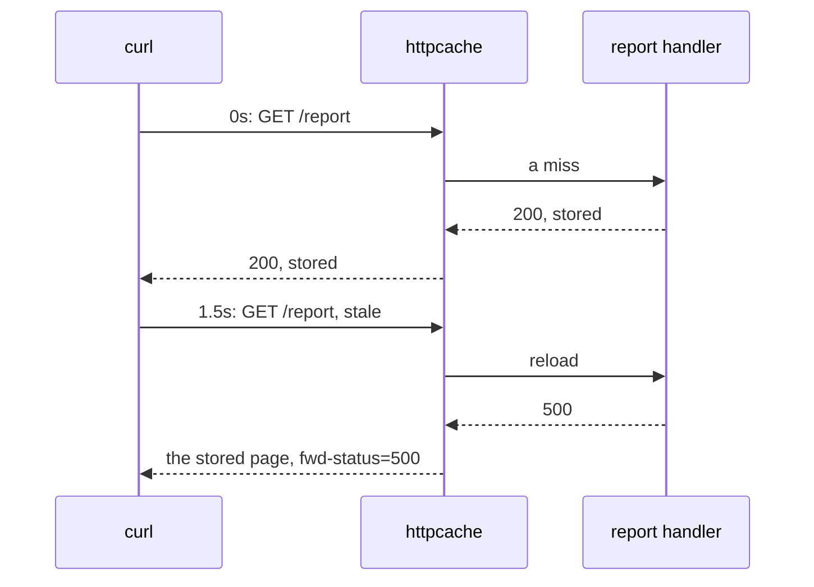
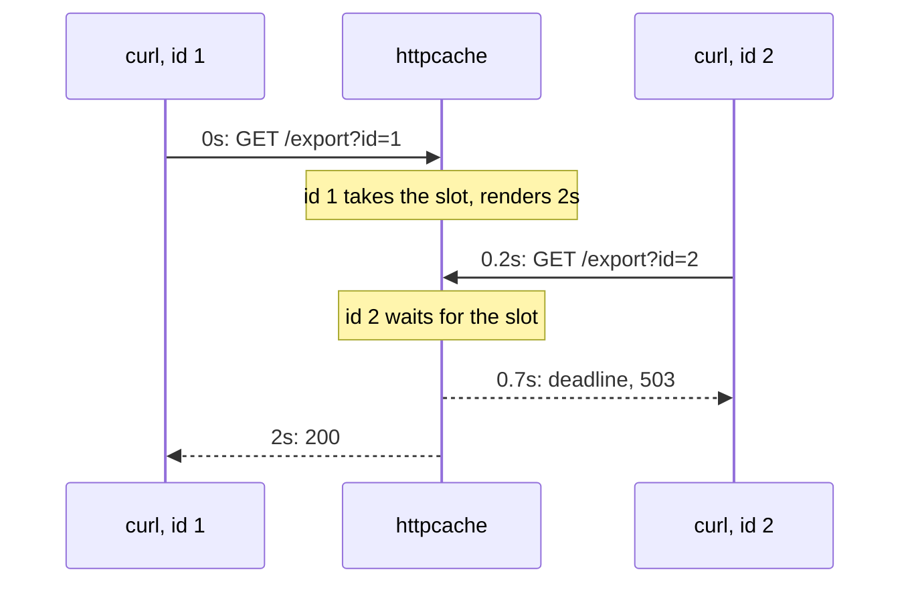

# `httpcache`: whole HTTP responses { #httpcache-whole-http-responses }

Store whole responses of a handler, so a hit sends the stored status, headers and body without
calling the handler.

## `httpcache.New`: cache the responses of a handler { #httpcachenew }

Returns a middleware that caches the responses of a handler in a `*gashe.Cache`.

API: [`httpcache.New`](https://pkg.go.dev/github.com/eugeneliukindev/gashe/httpcache#New), [`httpcache.Options`](https://pkg.go.dev/github.com/eugeneliukindev/gashe/httpcache#Options), [`httpcache.Vary`](https://pkg.go.dev/github.com/eugeneliukindev/gashe/httpcache#Vary), [`httpcache.Response`](https://pkg.go.dev/github.com/eugeneliukindev/gashe/httpcache#Response)

```go
cached := httpcache.New(c, httpcache.Options{
	Policy: gashe.Policy[httpcache.Response]{TTL: time.Minute, StaleIfError: time.Hour},
	Vary: httpcache.Vary{
		Headers: []string{"Accept-Language"},
		Query:   []string{"page", "sort"},
		Cookies: []string{"currency"},
	},
})
mux.Handle("GET /products/", cached(http.HandlerFunc(listProducts)))
```

What a request gets; its key is the host, the path and what `Vary` names, see
[how the key is made](#how-the-key-is-made):

| The request | The answer |
|---|---|
| another method, `Range`, `Authorization` without `Vary.User`, `Cookie` without `Vary.Cookies` or `Vary.User` | goes past the cache |
| a hit | the stored response with `ETag`, `Age` and `Cache-Status: gashe; hit`; a matching `If-None-Match` gets `304 Not Modified` |
| stale, within `StaleWhileRevalidate` | the stale page, marked `Cache-Status: gashe; hit` only; one request renders it again in the background |
| a miss | the handler runs once for all concurrent requests of the key, as `GET` also for `HEAD` |
| a response the [rules of its headers](#headers-what-each-one-does) do not store | is sent only to the request that made it; the other waiting requests run the handler themselves |
| a 5xx | a loader error: within `StaleIfError` the last stored page, with `Cache-Status: gashe; fwd=stale; fwd-status=500`; otherwise the 5xx, sent to every waiting request too unless a header keeps it to one client |
| held back by `Policy.MaxConcurrentLoads`, or its `ctx` deadline passes while it waits for a render | `503 Service Unavailable` |

**Options** (`httpcache.Options`):

| Field | Type | Default | What it does |
|---|---|---|---|
| `Policy` | `gashe.Policy[httpcache.Response]` | required: a `TTL` or a stale window | how pages are cached, as in `GetOrLoad`; a nil `CacheIf` stores `200` only; `Negative` makes `New` panic: store `404` with `CacheIf` instead |
| `Vary` | `httpcache.Vary` | host, path and query | which parts of a request a page depends on, and so its key |
| `MaxBodyBytes` | `int` | 0: 1 MB | a larger body is sent but not stored |

**Vary** <span class="version-badge">Added in v0.5</span> (`httpcache.Vary`; the host and the path are always part of the key):

| Field | Type | Default | What it does |
|---|---|---|---|
| `Headers` | `[]string` | nil: none | request headers whose values are part of the key; a `Vary` header naming only them is stored |
| `Query` | `[]string` | nil: the whole query as sent | only these query parameters, sorted; an empty list means none |
| `Cookies` | `[]string` | nil: requests with `Cookie` go past the cache | only these cookies; requests with other cookies are cached too |
| `User` | `func(*http.Request) string` | nil: pages are shared | who the page is for; pages per user, and `Authorization` and `Cookie` requests are cached |
| `Custom` | `func(*http.Request) string` | nil: none | anything else the page depends on, added at the end of the key |

| What | How |
|---|---|
| Default | `GET` and `HEAD` requests without `Authorization`, `Cookie` and `Range` are cached under their host, path and query; a `200` of at most 1 MB, without `Set-Cookie`, a `Vary` header and `Cache-Control` `no-store`, `private` or `no-cache`, is stored for `Policy.TTL` |
| Errors | `New` panics on a negative `MaxBodyBytes` and on `Policy.Negative` |
| Memory | the handler writes into a buffer first: `MaxBodyBytes` decides what is stored, not what a render takes |

!!! warning
    A response must be the same for everyone who gets its key: every part of a request the handler
    builds a page from, a cookie, `X-Forwarded-Host`, `Accept-Language`, must be in `Vary`, or one
    request's page leaks to others (web cache deception, web cache poisoning).

    The whole body is buffered before it is sent, however large: a streaming response, such as
    server-sent events, reaches the client only when the handler returns. Keep such routes out of
    the cache.

- **Example:** [examples/httpserver](https://github.com/eugeneliukindev/gashe/blob/main/examples/httpserver/main.go)

???+ example "examples/httpserver/main.go"

    ```go hl_lines="28 30-31 36"
    --8<-- "examples/httpserver/main.go"
    ```

    Output:

    ```text
    --8<-- "docs/snippets/examples/httpserver.txt"
    ```

---

## Requests and responses { #try-it-with-curl }

The requests below go to a server with three cached pages, on `localhost:8080`; every response is
from a real run, with JSON formatted for reading.

???+ example "The server: examples/httpapi/main.go"

    ```go hl_lines="40-42 48 55"
    --8<-- "examples/httpapi/main.go"
    ```

| Page | Policy |
|---|---|
| `/products` | `TTL` 1m, `Vary` `Accept-Language` and `?page` |
| `/report` | `TTL` 1s, `StaleIfError` 1h; the handler fails after one render |
| `/export` | `TTL` 1m, `MaxConcurrentLoads` 1; half a second to get the slot |

### The first request renders and stores { #the-first-request-renders-and-stores }

The handler runs, and `Cache-Status` says the response was stored. `ETag` is a hash of the body,
since the handler set none.

```bash
--8<-- "docs/snippets/http/miss.curl"
```

```http
--8<-- "docs/snippets/http/miss.http"
```

### The next one is a hit { #the-next-one-is-a-hit }

The handler does not run. `Age` is how long ago the page was stored.

```bash
--8<-- "docs/snippets/http/hit.curl"
```

```http
--8<-- "docs/snippets/http/hit.http"
```

### A client with the page gets 304 { #a-client-with-the-page-gets-304 }

`If-None-Match` names the `ETag` the client has, so no body is sent.

```bash
--8<-- "docs/snippets/http/not-modified.curl"
```

```http
--8<-- "docs/snippets/http/not-modified.http"
```

### A query parameter outside `Vary.Query` changes nothing { #a-query-parameter-outside-varyquery-changes-nothing }

<span class="version-badge">Added in v0.5</span>

`Vary.Query` lists `page` only, so `utm_source` is not in the key and the same entry answers.

```bash
--8<-- "docs/snippets/http/query.curl"
```

```http
--8<-- "docs/snippets/http/query.http"
```

### A header in `Vary.Headers` makes another entry { #a-header-in-varyheaders-makes-another-entry }

<span class="version-badge">Added in v0.5</span>

`Accept-Language` is in `Vary.Headers`, so the Russian page is an entry of its own.

```bash
--8<-- "docs/snippets/http/vary.curl"
```

```http
--8<-- "docs/snippets/http/vary.http"
```

### A request with a cookie goes past the cache { #a-request-with-a-cookie-goes-past-the-cache }

The page might depend on the session, so it is neither read nor stored: `fwd=request`.
`Vary.Cookies` lists the cookies a page depends on, if any.

```bash
--8<-- "docs/snippets/http/cookie.curl"
```

```http
--8<-- "docs/snippets/http/cookie.http"
```

### Other methods go past the cache { #other-methods-go-past-the-cache }

```bash
--8<-- "docs/snippets/http/method.curl"
```

```http
--8<-- "docs/snippets/http/method.http"
```

### A failing handler gets the last stored page { #a-failing-handler-gets-the-last-good-page }

`/report` is fresh for a second, and `StaleIfError` keeps it for an hour. Its handler works once,
then fails:



```bash
--8<-- "docs/snippets/http/report.curl"
```

```http
--8<-- "docs/snippets/http/report.http"
```

```bash
--8<-- "docs/snippets/http/stale.curl"
```

```http
--8<-- "docs/snippets/http/stale.http"
```

### Over `MaxConcurrentLoads`, a request gets 503 { #over-maxconcurrentloads-a-request-gets-503 }

<span class="version-badge">Added in v0.5</span>

`/export` renders for two seconds with `MaxConcurrentLoads: 1`, and each request has half a second
to get the slot:



```bash
--8<-- "docs/snippets/http/overloaded.curl"
```

```http
--8<-- "docs/snippets/http/overloaded.http"
```

---

## How the key is made { #how-the-key-is-made }

<span class="version-badge">Added in v0.5</span>

The host and the path are always part of the key; of the rest, only what `Vary` names, so requests
that differ only in other headers, cookies or query parameters get the same page.

API: [`httpcache.Vary`](https://pkg.go.dev/github.com/eugeneliukindev/gashe/httpcache#Vary)

```text
<host><path>?<query> h:<header>=<value> c:<cookie>=<value> u=<user> x=<custom>
```

| What | How |
|---|---|
| Example | with `Vary{Headers: {"Accept-Language"}, Query: {"page"}, Cookies: {"currency"}}`, `/list?page=2&utm_source=mail` and `/list?page=2&utm_source=ads`, with `Accept-Language: de` and `Cookie: currency=eur; _ga=111`, are both `shop.com/list?page=2 h:Accept-Language=de c:currency=eur`: the second one is a hit |
| The query | with `Vary.Query`, its parameters are sorted; without it, the query is used as sent, so `?a=1&b=2` and `?b=2&a=1` are two entries |
| Encoding | header, cookie, user and custom values are escaped |
| Before the key | `gashe.Options.Prefix` and `Policy.Prefix` |

---

## Headers: what each one does { #headers-what-each-one-does }

How `httpcache` treats each header of the request and of the response, and which ones it adds.

Headers of the request:

| Header | What `httpcache` does |
|---|---|
| method | only `GET` and `HEAD` are cached; `HEAD` reads what `GET` stored |
| `Host` | always part of the key, with the path; the query too, or `Vary.Query` of it |
| `Authorization` | the request goes past the cache unless `Vary.User` is set: the page may belong to who sent it |
| `Cookie` | past the cache too, unless `Vary.Cookies` lists the cookies the page depends on or `Vary.User` is set |
| `Range` | the request goes past the cache |
| `If-None-Match` | a matching `ETag` gets `304 Not Modified`, compared the weak way of [RFC 9110](https://www.rfc-editor.org/rfc/rfc9110#section-13.1.2) |
| `Cache-Control`, `Pragma` | ignored on purpose: a client cannot make the handler run on every request |
| the headers in `Vary.Headers` | their values are part of the key |

Headers of the response the handler writes ([RFC 9111](https://www.rfc-editor.org/rfc/rfc9111#section-3)):

| Header | What `httpcache` does |
|---|---|
| `Cache-Control: no-store`, `private`, `no-cache` | the response is not stored |
| `Cache-Control: max-age` | ignored: freshness comes from `Policy` |
| `Set-Cookie` | the response is not stored |
| `Vary` | stored only if every header it names is in `Options.Vary`: `Vary.Headers`, `Cookie` with `Vary.Cookies` or `Vary.User`, `Authorization` with `Vary.User`; `Vary: *` never |
| `ETag` | kept; without one, a hash of the body |
| hop-by-hop, the headers `Connection` names, `Date`, `Content-Length` | not stored ([RFC 9110](https://www.rfc-editor.org/rfc/rfc9110#section-7.6.1)); `Content-Length` is set again from the body, for `HEAD` too |
| any other | stored and sent with every hit |

Headers `httpcache` adds:

| Header | Value |
|---|---|
| `ETag` | on every response the cache handles; not on requests that go past it |
| `Age` | only on a response from the cache, fresh or stale: the seconds since it was stored |
| `Cache-Status` ([RFC 9211](https://www.rfc-editor.org/rfc/rfc9211)) | `gashe; hit` (also a stale page of `StaleWhileRevalidate`), `gashe; fwd=stale; fwd-status=500` (a stale page answered a 5xx), `gashe; fwd=uri-miss; stored`, `gashe; fwd=uri-miss` (not stored), `gashe; fwd=method` or `gashe; fwd=request` (past the cache) |

---

## Behind a reverse proxy { #behind-a-reverse-proxy }

The key must hold the host the handler builds the page for.

```go
cached := httpcache.New(c, httpcache.Options{
	Policy: pages,
	Vary: httpcache.Vary{
		Headers: []string{"X-Forwarded-Host", "X-Forwarded-Proto"}, // set by your proxy, not by clients
	},
})
```

| Proxy | `Vary.Headers` |
|---|---|
| Traefik, which keeps `Host` by default, or nginx with `proxy_set_header Host $host` | nothing: the default key is right |
| a proxy that sets `Host` to its upstream | `X-Forwarded-Host`, and `X-Forwarded-Proto` if the page has absolute links |

| What | How |
|---|---|
| `X-Forwarded-*` | trust it only where your proxy sets it and drops what the client sent |
| The client IP | never in the key, `X-Forwarded-For` or `X-Real-Ip`: every visitor would get a copy of their own |
| A random query | makes a new entry each time unless `Vary.Query` lists the parameters that matter; a random `Host` too, so bound memory with `MaxBytes` |
