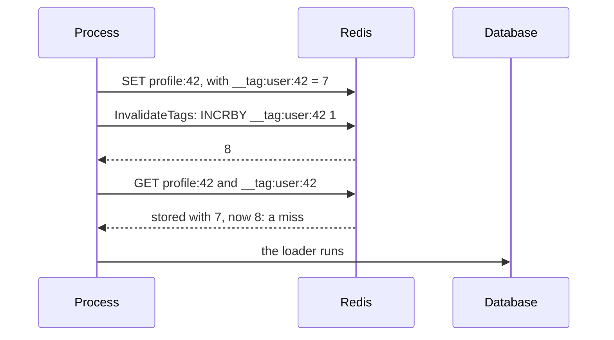

# Invalidation { #invalidation }

Make stored results go after the data changed.

## `Tags`: invalidate many entries with one write { #tags-invalidate-many-entries-with-one-write }

`c.InvalidateTags` makes every entry with the tag a miss; nothing is deleted, nothing is scanned.

API: [`gashe.Policy`](https://pkg.go.dev/github.com/eugeneliukindev/gashe#Policy), [`gashe.Cache.InvalidateTags`](https://pkg.go.dev/github.com/eugeneliukindev/gashe#Cache.InvalidateTags)

```go
profileCache := gashe.For(c, gashe.Policy[Profile]{TTL: time.Hour, Tags: []string{"user:42"}})
orderCache := gashe.For(c, gashe.Policy[[]Order]{TTL: time.Hour, Tags: []string{"user:42", "orders"}})

_, err = db.ExecContext(ctx, "UPDATE users SET name = $1 WHERE id = 42", name)
err = c.InvalidateTags(ctx, "user:42") // after the write, not before
```



| Field | Type | Default | What it does |
|---|---|---|---|
| `Tags` | `[]string` | nil: none | `InvalidateTags` of any of them makes the result a miss |

| What | How |
|---|---|
| Errors | `InvalidateTags` returns backend errors |
| Redis | per tag, `SET __tag:<tag> <random> NX`, then `INCRBY __tag:<tag> 1` |
| A missing counter | never created or evicted: reads and `InvalidateTags` create it at a random generation, so entries stored before an eviction stay invalid |
| No race | a load reads the counters before it calls the loader, so a slow load cannot store its result over an invalidation |
| Cost | one more key read per tag on a lookup |
| Counters | never expire: tag per user, not per request |

- **Example:** [examples/tags](https://github.com/eugeneliukindev/gashe/blob/main/examples/tags/main.go)

???+ example "examples/tags/main.go"

    ```go hl_lines="23 38"
    --8<-- "examples/tags/main.go"
    ```

    Output:

    ```text
    --8<-- "docs/snippets/examples/tags.txt"
    ```

---

## `Cached.Set`: store a result you already have { #cachedset }

Stores a result as a load would: with the TTL, `Jitter`, tags and shape of the policy.

API: [`gashe.Cached.Set`](https://pkg.go.dev/github.com/eugeneliukindev/gashe#Cached.Set)

```go
_, err = db.ExecContext(ctx, "UPDATE users SET name = $1 WHERE id = 42", u.Name)
err = userCache.Set(ctx, "42", u) // the next GetOrLoad is a hit with the new result
```

| What | How |
|---|---|
| Errors | backend and codec errors |
| Redis | `GET` of the tag counters, then `SET users:v2:42 ... EX or PX` |
| A result the policy does not store | by `CacheIf` or a negative TTL: the entry is deleted (`UNLINK`) |
| Race | a slower load that started before the `Set` can store its older result after it; only a tag avoids that |

---

## `Reload`: load again after the data changed { #reload }

Calls the loader and stores the result, whatever is stored: use it after the data changed when you
do not have the new result.

API: [`gashe.Cached.Reload`](https://pkg.go.dev/github.com/eugeneliukindev/gashe#Cached.Reload), [`gashe.Reload`](https://pkg.go.dev/github.com/eugeneliukindev/gashe#Reload)

```go
u, err := userCache.Reload(ctx, "42", loadUser)
u, err = gashe.Reload(ctx, c, "42", userPolicy, loadUser)
```

| What | How |
|---|---|
| Returns | the loaded result |
| Errors | the loader error, a "not found" too; the stored entry stays. `ErrOverloaded`, `ErrInvalidOptions` as in `GetOrLoad` |
| Redis | `GET` of the tag counters, then `SET ... EX or PX` |

---

## `Cached.Delete`: drop one entry { #cacheddelete }

Deletes the entry, with `Policy.Prefix`.

API: [`gashe.Cached.Delete`](https://pkg.go.dev/github.com/eugeneliukindev/gashe#Cached.Delete)

```go
existed, err := userCache.Delete(ctx, "42") // deletes users:v2:42
```

| What | How |
|---|---|
| Returns | whether the entry existed |
| Errors | backend errors |
| Redis | `UNLINK` |
| Race | a load that started before the delete can store its older result after it; use a tag where that matters |
