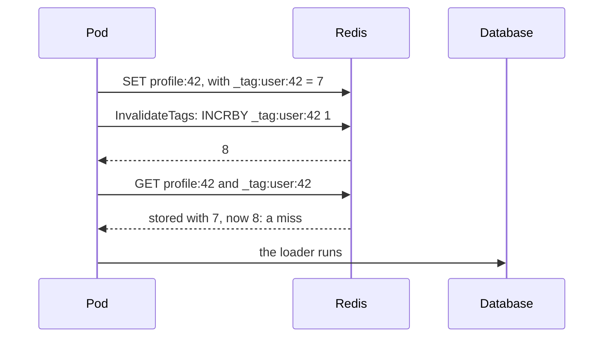

# Invalidation { #invalidation }

Make stored results go after the data changed.

## `Tags`: invalidate many entries with one write { #tags-invalidate-many-entries-with-one-write }

```go
profileCache := gashe.For(c, gashe.Policy[Profile]{TTL: time.Hour, Tags: []string{"user:42"}})
orderCache := gashe.For(c, gashe.Policy[[]Order]{TTL: time.Hour, Tags: []string{"user:42", "orders"}})

_, err = db.ExecContext(ctx, "UPDATE users SET name = $1 WHERE id = 42", name)
err = c.InvalidateTags(ctx, "user:42") // after the write, not before
```

`c.InvalidateTags` makes every entry with the tag a miss; nothing is deleted, nothing is scanned.



| What | How |
|---|---|
| Errors | `InvalidateTags` returns backend errors |
| Redis | `INCRBY _tag:<tag> 1` per tag |
| Cost | one more key read per tag on a lookup |
| Counters | never expire: tag per user, not per request |

- **Example:** [examples/tags](https://github.com/eugeneliukindev/gashe/blob/main/examples/tags/main.go)

??? example "examples/tags/main.go"

    ```go
    --8<-- "examples/tags/main.go"
    ```

    Output:

    ```text
    --8<-- "docs/snippets/examples/tags.txt"
    ```

---

## `Cached.Set` { #cachedset }

```go
_, err = db.ExecContext(ctx, "UPDATE users SET name = $1 WHERE id = 42", u.Name)
err = userCache.Set(ctx, "42", u) // the next GetOrLoad is a hit with the new result
```

Stores a result you already have, as a load would: with the TTL, `Jitter`, tags and shape of the
policy.

| What | How |
|---|---|
| Errors | backend and codec errors |
| Redis | `GET` of the tag counters, then `SET users:v2:42 ... PX` |
| A result the policy does not store | by `CacheIf` or a negative TTL, deletes the entry (`UNLINK`); unlike `Delete`, it has no race with a parallel load |

---

## `Reload` { #reload }

```go
u, err := userCache.Reload(ctx, "42", loadUser)
u, err = gashe.Reload(ctx, c, "42", userPolicy, loadUser)
```

Calls the loader and stores the result, whatever is stored: use it after the data changed when you
do not have the new result.

| What | How |
|---|---|
| Returns | the loaded result |
| Errors | the loader error; the stored entry stays |
| Redis | `GET` of the tag counters, then `SET ... PX` |

---

## `Cached.Delete` { #cacheddelete }

```go
existed, err := userCache.Delete(ctx, "42") // deletes users:v2:42
```

Deletes the entry, with `Policy.Prefix`.

| What | How |
|---|---|
| Returns | whether the entry existed |
| Redis | `UNLINK` |
| Race | a read that loaded before the write can store its old result after the delete; use `Set` or a tag where that matters |
