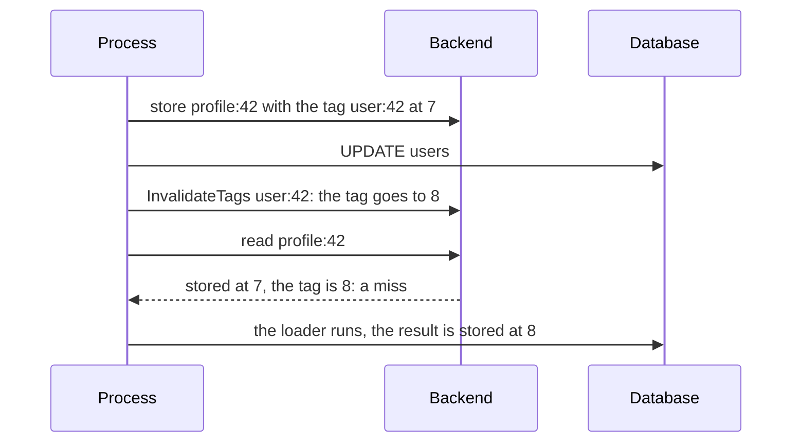

# Tags { #invalidation }

This page shows how to make stored results go after the data changed. In this section, we will go
through [`Tags`](#tags), [`Cached.Set`](#cachedset),
[`Reload`](#reload) and [`Cached.Delete`](#cacheddelete).

## `Policy.Tags` { #tags }

A user changes their name, and you must drop every entry that shows it. With `Tags`, one call of
`Cache.InvalidateTags` makes every entry with the tag a miss; nothing is deleted, nothing is scanned.

??? api "API documentation"

    [`gashe.Policy`](../reference/gashe.md#Policy)<br>
    [`Cache.InvalidateTags`](../reference/gashe.md#Cache.InvalidateTags)<br>

```go hl_lines="23 27 32"
--8<-- "examples/docs/invalidation/tags/main.go"
```

1. Invalidate after the write, not before.

Each entry remembers the counter of its tag when it was stored: after the counter moves,
the next read sees an older number and is a miss.



| Field | Default | What it does |
|---|---|---|
| `Tags` | nil: none | `InvalidateTags` of any of them makes the result a miss |

- Each tag costs one more key read on a lookup.
- A slow load cannot store its result over an invalidation: it reads the counters before it calls
  the loader.
- `InvalidateTags` returns backend errors.

!!! tip
    Counters never expire: tag per user, not per request.

!!! danger
    Call `InvalidateTags` after the write to the database, not before: a load between the two reads
    the old data and stores it under the new counter, and it is served until its TTL ends.

??? note "Technical details"

    - A counter never created, or evicted, is created at a random generation by reads and
      `InvalidateTags`, so entries stored before an eviction stay invalid.
    - In Redis: per tag, `SET __tag:<tag> <random> NX`, then `INCRBY __tag:<tag> 1`.

```go hl_lines="22 30"
--8<-- "examples/tags/main.go"
```


```text title="In the backend"
--8<-- "docs/snippets/backend/tags.txt"
```

---

## `Cached.Set` { #cachedset }

You just wrote the new value to the database, and a load would only read it back. With
`Cached.Set`, you store the result you already have as a load would: with the TTL, `TTL.Jitter`, tags
and shape of the policy.

??? api "API documentation"

    [`Cached.Set`](../reference/gashe.md#Cached[V].Set)<br>

```go hl_lines="38"
--8<-- "examples/docs/invalidation/set/main.go"
```

1. The next `GetOrLoad` is a hit with the new result.

- A result the policy does not store, by `CacheIf`, deletes the entry.
- It returns backend and codec errors.

!!! warning
    A slower load that started before the `Set` can store its older result after it; only a tag
    avoids that.

??? note "Technical details"

    In Redis: `GET` of the tag counters, then `SET users:v2:42 ... EX or PX`; `UNLINK` for a result
    the policy does not store.

---

## `gashe.Reload` { #reload }

The data changed, but you do not have the new result. `Reload` calls the loader and stores its
result, whatever is stored.

??? api "API documentation"

    [`Cached.Reload`](../reference/gashe.md#Cached[V].Reload)<br>
    [`gashe.Reload`](../reference/gashe.md#Reload)<br>

```go hl_lines="23 25"
--8<-- "examples/docs/invalidation/reload/main.go"
```

- On a loader error, a "not found" too, the error is returned and the stored entry stays.
- It returns the loaded result; `ErrOverloaded` and `ErrInvalidOptions` come as in `GetOrLoad`.

??? note "Technical details"

    In Redis: `GET` of the tag counters, then `SET ... EX or PX`.

---

## `Cached.Delete` { #cacheddelete }

One entry is wrong and must go. `Cached.Delete` deletes it, with `Policy.Prefix`, and the next
`GetOrLoad` loads again.

??? api "API documentation"

    [`Cached.Delete`](../reference/gashe.md#Cached[V].Delete)<br>

```go hl_lines="21"
--8<-- "examples/docs/invalidation/delete/main.go"
```

- It returns whether the entry existed, and backend errors.

!!! warning
    A load that started before the delete can store its older result after it; use a tag where that
    matters.

??? note "Technical details"

    In Redis: `UNLINK`.
