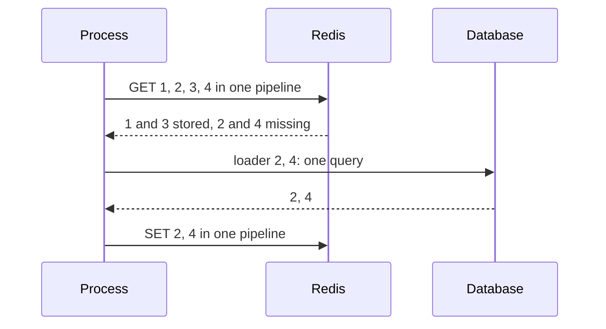

# Lists { #lists }

Load the missing items of a list with one query.

## `GetOrLoadMany`: one query for the missing keys of a list { #getorloadmany }

Reads all keys at once and calls the loader once with the missing ones: a page of 50 products costs
one round trip and at most one query, not 50.

API: [`gashe.Cached.GetOrLoadMany`](https://pkg.go.dev/github.com/eugeneliukindev/gashe#Cached.GetOrLoadMany), [`gashe.GetOrLoadMany`](https://pkg.go.dev/github.com/eugeneliukindev/gashe#GetOrLoadMany)

```go
list, err := productCache.GetOrLoadMany(ctx, ids, func(ctx context.Context, missing []string) (map[string]Product, error) {
	return repo.ProductsByID(ctx, missing) // SELECT ... WHERE id = ANY($1)
})
list, err = gashe.GetOrLoadMany(ctx, c, ids, productPolicy, loadProducts) // the same without For
```



| What | How |
|---|---|
| Returns | a map of every key that was found or loaded |
| Errors | the loader error. `ErrOverloaded` - every slot of `MaxConcurrentLoads` stayed taken until `ctx` ended. `ErrInvalidOptions` - `StaleWhileRevalidate`, `StaleIfError`, `LockOnMiss` or `Negative` is set |
| Policy fields | `TTL`, `Jitter`, `Tags`, `CacheIf`, `Prefix`, `MaxConcurrentLoads`, `Fallback` |
| Redis | `GET` per key and per tag in one pipeline; `SET ... EX or PX` per loaded key in one pipeline |
| Keys the loader leaves out | are not stored |
| Concurrent calls | do not share a load |

- **Example:** [examples/batch](https://github.com/eugeneliukindev/gashe/blob/main/examples/batch/main.go)

???+ example "examples/batch/main.go"

    ```go hl_lines="26 39"
    --8<-- "examples/batch/main.go"
    ```

    Output:

    ```text
    --8<-- "docs/snippets/examples/batch.txt"
    ```
