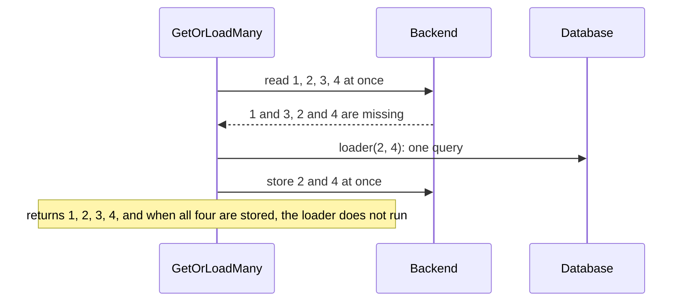

# Loading { #loading }

This page shows how `GetOrLoad` answers, how a list loads with one query, how long results stay fresh and what gets stored. In this
section, we will go through [`gashe.For`](#gashefor), [`GetOrLoad`](#getorload),
[`GetOrLoadMany`](#getorloadmany), [`TTL`](#ttl),
[`CacheIf` and `Prefix`](#cacheif-prefix) and
[type shapes](#type-shapes).

## `gashe.For` { #gashefor }

Passing the same policy to every call is easy to get wrong. With `gashe.For`, you bind a `Policy` to
the cache once, and it is checked once; keep one per kind of data.

??? api "API documentation"

    [`gashe.For`](../reference/gashe.md#For)<br>

```go hl_lines="20-23"
--8<-- "examples/docs/loading/for/main.go"
```

- `For` panics on an invalid policy, such as `TTL: "1hr"`.
- It returns a `gashe.Cached[User]`: the functions of the same name, with the policy. Its `Set` and
  `Delete` apply `Policy.Prefix`.

!!! tip
    Call `For` at startup, in package variables or your constructor: an invalid policy then panics
    before the first request, not in the middle of one.

---

## `gashe.GetOrLoad` { #getorload }

Every request that reads the database costs you time and load. With `GetOrLoad`, you get the stored
result while the policy allows it; otherwise the loader runs, and its result is stored and returned.

??? api "API documentation"

    [`Cached.GetOrLoad`](../reference/gashe.md#Cached[V].GetOrLoad)<br>
    [`gashe.GetOrLoad`](../reference/gashe.md#GetOrLoad)<br>

```go hl_lines="25-27"
--8<-- "examples/docs/loading/getorload/main.go"
```

**Options** (`gashe.Policy[V]`; a zero field is off):

| Field | Default | What it does |
|---|---|---|
| [`TTL`](#ttl) | `For` required, unless a stale window is set | `For`: how long a result is fresh, as `time.Duration`, a string for `time.ParseDuration` or `func(V) time.Duration`; `Jitter`: [spreads it](stampedes.md#jitter) by up to this share |
| [`Prefix`](#cacheif-prefix) | `""`: none | before the key, after `Options.Prefix`, separator included |
| [`Stale`](stale.md#stale-options) | zero: off | when the stale result, past `TTL`, still answers: at once while it reloads (`WhileRevalidate`), instead of a failing loader (`IfError`) or a slow one (`IfSlow`), each within its own window after `TTL` |
| [`Stampede`](stampedes.md) | zero: off | concurrent calls share a load: in the process (`SingleFlight`), across processes (`LockFor`), and at most `MaxLoads` at once |
| [`Tags`](invalidation.md#tags) | nil: none | `InvalidateTags` of any of them makes the result a miss |
| [`Negative`](negative.md#negative-cache-not-found) | off while `IsNotFound` is nil | caches a "not found": `IsNotFound` picks the errors, `TTL` keeps it; the call gets `gashe.ErrNotFound` |
| [`Fallback`](outages.md#fallback) | zero: none | while the backend fails, keep and answer results in a backend of its own |
| [`CacheIf`](#cacheif-prefix) | nil: every successful result | which results are stored |

- The loader gets a `ctx` of its own, with the values of the request but not its deadline; it is
  cancelled once every call waiting for it has left.
- You get the result as it reads back from the cache.
- With [`Stampede.SingleFlight`](stampedes.md#singleflight), concurrent calls for one key and type
  in a process share one read and one load.
- With only `TTL`, a fresh result is a hit, a miss or an expired result calls the loader, and a
  loader error is returned and not stored.
- An entry of another [type shape](#type-shapes) of `V`, or with an
  older tag, is a miss.
- Errors: the loader error, unless `Stale.IfError` answers it; `gashe.ErrNotFound` when a "not found" is
  cached; `ctx.Err()` when `ctx` ended while `Stampede.LockFor` waited; `ErrOverloaded` when every slot of
  `Stampede.MaxLoads` stayed taken until `ctx` ended; `ErrInvalidOptions` for an invalid policy, in
  the function form.
- How each call is answered, with the `Result` that `Options.Hooks.OnResult` gets:
    - a fresh entry, younger than `TTL`: the stored result, the loader does not run (`hit`);
    - stale, within `Stale.WhileRevalidate`: the stale result, and the loader runs in the background,
      once for all processes (`stale-while-revalidate`);
    - stale, within `Stale.IfError.For`, and the loader fails: the stale result, the error goes to
      `OnError` (`stale-if-error`);
    - stale, within `Stale.IfSlow.For`, and the loader is slower than `Stale.IfSlow.After`: the stale
      result, the loader goes on in the background and stores its result (`stale-if-slow`);
    - a "not found" within `Negative.TTL`: `gashe.ErrNotFound`, the loader does not run (`negative-hit`);
    - missing or expired: the loader runs; its result is returned and stored, its error is returned
      and not stored (`miss`);
    - the backend fails and `Fallback` has the key: the kept result, the loader does not run
      (`fallback`);
    - the backend fails and there is no `Fallback`: the loader runs on every call (`miss`).

!!! warning
    Do not read a `GetOrLoad` key with `Cache.Get`: the basic API stores plain values, and cannot read
    the entries of `GetOrLoad`.

??? note "Technical details"

    In Redis: `GET` of the key and its `__tag:` counters in one pipeline, and `SET ... EX or PX` to
    store. `Stampede.LockFor` adds `SET __load:<key> NX EX or PX`, `Stale.WhileRevalidate` and
    `Stale.IfSlow` add `SET __refresh:<key> NX EX or PX`.

```go hl_lines="24-27 32"
--8<-- "examples/cacheaside/main.go"
```

## `gashe.GetOrLoadMany` { #getorloadmany }

A page shows 50 products, and loading them one by one costs 50 round trips and 50 queries. With
`GetOrLoadMany`, you read all keys at once and call the loader once with the missing ones: one
round trip and at most one query.

??? api "API documentation"

    [`Cached.GetOrLoadMany`](../reference/gashe.md#Cached[V].GetOrLoadMany)<br>
    [`gashe.GetOrLoadMany`](../reference/gashe.md#GetOrLoadMany)<br>

```go hl_lines="35-38"
--8<-- "examples/docs/loading/getorloadmany/main.go"
```

Four keys, two of them stored: one read for all four, and one query for the two missing:



- It returns a map of every key that was found or loaded.
- Concurrent calls do not share a load.
- It supports the policy fields `TTL`, `TTL.Jitter`, `Tags`, `CacheIf`, `Prefix`,
  `Stampede.MaxLoads` and `Fallback`. With `Stale`, `Stampede.LockFor` or
  `Negative` set, it returns `ErrInvalidOptions`.
- It returns the loader error, or `ErrOverloaded` when every slot of `Stampede.MaxLoads` stayed
  taken until `ctx` ended.

!!! tip
    For one hot key that many requests read at once, use `GetOrLoad`: it shares one load between
    them.

!!! warning
    Keys the loader leaves out are not stored, and `Negative` is not supported: an id that does not
    exist reaches the loader on every call.

??? note "Technical details"
    - In Redis: `GET` per key and per tag in one pipeline; `SET ... EX or PX` per loaded key in one
      pipeline.

```go hl_lines="36"
--8<-- "examples/batch/main.go"
```

---

## `Policy.TTL` { #ttl }

Some results go out of date in a minute, others in a day. With `TTL`, you say how long a result is
fresh in `TTL.For`: a `time.Duration`, a string for `time.ParseDuration`, or a function of the result
that gashe calls after a load.

--8<-- "docs/snippets/lifecycle.html"

??? api "API documentation"

    [`gashe.Policy`](../reference/gashe.md#Policy)<br>

```go hl_lines="26-31"
--8<-- "examples/docs/loading/ttl-forms/main.go"
```

1. A string from the configuration, such as `"10m"`.
2. Each TTL varies by up to 10%, so entries stored together do not expire together.
3. An int, not a `time.Duration`: `ErrInvalidOptions`.

- Any type but these three, a string `time.ParseDuration` rejects, a negative duration, or neither
  `TTL.For` nor a stale window is `ErrInvalidOptions`.
- To leave a result out, use [`CacheIf`](#cacheif-prefix): a negative TTL from the function is not
  stored, and goes to `OnError` as `ErrInvalidOptions`.
- The entry lives `TTL` plus the longest of `Stale.WhileRevalidate`, `Stale.IfError.For` and
  `Stale.IfSlow.For`.

!!! tip
    A TTL that depends on the arguments needs no function: `TTL: ttlFor(itemID)`.

!!! warning
    `TTL: 3600` is an int, not 3600 seconds and not a `time.Duration`: it is `ErrInvalidOptions`.
    Write `time.Hour`, or `"1h"`.

---

## `Policy.CacheIf`, `Policy.Prefix` { #cacheif-prefix }

Not every result is worth storing, and two kinds of data may share a key. `CacheIf` decides which
results are stored; `Prefix` goes before every key of the policy.

??? api "API documentation"

    [`gashe.Policy`](../reference/gashe.md#Policy)<br>

```go hl_lines="26 32"
--8<-- "examples/docs/loading/cacheif-prefix/main.go"
```

- Changing `Prefix` makes every entry of that kind a miss at once.
- When `CacheIf` returns false, the result is returned and not stored.

!!! tip
    After a change in what a result means, change its `Prefix`, such as `users:v2:` to `users:v3:`:
    the old entries are never read again and expire with their TTL.

---

## Type shapes { #type-shapes }

After a deploy renames a field, old entries would read as empty values. gashe does this for you: an
entry of another type shape is a miss that loads again.

```go hl_lines="19 24"
--8<-- "examples/docs/loading/type-shapes/main.go"
```

- The shape is the exported field names, `json` and `msgpack` tags and field types, nested types
  included.
- Values do not change the shape: only changed types reload.
- How it works: [type shapes](../internals/storage.md#type-shapes).
