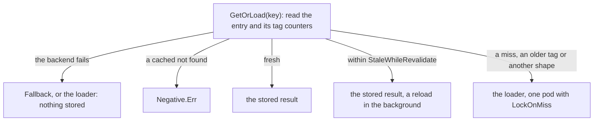

# Loading { #loading }

How `GetOrLoad` answers, how long results are fresh and what gets stored.

## `gashe.For` { #gashefor }

```go
userCache := gashe.For(c, gashe.Policy[User]{TTL: time.Hour, Prefix: "users:v2:"})
```

Binds a `Policy` to the cache and checks it once; keep one per kind of data.

| What | How |
|---|---|
| Returns | a `gashe.Cached[User]`: the functions of the same name, with the policy; its `Set` and `Delete` apply `Policy.Prefix` |
| Errors | panics on an invalid policy, such as `TTL: "1hr"` |

---

## `GetOrLoad` { #getorload }

Answers the stored result while the policy allows it; otherwise calls the loader, stores the result
and returns it.

**Each option:** [`TTL`](#ttl-how-long-a-result-is-fresh), [`Jitter`](stampedes.md#jitter-spread-expiry),
[`StaleWhileRevalidate`](stale.md#stalewhilerevalidate-answer-old-data-while-reloading), [`StaleIfError`,
`StaleIfSlow`](stale.md#staleiferror-staleifslow-answer-old-data-while-the-source-fails),
[`Negative`](negative.md#negative-cache-not-found), [`LockOnMiss`](stampedes.md#lockonmiss-one-load-for-all-pods),
[`MaxConcurrentLoads`](stampedes.md#maxconcurrentloads-protect-the-source-from-too-many-loads-at-once),
[`Fallback`](outages.md#fallback-answer-from-memory-while-the-backend-is-down),
[`Tags`](invalidation.md#tags-invalidate-many-entries-with-one-write), [`CacheIf`,
`Prefix`](#cacheif-prefix-what-to-store-and-under-which-key), [Type
shapes](#type-shapes-type-changes-after-a-deploy).

```go
userCache := gashe.For(c, gashe.Policy[User]{TTL: time.Hour})
u, err := userCache.GetOrLoad(ctx, "42", loadUser)
u, err = gashe.GetOrLoad(ctx, c, "42", userPolicy, loadUser) // the same without For
```

**Default:** with only `TTL`, a fresh result is answered from the cache, a miss or an expired result
calls the loader, and a loader error is returned and not stored.

Where the answer comes from; concurrent calls for one key and type in a process share one read and
one load.



The life of an entry:

| Age | State | A call |
|---|---|---|
| under `TTL` | fresh | a hit |
| `TTL` to `TTL` + the longer of `StaleWhileRevalidate` and `StaleIfError` | stale | the old result now with `StaleWhileRevalidate`, or instead of a loader error with `StaleIfError`; otherwise the loader runs |
| older | gone: the backend dropped it | a miss |

**What a call answers** (the last column is the `Result` that `Options.OnResult` gets):

| The entry | The answer | The loader | `Result` |
|---|---|---|---|
| fresh, younger than `TTL` | the stored result | does not run | `hit` |
| stale, within `StaleWhileRevalidate` | the stored result | runs in the background, once for all pods | `stale-while-revalidate` |
| stale, within `StaleIfError`, the loader fails | the stored result | ran and failed; the error goes to `OnError` | `stale-if-error` |
| stale, within `StaleIfError`, the loader is slower than `StaleIfSlow` | the stored result | goes on in the background and stores its result | `stale-if-slow` |
| a "not found" within `Negative.TTL` | `Negative.Err` | does not run | `negative-hit` |
| missing or expired | the loaded result; an error is returned and not stored | runs | `miss` |
| the backend fails, `Fallback` has the key | the kept result | does not run | `fallback` |
| the backend fails, no `Fallback` | the loaded result | runs on every call | `miss` |

**Options** (`gashe.Policy`; a zero field is off, each one is explained below):

| Field | Default | What it does |
|---|---|---|
| `TTL` | required, unless a stale window is set | how long a result is fresh: a `time.Duration`, `"1h"` or a function of the result |
| `Jitter` | 0 | spreads TTLs randomly by up to this share, from 0 to less than 1 |
| `StaleWhileRevalidate` | 0 | after `TTL`: answer the old result, reload it in the background |
| `StaleIfError` | 0 | after `TTL`: answer the old result instead of a loader error |
| `StaleIf` | nil: any error | which loader errors `StaleIfError` covers |
| `StaleIfSlow` | 0: wait for the loader | a slower loader gets the old result; needs `StaleIfError` |
| `Negative` | off while `If` is nil | cache a "not found": `If` picks the errors, `Err` is returned, `TTL` keeps it |
| `LockOnMiss` | 0 | one process loads a miss, the others wait; the longest the lock is held |
| `MaxConcurrentLoads` | 0: no limit | how many loads of this kind run at once in a process |
| `Fallback` | nil: none | while the backend fails, keep and answer results from memory, at most `MaxTTL` |
| `Tags` | none | `InvalidateTags` of any of them makes the result a miss |
| `CacheIf` | nil: every successful result | which results are stored |
| `Prefix` | `""` | before the key, after `Options.Prefix` |

| What | How |
|---|---|
| Returns | the result as it reads back from the cache |
| Errors | the loader error, unless `StaleIfError` answers it. `Negative.Err` - a "not found" is cached. `ctx.Err()` - `ctx` ended while `LockOnMiss` waited. `ErrOverloaded` - every slot of `MaxConcurrentLoads` stayed taken until `ctx` ended. `ErrInvalidOptions` - an invalid policy, in the function form |
| Redis | `GET` of the key and its `_tag:` counters in one pipeline; `SET ... PX` to store; `LockOnMiss` adds `SET _load:<key> NX PX`, `StaleWhileRevalidate` adds `SET _refresh:<key> NX PX` |
| The loader | gets a `ctx` that may outlive the request |
| `c.Get` | cannot read a `GetOrLoad` key: the basic API stores plain values |

- **Example:** [examples/cacheaside](https://github.com/eugeneliukindev/gashe/blob/main/examples/cacheaside/main.go)

??? example "examples/cacheaside/main.go"

    ```go
    --8<-- "examples/cacheaside/main.go"
    ```

    Output:

    ```text
    --8<-- "docs/snippets/examples/cacheaside.txt"
    ```

---

## `TTL`: how long a result is fresh { #ttl-how-long-a-result-is-fresh }

```go
TTL: time.Hour
TTL: "1h30m"
TTL: cfg.UserTTL // a string from the configuration, such as "10m"
TTL: func(t Token) time.Duration { return time.Until(t.ExpiresAt) - time.Minute }
TTL: func(p Page) time.Duration {
	if p.Draft {
		return -1 // negative: do not store
	}
	return 10 * time.Minute
}
TTL: 3600 // an int, not a time.Duration: ErrInvalidOptions
```

A `time.Duration`, a string for `time.ParseDuration`, or a function of the result that gashe calls
after a load.

| What | How |
|---|---|
| The entry lives | `TTL` plus the longer of `StaleWhileRevalidate` and `StaleIfError` |
| Depends on the arguments | needs no function: `TTL: ttlFor(itemID)` |

---

## `CacheIf`, `Prefix`: what to store and under which key { #cacheif-prefix-what-to-store-and-under-which-key }

```go
gashe.Policy[[]Item]{TTL: time.Minute, CacheIf: func(v []Item) bool { return len(v) > 0 }} // skip empty results
gashe.Policy[User]{TTL: time.Hour, Prefix: "users:v2:"}                                    // stores users:v2:42
```

`CacheIf` decides which results are stored; `Prefix` goes before every key of the policy. Changing
`Prefix` makes every entry of that kind a miss at once.

---

## Type shapes: type changes after a deploy { #type-shapes-type-changes-after-a-deploy }

```go
type User struct{ Name string }     // before the deploy
type User struct{ FullName string } // after it: old entries are misses
```

Built in: an entry of another type shape is a miss that loads again, so a renamed field does not
read as empty, as `encoding/json` would leave it. Only changed types reload; values do not change the
shape.
