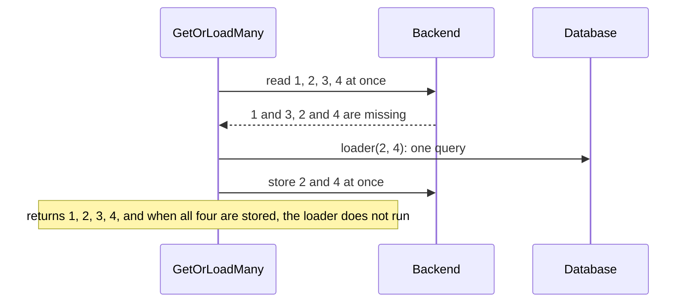

# Load and cache data { #loading }

This page shows how [`GetOrLoad`](../reference/gashe.md#GetOrLoad) answers, how a list loads with one query, how long results stay fresh and what gets stored. In this
section, we will go through [the policy](#policy), [`gashe.For`](#gashefor), [`GetOrLoad`](#getorload),
[`GetOrLoadMany`](#getorloadmany), [`TTL`](#ttl),
[`Store` and `Prefix`](#cacheif-prefix) and
[type shapes](#type-shapes).

## The policy { #policy }

Each kind of data has its own rules: how long it is fresh, when an old result still answers, how
loads are shared. A [`gashe.Policy`](../reference/gashe.md#Policy) holds them for one kind of data: you set it once and pass it to
[`gashe.For`](../reference/gashe.md#For), or to every [`gashe.GetOrLoad`](../reference/gashe.md#GetOrLoad).

```go hl_lines="4-10"
--8<-- "examples/docs/loading/policy/main.go:example"
```

??? example "Full program"

    ```go
    --8<-- "examples/docs/loading/policy/main.go"
    ```

Every field: [`Policy`](../reference/gashe.md#Policy)

- The zero value of each field is off: a policy with only `TTL` caches results for that long.
- An invalid policy returns [`ErrInvalidOptions`](../reference/gashe.md#variables) from every call, and makes [`gashe.For`](../reference/gashe.md#For) panic.
- Use one policy per kind of data: [`Stampede.MaxLoads`](../reference/gashe.md#Stampede) counts loads per type and `Prefix`.

---

## A policy for one kind of data { #gashefor }

Passing the same policy to every call is easy to get wrong. With [`gashe.For`](../reference/gashe.md#For), you bind a [`Policy`](../reference/gashe.md#Policy) to
the cache once, and it is checked once; keep one per kind of data.

```go hl_lines="1-4"
--8<-- "examples/docs/loading/for/main.go:example"
```

??? example "Full program"

    ```go
    --8<-- "examples/docs/loading/for/main.go"
    ```

**Signature:** `func For[V any](c *Cache, o Policy[V]) Cached[V]`

- `For` panics on an invalid policy, such as `TTL: "1hr"`.
- It returns a `gashe.Cached[User]`: the functions of the same name, with the policy. Its `Set` and
  `Delete` apply [`Policy.Prefix`](../reference/gashe.md#Policy).

!!! tip
    Call `For` at startup, in package variables or your constructor: an invalid policy then panics
    before the first request, not in the middle of one.

---

## Read, or load and store { #getorload }

Every request that reads the database costs you time and load. With [`GetOrLoad`](../reference/gashe.md#GetOrLoad), you get the stored
result while the policy allows it; otherwise the loader runs, and its result is stored and returned.

```go hl_lines="6-8"
--8<-- "examples/docs/loading/getorload/main.go:example"
```

??? example "Full program"

    ```go
    --8<-- "examples/docs/loading/getorload/main.go"
    ```

**Signature:** `func (p Cached[V]) GetOrLoad(ctx context.Context, key string, load func(context.Context) (V, error)) (V, error)`

The fields of the policy are in [The policy](#policy).

- The loader gets a `ctx` of its own, with the values of the request but not its deadline; it is
  cancelled once every call waiting for it has left.
- You get the result as it reads back from the cache.
- With [`Stampede.SingleFlight`](stampedes.md#singleflight), concurrent calls for one key and type
  in a process share one read and one load.
- With only `TTL`, a fresh result is a hit, a miss or an expired result calls the loader, and a
  loader error is returned and not stored.
- An entry of another [type shape](#type-shapes) of `V`, or with an
  older tag, is a miss.
- Errors: the loader error, unless [`Stale.IfError`](../reference/gashe.md#Stale) answers it; [`gashe.ErrNotFound`](../reference/gashe.md#ErrNotFound) when a "not found" is
  cached; `ctx.Err()` when `ctx` ended while [`Stampede.LockFor`](../reference/gashe.md#Stampede) waited; [`ErrOverloaded`](../reference/gashe.md#variables) when every slot of
  [`Stampede.MaxLoads`](../reference/gashe.md#Stampede) stayed taken until `ctx` ended; [`ErrInvalidOptions`](../reference/gashe.md#variables) for an invalid policy, in
  the function form.
- How each call is answered, with the [`Result`](../reference/gashe.md#Result) that [`Options.Hooks.OnResult`](../reference/gashe.md#Options) gets:
    - a fresh entry, younger than `TTL`: the stored result, the loader does not run (`hit`);
    - stale, within [`Stale.WhileRevalidate`](../reference/gashe.md#Stale): the stale result, and the loader runs in the background,
      once for all processes (`stale-while-revalidate`);
    - stale, within [`Stale.IfError.For`](../reference/gashe.md#Stale), and the loader fails: the stale result, the error goes to
      [`OnError`](../reference/gashe.md#Hooks) (`stale-if-error`);
    - stale, within [`Stale.IfSlow.For`](../reference/gashe.md#Stale), and the loader is slower than [`Stale.IfSlow.After`](../reference/gashe.md#Stale): the stale
      result, the loader goes on in the background and stores its result (`stale-if-slow`);
    - a "not found" within [`Negative.TTL`](../reference/gashe.md#Negative): [`gashe.ErrNotFound`](../reference/gashe.md#ErrNotFound), the loader does not run (`negative-hit`);
    - missing or expired: the loader runs; its result is returned and stored, its error is returned
      and not stored (`miss`);
    - the backend fails and [`Fallback`](../reference/gashe.md#Fallback) has the key: the kept result, the loader does not run
      (`fallback`);
    - the backend fails and there is no [`Fallback`](../reference/gashe.md#Fallback): the loader runs on every call (`miss`).

!!! warning
    Do not read a [`GetOrLoad`](../reference/gashe.md#Cached[V].GetOrLoad) key with [`Cache.Get`](../reference/gashe.md#Cache.Get): the basic API stores plain values, and cannot read
    the entries of [`GetOrLoad`](../reference/gashe.md#GetOrLoad).

??? note "Technical details"

    In Redis: `GET` of the key and its `__tag:` counters in one pipeline, and `SET ... EX or PX` to
    store. [`Stampede.LockFor`](../reference/gashe.md#Stampede) adds `SET __load:<key> NX EX or PX`, [`Stale.WhileRevalidate`](../reference/gashe.md#Stale) and
    [`Stale.IfSlow`](../reference/gashe.md#Stale) add `SET __refresh:<key> NX EX or PX`.

```go hl_lines="1-4 9"
--8<-- "examples/cacheaside/main.go:example"
```

??? example "Full program"

    ```go
    --8<-- "examples/cacheaside/main.go"
    ```

## Many keys in one query { #getorloadmany }

A page shows 50 products, and loading them one by one costs 50 round trips and 50 queries. With
[`GetOrLoadMany`](../reference/gashe.md#GetOrLoadMany), you read all keys at once and call the loader once with the missing ones: one
round trip and at most one query.

```go hl_lines="8-11"
--8<-- "examples/docs/loading/getorloadmany/main.go:example"
```

??? example "Full program"

    ```go
    --8<-- "examples/docs/loading/getorloadmany/main.go"
    ```

**Signature:** `func (p Cached[V]) GetOrLoadMany(ctx context.Context, keys []string, load func(ctx context.Context, missing []string) (map[string]V, error)) (map[string]V, error)`

Four keys, two of them stored: one read for all four, and one query for the two missing:



- It returns a map of every key that was found or loaded.
- Concurrent calls do not share a load.
- It supports the policy fields `TTL`, [`TTL.Jitter`](../reference/gashe.md#TTL), [`Tags`](../reference/gashe.md#Policy), [`Store`](../reference/gashe.md#Store), `Prefix`,
  [`Stampede.MaxLoads`](../reference/gashe.md#Stampede) and [`Fallback`](../reference/gashe.md#Fallback). With [`Stale`](../reference/gashe.md#Stale), [`Stampede.LockFor`](../reference/gashe.md#Stampede) or
  [`Negative`](../reference/gashe.md#Negative) set, it returns [`ErrInvalidOptions`](../reference/gashe.md#variables).
- It returns the loader error, or [`ErrOverloaded`](../reference/gashe.md#variables) when every slot of [`Stampede.MaxLoads`](../reference/gashe.md#Stampede) stayed
  taken until `ctx` ended.

!!! tip
    For one hot key that many requests read at once, use [`GetOrLoad`](../reference/gashe.md#GetOrLoad): it shares one load between
    them.

!!! warning
    Keys the loader leaves out are not stored, and [`Negative`](../reference/gashe.md#Negative) is not supported: an id that does not
    exist reaches the loader on every call.

??? note "Technical details"
    - In Redis: `GET` per key and per tag in one pipeline; `SET ... EX or PX` per loaded key in one
      pipeline.

```go hl_lines="18"
--8<-- "examples/batch/main.go:example"
```

??? example "Full program"

    ```go
    --8<-- "examples/batch/main.go"
    ```

---

## How long a result is fresh { #ttl }

Some results go out of date in a minute, others in a day. With `TTL`, you say how long a result is
fresh in [`TTL.For`](../reference/gashe.md#TTL): a `time.Duration`, a string for `time.ParseDuration`, or a function of the result
that gashe calls after a load.

--8<-- "docs/snippets/lifecycle.html"

```go hl_lines="7-12"
--8<-- "examples/docs/loading/ttl-forms/main.go:example"
```

1. A string from the configuration, such as `"10m"`.
2. Each TTL varies by up to 10%, so entries stored together do not expire together.
3. An int, not a `time.Duration`: [`ErrInvalidOptions`](../reference/gashe.md#variables).

??? example "Full program"

    ```go
    --8<-- "examples/docs/loading/ttl-forms/main.go"
    ```

- Any type but these three, a string `time.ParseDuration` rejects, a negative duration, or neither
  [`TTL.For`](../reference/gashe.md#TTL) nor a stale window is [`ErrInvalidOptions`](../reference/gashe.md#variables).
- To leave a result out, use [`Store.If`](#cacheif-prefix): a negative TTL from the function is not
  stored, and goes to [`OnError`](../reference/gashe.md#Hooks) as [`ErrInvalidOptions`](../reference/gashe.md#variables).
- The entry lives `TTL` plus the longest of [`Stale.WhileRevalidate`](../reference/gashe.md#Stale), [`Stale.IfError.For`](../reference/gashe.md#Stale) and
  [`Stale.IfSlow.For`](../reference/gashe.md#Stale).

!!! tip
    A TTL that depends on the arguments needs no function: `TTL: ttlFor(itemID)`.

!!! warning
    `TTL: 3600` is an int, not 3600 seconds and not a `time.Duration`: it is [`ErrInvalidOptions`](../reference/gashe.md#variables).
    Write `time.Hour`, or `"1h"`.

---

## What is stored, and under which key { #cacheif-prefix }

Not every result is worth storing, and two kinds of data may share a key. [`Store`](../reference/gashe.md#Store) decides which
results are stored: `If` looks at the result, `SlowerThan` at how long its load took. `Prefix`
goes before every key of the policy.

```go hl_lines="4 10"
--8<-- "examples/docs/loading/cacheif-prefix/main.go:example"
```

??? example "Full program"

    ```go
    --8<-- "examples/docs/loading/cacheif-prefix/main.go"
    ```

- Changing `Prefix` makes every entry of that kind a miss at once.
- When `Store.If` returns false, the result is returned and not stored.
- With `Store.SlowerThan`, a load faster than it is returned and not stored: a source that answers
  fast is called every time, and only the slow ones are cached.

!!! tip
    After a change in what a result means, change its `Prefix`, such as `users:v2:` to `users:v3:`:
    the old entries are never read again and expire with their TTL.

---

## Type shapes { #type-shapes }

After a deploy renames a field, old entries would read as empty values. gashe does this for you: an
entry of another type shape is a miss that loads again.

```go hl_lines="2 7"
--8<-- "examples/docs/loading/type-shapes/main.go:example"
```

??? example "Full program"

    ```go
    --8<-- "examples/docs/loading/type-shapes/main.go"
    ```

- The shape is the exported field names, `json` and `msgpack` tags and field types, nested types
  included.
- Values do not change the shape: only changed types reload.
- How it works: [type shapes](../internals/storage.md#type-shapes).
