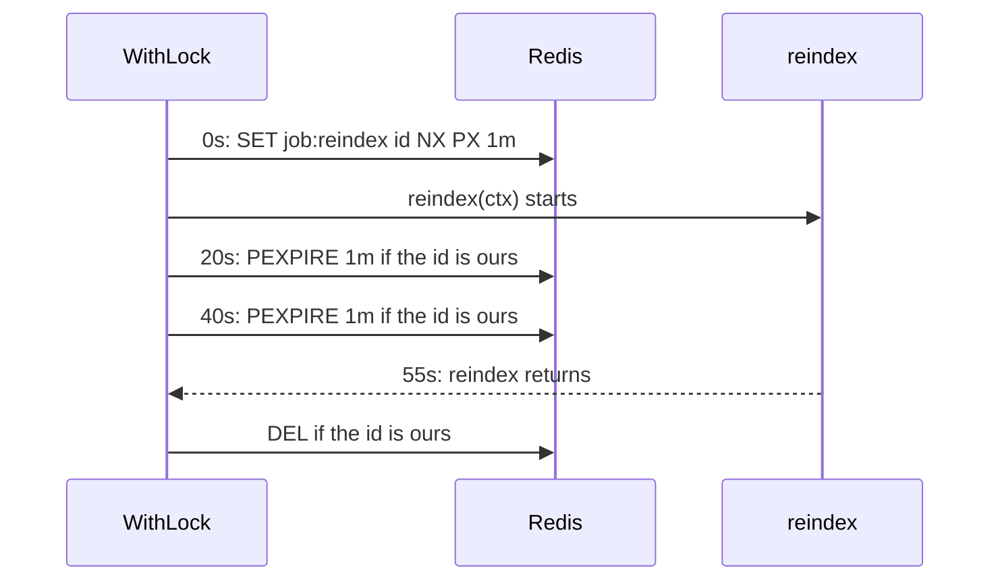

# Locks { #locks }

Some work must never run twice at once across pods: a daily report, a payment. A lock is a key in the
backend that holds the random id of its holder; it is shared by every process, and its TTL frees it
if the holder dies.

!!! danger
    Locks are advisory: a holder paused longer than the TTL (GC, a frozen VM) can overlap with the next
    one. Make writes that guard money idempotent too.

## `c.WithLock` { #cwithlock }

Runs a function while holding the lock, and keeps the lock as long as the function runs.

```go
err := c.WithLock(ctx, "job:reindex", time.Minute, func(ctx context.Context) error {
	return reindex(ctx)
})
```

**Default:** the only option is the TTL; `Options.LockPollInterval`, 100ms, sets how often a busy lock
is checked.

It takes the lock as `c.Lock` does, runs the function with a `ctx` of its own, extends the lock
every third of the TTL and releases it when the function returns.



| What | How |
|---|---|
| Returns | the error of the function |
| Errors | `ErrLockLost` - an extension failed, and the `ctx` of the function was cancelled. `ctx.Err()` - the wait ended first. `ErrInvalidTTL` - the TTL is not positive |
| Redis | as `c.Lock`, `lease.Extend` and `lease.Unlock` |

- **Example:** [examples/lock](https://github.com/eugeneliukindev/gashe/blob/main/examples/lock/main.go)

??? example "examples/lock/main.go"

    ```go
    --8<-- "examples/lock/main.go"
    ```

    Output:

    ```text
    --8<-- "docs/snippets/examples/lock.txt"
    ```

## `c.TryLock` { #ctrylock }

```go
lease, ok, err := c.TryLock(ctx, "job:reindex", time.Minute)
if err != nil || !ok {
	return err // the backend is down, or another pod runs the job: skip it
}
defer lease.Unlock(ctx)
```

Takes the lock if it is free, without waiting.

| What | How |
|---|---|
| Returns | `ok` is false and `lease` is nil while someone else holds it |
| Errors | as `c.Lock` |
| Redis | `SET key <random id> NX PX` |

## `c.Lock` { #clock }

```go
lease, err := c.Lock(ctx, "job:reindex", time.Minute)
defer lease.Unlock(ctx)
```

Takes the lock, waiting while someone else holds it; use it for a lock that outlives one function,
otherwise use `WithLock`.

| What | How |
|---|---|
| Returns | a `*gashe.Lease` |
| Errors | `ctx.Err()` - `ctx` ended first. `ErrInvalidTTL` - the TTL is not positive. Backend errors |
| Redis | `SET key <random id> NX PX`, every `LockPollInterval` while the lock is busy |

## `lease.Extend` { #leaseextend }

```go
err := lease.Extend(ctx, time.Minute)
```

Gives the lock a new TTL from now, if it is still yours.

| What | How |
|---|---|
| Errors | `ErrLockLost` - it expired, and someone else may hold it. `ErrInvalidTTL` - the TTL is not positive |
| Redis | a script that checks the holder id and runs `PEXPIRE` |

## `lease.Unlock` { #leaseunlock }

```go
err := lease.Unlock(ctx)
```

Releases the lock if it is still yours; it ignores the cancellation of `ctx`, so a finished request
does not leave the lock behind.

| What | How |
|---|---|
| Redis | a script that checks the holder id and runs `DEL` |

## `c.IsLocked` { #cislocked }

```go
locked, err := c.IsLocked(ctx, "job:reindex")
```

Reports whether someone holds the lock.

| What | How |
|---|---|
| Redis | `EXISTS` |
