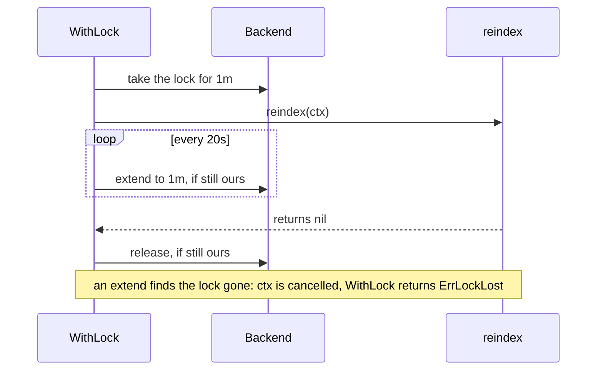
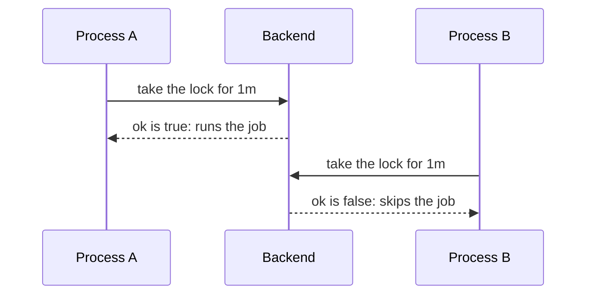

# Locks { #locks }

This page shows how you let one caller across all processes run work that must never run twice at
once, such as a daily report or a payment. In this section, we will go through
[`Cache.WithLock`](#cwithlock), [`Cache.TryLock`](#ctrylock), [`Cache.Lock`](#clock),
[`Lease.Extend`](#leaseextend), [`Lease.Unlock`](#leaseunlock) and [`Cache.IsLocked`](#cislocked).

## Run work under a lock { #cwithlock }

A job must never run twice at once, but every process may start it. With [`Cache.WithLock`](../reference/gashe.md#Cache.WithLock), you run the
function under a lock that one caller across all processes holds, and the lock is kept as long as
the function runs.

```go hl_lines="20-22"
--8<-- "examples/docs/locks/withlock/main.go"
```

With a TTL of one minute, the lock is extended every 20 seconds while `reindex` runs:



- The lock is shared by every process of the backend; its TTL frees it if the holder dies.
- It takes the lock as [`Cache.Lock`](../reference/gashe.md#Cache.Lock) does, runs the function with a `ctx` of its own, extends the lock
  every third of the TTL and releases it when the function returns.
- The TTL is the only option; [`Options.LockPollInterval`](../reference/gashe.md#Options), 100ms, sets how often a busy lock is
  tried again.
- It returns the error of the function, with these exceptions:
    - [`ErrLockLost`](../reference/gashe.md#variables): an extension found the lock gone, its `ctx` was cancelled, and the function
      returned nil or an error that wraps `context.Cause(ctx)`. A function that returns `ctx.Err()`
      gives `context.Canceled`. A backend error of an extension follows the same rule and is not
      turned into [`ErrLockLost`](../reference/gashe.md#variables).
    - `ctx.Err()`: the wait for the lock ended first.
    - [`ErrInvalidTTL`](../reference/gashe.md#variables): the TTL is not positive.
    - Backend errors while taking the lock.
- Unlock errors go to [`OnError`](../reference/gashe.md#Hooks).

!!! tip
    Pass the `ctx` that [`WithLock`](../reference/gashe.md#Cache.WithLock) gives the function to every call of the work: it is cancelled
    when the lock is lost, so the work stops before the next holder starts.

!!! warning
    Locks are advisory: a holder paused longer than the TTL (GC, a frozen VM) can overlap with the next
    one. Make writes that guard money idempotent too.

??? note "Technical details"
    - The lock is a key that holds the random id of its holder.
    - In Redis: as [`Cache.Lock`](../reference/gashe.md#Cache.Lock), [`Lease.Extend`](../reference/gashe.md#Lease) and [`Lease.Unlock`](../reference/gashe.md#Lease.Unlock).

```go hl_lines="20 26-27"
--8<-- "examples/lock/main.go"
```

---

## Skip work another process does { #ctrylock }

When another process already runs the job, waiting for it is pointless. With [`Cache.TryLock`](../reference/gashe.md#Cache.TryLock), you take
the lock if it is free, without waiting, and skip the work otherwise.

```go hl_lines="13-17"
--8<-- "examples/docs/locks/trylock/main.go"
```

1. The backend is down, or another process runs the job: skip it.

When two processes start the job at once, one takes the lock and the other skips:



- `ok` is false and `lease` is nil while someone else holds the lock.
- It returns [`ErrInvalidTTL`](../reference/gashe.md#variables) when the TTL is not positive, and backend errors.

??? note "Technical details"
    - In Redis: `SET key <random id> NX EX or PX`.

---

## Wait for a lock { #clock }

Sometimes a lock must outlive one function. With [`Cache.Lock`](../reference/gashe.md#Cache.Lock), you take the lock, waiting while someone
else holds it, and get a [`*gashe.Lease`](../reference/gashe.md#Lease) you release yourself; otherwise use [`WithLock`](../reference/gashe.md#Cache.WithLock).

```go hl_lines="13-17"
--8<-- "examples/docs/locks/lock/main.go"
```

1. The wait ended first, or the backend failed: there is no lease to release.

- It returns `ctx.Err()` when `ctx` ends first, [`ErrInvalidTTL`](../reference/gashe.md#variables) when the TTL is not positive, and
  backend errors.

!!! warning
    On an error, `lease` is nil: check `err` before you defer [`Lease.Unlock`](../reference/gashe.md#Lease).

??? note "Technical details"
    - In Redis: `SET key <random id> NX EX or PX`, every [`LockPollInterval`](../reference/gashe.md#Options) while the lock is busy.

---

## Keep a lock for long work { #leaseextend }

Your work takes longer than the TTL of the lock. With [`Lease.Extend`](../reference/gashe.md#Lease.Extend), you give the lock a new TTL
from now, if it is still yours.

```go hl_lines="21"
--8<-- "examples/docs/locks/extend/main.go"
```

- [`ErrLockLost`](../reference/gashe.md#variables): the lock expired, and someone else may hold it.
- It also returns [`ErrInvalidTTL`](../reference/gashe.md#variables) when the TTL is not positive, and backend errors.

!!! tip
    [`Cache.WithLock`](../reference/gashe.md#Cache.WithLock) extends the lock for you every third of its TTL: use [`Lease.Extend`](../reference/gashe.md#Lease.Extend) only with
    [`Cache.Lock`](../reference/gashe.md#Cache.Lock) or [`Cache.TryLock`](../reference/gashe.md#Cache.TryLock).

??? note "Technical details"
    - In Redis: a script that checks the holder id and runs `PEXPIRE`.

---

## Release a lock { #leaseunlock }

A lock left behind blocks others until its TTL ends. With [`Lease.Unlock`](../reference/gashe.md#Lease.Unlock), you release the lock if it
is still yours; it ignores the cancellation of `ctx`, so a finished request does not leave the lock
behind.

```go hl_lines="20"
--8<-- "examples/docs/locks/unlock/main.go"
```

- It returns backend errors.

??? note "Technical details"
    - In Redis: a script that checks the holder id and runs `DEL`.

---

## Check a lock { #cislocked }

With [`Cache.IsLocked`](../reference/gashe.md#Cache.IsLocked), you check whether someone holds the lock, without taking it.

```go hl_lines="20 22"
--8<-- "examples/docs/locks/islocked/main.go"
```

- It returns backend errors.

!!! warning
    The lock may be taken or freed right after the answer: to run the work only once, take the lock
    with [`Cache.TryLock`](../reference/gashe.md#Cache.TryLock) instead of checking first.

??? note "Technical details"
    - In Redis: `EXISTS`.
