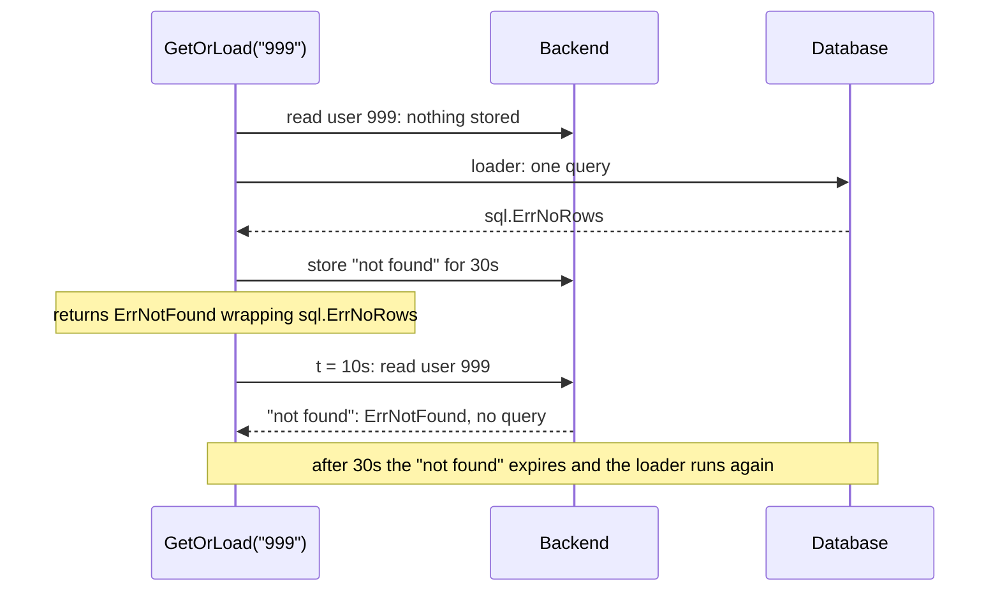

# Negative caching { #negative }

This page shows how you cache a "not found", so lookups of missing ids stop reaching the source.
In this section, we will go through [`Negative`](#negative-cache-not-found).

## `Policy.Negative` { #negative-cache-not-found }

Clients ask again and again for an id that does not exist, and every lookup reaches the database.
With `Negative`, you cache the "not found" for a short `Negative.TTL`, and every call gets
`gashe.ErrNotFound` meanwhile, without a query.

??? api "API documentation"

    [`gashe.Policy`](../reference/gashe.md#Policy)<br>
    [`gashe.Negative`](../reference/gashe.md#Negative)<br>

```go hl_lines="17-20"
--8<-- "examples/docs/negative/policy/main.go"
```

Here the first `GetOrLoad("999")` stores the "not found", lookups within 30 seconds get it without a
query, and after that the loader runs again:



**Options** (`gashe.Negative`):

| Field | Default | What it does |
|---|---|---|
| `IsNotFound` | nil: off | which loader errors mean "not found" |
| `TTL` | required with `IsNotFound` | how long the "not found" is cached; `TTL.Jitter` applies |

- The call gets `gashe.ErrNotFound`: wrapping the loader error when it loaded, so
  `errors.Is(err, sql.ErrNoRows)` holds too, and alone while the "not found" is cached. Check it
  with `errors.Is(err, gashe.ErrNotFound)`.
- `GetOrLoadMany` does not support it and returns `ErrInvalidOptions`; `httpcache.New` panics.
- With `Stale.IfError`, a "not found" is an answer, never a failure, whatever `IsFailure` says: it is returned and stored, never
  hidden by the stale result.
- With `Stampede.LockFor`, processes that waited for the lock take the "not found" the holder stored.
- `Reload` that gets a "not found" leaves the stored result alone, as any error does.

!!! tip
    Make `If` match only the error that means "does not exist": every other error stays a failure,
    which `Stale.IfError` may answer with the stale result.

!!! warning
    Data created meanwhile stays "not found" until `Negative.TTL` ends: keep it short, or delete the
    key when you create the data.

??? note "Technical details"
    - The "not found" is an entry of its own with `neg` set, stored for `Negative.TTL`, see
      [the GetOrLoad entry](../internals/storage.md#the-getorload-entry).

Three lookups of a user that does not exist. The two versions differ in the highlighted lines.

=== "With Negative"

    ```go hl_lines="22-25"
    --8<-- "examples/negative/with/main.go"
    ```

    The first lookup caches the "not found", the other two get it from the cache: 1 query.


    ```text title="In the backend"
    --8<-- "docs/snippets/backend/negative-with.txt"
    ```

=== "Without Negative"

    ```go
    --8<-- "examples/negative/without/main.go"
    ```

    Every lookup reaches the database, 3 queries.


    ```text title="In the backend"
    --8<-- "docs/snippets/backend/negative-without.txt"
    ```
