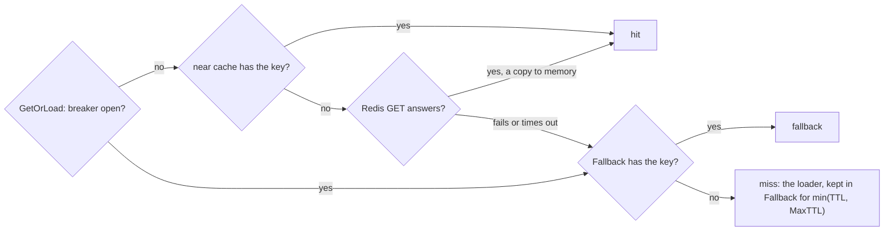
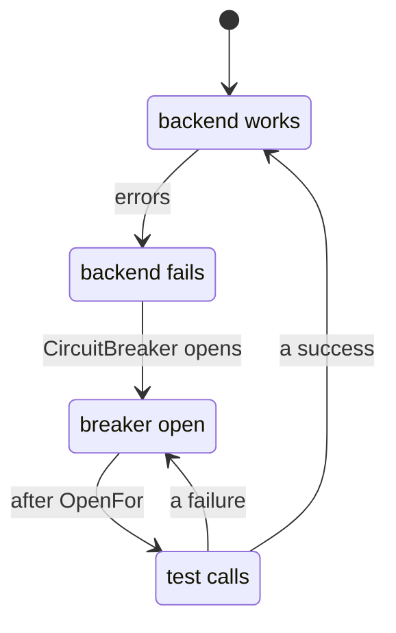

# Outages { #outages }

Keep answering while the cache backend is down.

## `CircuitBreaker`: keep working when the backend is down { #circuitbreaker-keep-working-when-the-backend-is-down }

```go
cacheBreaker := gashe.CircuitBreakerOptions{
	FailurePercent: 50,
	MinCalls:       20,
	Window:         10 * time.Second,
	OpenFor:        5 * time.Second,
}
```

Stops calling a failing backend for a while: calls fail at once with `ErrCircuitOpen`, and
`GetOrLoad` goes straight to the loader.

| What | How |
|---|---|
| Why | with the backend down, every call waits for its timeout before it goes to the loader |
| Without it | a failing backend never fails `GetOrLoad` or `RateLimit`; bound how long a slow Redis holds a request with go-redis `ReadTimeout` |
| Options | as in [`gashe.Guard`](breakers.md#gasheguard); a nil `IsFailure` here does not count a miss |
| `Ping` | not guarded |

!!! warning
    With the backend down, `LockOnMiss` no longer holds other pods back, and every pod sends its misses
    to the database. Put a breaker in front of the database for that case.

---

## `Fallback`: answer from memory while the backend is down { #fallback-answer-from-memory-while-the-backend-is-down }

```go
fallback := &gashe.FallbackOptions{
	Backend: memory.New(memory.Options{MaxBytes: 32 << 20}), // of its own; policies may share it
	MaxTTL:  30 * time.Second,
}
userCache := gashe.For(c, gashe.Policy[User]{TTL: time.Hour, Fallback: fallback})
```

While the backend fails or `Options.CircuitBreaker` is open, every load of the policy keeps its
result in `Fallback.Backend` and answers from it: one load per key and process, not one per call.

| What | How |
|---|---|
| Why | with the backend down, the database gets the traffic the cache took, often more than it can carry |
| Covers | `GetOrLoad`, `GetOrLoadMany`, `Reload` and `httpcache`; the `Result` is `fallback` |
| `MaxTTL` | only shortens: an entry lives the TTL of its policy, at most `MaxTTL`, since no invalidation reaches it; 0 means 30 seconds; set it per kind of data, shorter for rates than for users |
| The backend answers again | the fallback is no longer read, and its entries expire |
| Every pod | keeps its own entries, so pods may answer differently for up to `MaxTTL` |
| The basic API and locks | do not use it: they return the error, so a lock is never taken in the memory of one pod |

- **Example:** [examples/fallback](https://github.com/eugeneliukindev/gashe/blob/main/examples/fallback/main.go)

??? example "examples/fallback/main.go"

    ```go
    --8<-- "examples/fallback/main.go"
    ```

    Output:

    ```text
    --8<-- "docs/snippets/examples/fallback.txt"
    ```

Where a call looks; the breaker guards the whole backend given to `gashe.New`, so while it is open the
near cache is not read either.



| State | Near cache | Redis | Fallback | Loader |
|---|---|---|---|---|
| Redis works | read first | read on a local miss, written | not read | on a miss |
| Redis fails, breaker closed | read first | read, waits for the timeout | read after Redis fails | when Fallback has nothing |
| breaker open | not read | not called | read | once per key and process per `MaxTTL` |

How the backend goes from working to failing and back:


