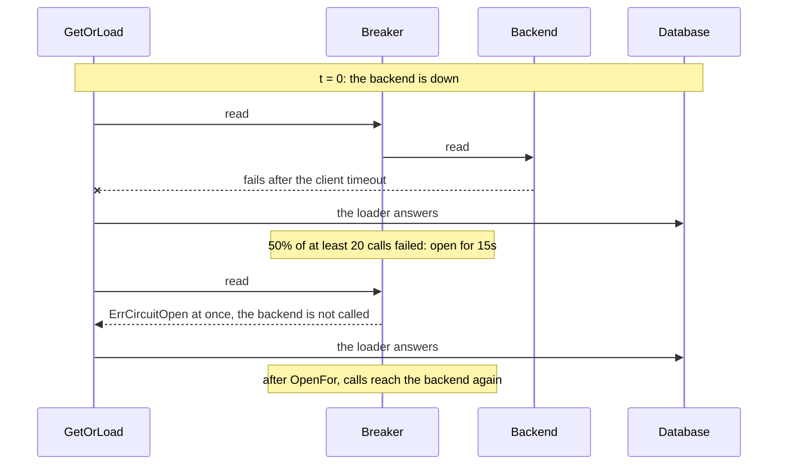
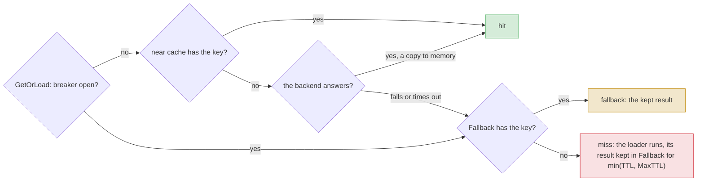

# When Redis is down { #outages }

This page shows how to keep answering while the cache backend is down. In this section, we will go
through [`CircuitBreaker`](#circuitbreaker) and
[`Fallback`](#fallback).

!!! note
    These keep the cache answering when its own backend fails. To guard your calls of a failing
    service, such as an external API, see [Protect a dependency](breakers.md).

## Stop calling a backend that is down { #circuitbreaker }

With the backend down, every call waits for its timeout before it goes to the loader. With
[`Options.CircuitBreaker`](../reference/gashe.md#Options), the cache stops calling a failing backend for a while: calls fail at once
with [`ErrCircuitOpen`](../reference/gashe.md#variables), and [`GetOrLoad`](../reference/gashe.md#GetOrLoad) goes straight to the loader.

```go hl_lines="1-6"
--8<-- "examples/docs/outages/circuit-breaker/main.go:example"
```

??? example "Full program"

    ```go
    --8<-- "examples/docs/outages/circuit-breaker/main.go"
    ```

With the options above, Redis stops at t = 0: until the breaker opens, every call waits for the
go-redis timeout; while it is open, calls fail at once.



- Under load, it opens about one [`Window`](../reference/gashe.md#CircuitBreaker) after the outage starts: the successes from before it must
  leave the window first.
- go-redis `ReadTimeout` does not bound a call to a stopped Redis: with `ReadTimeout` 100ms and the
  default `MaxRetries` (3) and `DialerRetries` (5), a call took about 2.1s.
- Without it, a failing backend never fails [`GetOrLoad`](../reference/gashe.md#GetOrLoad) or [`RateLimit`](../reference/gashe.md#Cache.RateLimit), but every call waits for
  go-redis to give up.
- A nil `IsFailure` here counts a passed `ctx` deadline as a failure, so a hung backend opens the
  breaker. It does not count a miss, [`ErrWrongType`](../reference/gashe.md#variables), a cancelled `ctx`, or a call whose `ctx` ended
  before it started.
- [`Ping`](../reference/gashe.md#Cache.Ping) is not guarded.
- The options are a [`gashe.CircuitBreaker`](../reference/gashe.md#CircuitBreaker), as in [`gashe.Guard`](breakers.md#gasheguard); its zero value means no breaker.

!!! tip
    Set `MaxRetries: -1` on the go-redis client: with `ReadTimeout` 100ms, a call to a stopped Redis
    then took about 0.5s instead of 2.1s to fail, in the window before the breaker opens.

!!! warning
    With the backend down, [`Stampede.LockFor`](../reference/gashe.md#Stampede) no longer holds other processes back, and every process sends
    its misses to the database. Put a breaker in front of the database for that case.

---

## Answer from the memory of the process { #fallback }

!!! version "Added in v0.5"

With the backend down, the database gets the traffic the cache took, often more than it can carry.
With [`Fallback`](../reference/gashe.md#Fallback), while the backend fails or [`Options.CircuitBreaker`](../reference/gashe.md#Options) is open, every load of the
policy keeps its result in [`Fallback.Backend`](../reference/gashe.md#Fallback) and answers from it: one load per key and process, not
one per call.

```go hl_lines="1-8"
--8<-- "examples/docs/outages/fallback/main.go:example"
```

1. A backend of its own; policies may share it.

??? example "Full program"

    ```go
    --8<-- "examples/docs/outages/fallback/main.go"
    ```

Where a call looks: the breaker guards the whole backend given to [`gashe.New`](../reference/gashe.md#New), so while it is open
the near cache is not read either.



- No invalidation reaches the fallback, so [`MaxTTL`](../reference/gashe.md#Fallback) only shortens the TTL.
- Each process keeps its own fallback entries, so processes may answer differently for up to
  [`MaxTTL`](../reference/gashe.md#Fallback).
- The basic API and locks do not use it: they return the error, so a lock is never taken in the
  memory of one process.
- It covers [`GetOrLoad`](../reference/gashe.md#GetOrLoad), [`GetOrLoadMany`](../reference/gashe.md#GetOrLoadMany), [`Reload`](../reference/gashe.md#Reload) and `httpcache`; the [`Result`](../reference/gashe.md#Result) is `fallback`.
- While Redis works, the fallback is not read. Once the backend answers again, the fallback is no
  longer read, and its entries expire.
- While Redis fails and the breaker is closed, each call still waits for the Redis timeout, then
  reads the fallback; the loader runs when the fallback has nothing.
- While the breaker is open, neither the near cache nor Redis is called: the fallback is read, and
  the loader runs once per key and process per `min(TTL, MaxTTL)`.

!!! tip
    Set [`MaxTTL`](../reference/gashe.md#Fallback) per kind of data, as long as a result may stay unchanged by invalidations: shorter
    for rates than for users.
