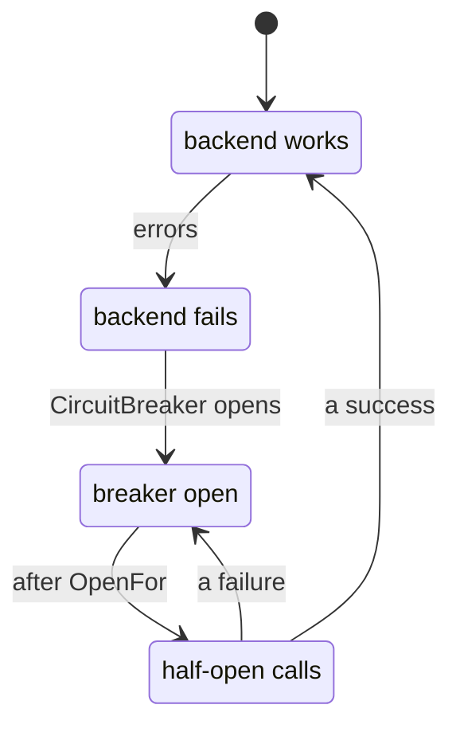
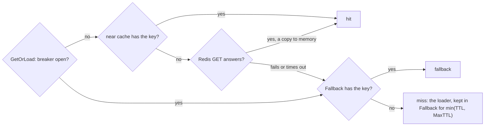

# Outages { #outages }

Keep answering while the cache backend is down.

## `CircuitBreaker`: keep working when the backend is down { #circuitbreaker-keep-working-when-the-backend-is-down }

Stops calling a failing backend for a while: calls fail at once with `ErrCircuitOpen`, and
`GetOrLoad` goes straight to the loader.

API: [`gashe.Options`](https://pkg.go.dev/github.com/eugeneliukindev/gashe#Options), [`gashe.CircuitBreakerOptions`](https://pkg.go.dev/github.com/eugeneliukindev/gashe#CircuitBreakerOptions)

```go
cacheBreaker := gashe.CircuitBreakerOptions{
	FailurePercent: 50,
	MinCalls:       20,
	Window:         10 * time.Second,
	OpenFor:        5 * time.Second,
}
```



| What | How |
|---|---|
| Why | with the backend down, every call waits for its timeout before it goes to the loader |
| Options | `Options.CircuitBreaker`, a `*gashe.CircuitBreakerOptions`, as in [`gashe.Guard`](breakers.md#gasheguard) |
| A nil `IsFailure` here | counts a passed `ctx` deadline as a failure, so a hung backend opens the breaker; does not count a miss, `ErrWrongType`, a cancelled `ctx`, or a call whose `ctx` ended before it started |
| When it opens | under load, about one `Window` after the outage starts: the successes from before it must leave the window first |
| Without it | a failing backend never fails `GetOrLoad` or `RateLimit`, but every call waits for go-redis to give up |
| A stopped Redis | go-redis `ReadTimeout` does not bound the call: with `ReadTimeout` 100ms and the default `MaxRetries` (3) and `DialerRetries` (5), a call took about 2.1s; with `MaxRetries: -1`, about 0.5s |
| `Ping` | not guarded |

!!! warning
    With the backend down, `LockOnMiss` no longer holds other processes back, and every process sends
    its misses to the database. Put a breaker in front of the database for that case.

---

## `Fallback`: answer from memory while the backend is down { #fallback-answer-from-memory-while-the-backend-is-down }

<span class="version-badge">Added in v0.5</span>

While the backend fails or `Options.CircuitBreaker` is open, every load of the policy keeps its
result in `Fallback.Backend` and answers from it: one load per key and process, not one per call.

API: [`gashe.Policy`](https://pkg.go.dev/github.com/eugeneliukindev/gashe#Policy), [`gashe.FallbackOptions`](https://pkg.go.dev/github.com/eugeneliukindev/gashe#FallbackOptions), [`gashe.ResultFallback`](https://pkg.go.dev/github.com/eugeneliukindev/gashe#ResultFallback)

```go
fallback := &gashe.FallbackOptions{
	Backend: memory.New(memory.Options{MaxBytes: 32 << 20}), // of its own; policies may share it
	MaxTTL:  30 * time.Second,
}
userCache := gashe.For(c, gashe.Policy[User]{TTL: time.Hour, Fallback: fallback})
```

Where a call looks; the breaker guards the whole backend given to `gashe.New`, so while it is open the
near cache is not read either.



**Options** (`gashe.FallbackOptions`):

| Field | Type | Default | What it does |
|---|---|---|---|
| `Backend` | `gashe.Backend` | required | keeps the results, usually a `memory.Backend` of its own; policies of one `Cache` may share it, a near cache or another `Cache` may not |
| `MaxTTL` | `time.Duration` | 0: 30 seconds | the longest a result stays in `Backend`: the TTL of its policy, but never longer |

| What | How |
|---|---|
| Why | with the backend down, the database gets the traffic the cache took, often more than it can carry |
| Covers | `GetOrLoad`, `GetOrLoadMany`, `Reload` and `httpcache`; the `Result` is `fallback` |
| `MaxTTL` | only shortens, since no invalidation reaches the fallback; set it per kind of data, shorter for rates than for users |
| The backend answers again | the fallback is no longer read, and its entries expire |
| Every process | has its own memory, so only Redis is shared: each keeps its own fallback entries, and processes may answer differently for up to `MaxTTL` |
| The basic API and locks | do not use it: they return the error, so a lock is never taken in the memory of one process |

| State | Near cache | Redis | Fallback | Loader |
|---|---|---|---|---|
| Redis works | read first | read on a local miss, written | not read | on a miss |
| Redis fails, breaker closed | read first | read, waits for the timeout | read after Redis fails | when Fallback has nothing |
| breaker open | not read | not called | read | once per key and process per `min(TTL, MaxTTL)` |

- **Example:** [examples/fallback](https://github.com/eugeneliukindev/gashe/tree/main/examples/fallback)

???+ example "examples/fallback: without and with Policy.Fallback"

    100 requests with Redis up, then 100 with Redis down. The two versions differ in the lines
    highlighted.

    === "With Fallback"

        ```go hl_lines="36 37 40"

        --8<-- "examples/fallback/with/main.go"

        ```

        Output: while Redis is down the first request loads into the fallback and the others read it: 1 query.

        ```text
        --8<-- "docs/snippets/examples/fallback-with.txt"
        ```

    === "Without Fallback"

        ```go

        --8<-- "examples/fallback/without/main.go"

        ```

        Output: while Redis is down every request goes to the database, 100 queries.

        ```text
        --8<-- "docs/snippets/examples/fallback-without.txt"
        ```
