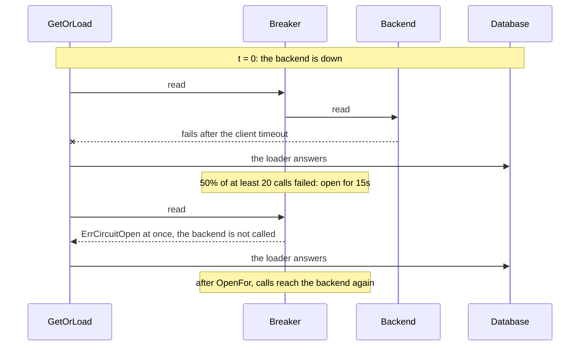
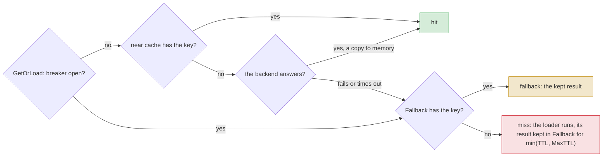

# Outages { #outages }

This page shows how to keep answering while the cache backend is down. In this section, we will go
through [`CircuitBreaker`](#circuitbreaker) and
[`Fallback`](#fallback).

!!! note
    These keep the cache answering when its own backend fails. To guard your calls of a failing
    service, such as an external API, see [Circuit breakers](breakers.md).

## `Options.CircuitBreaker` { #circuitbreaker }

With the backend down, every call waits for its timeout before it goes to the loader. With
`Options.CircuitBreaker`, the cache stops calling a failing backend for a while: calls fail at once
with `ErrCircuitOpen`, and `GetOrLoad` goes straight to the loader.

??? api "API documentation"

    [`gashe.Options`](../reference/gashe.md#Options)<br>
    [`gashe.CircuitBreaker`](../reference/gashe.md#CircuitBreaker)<br>

```go hl_lines="15-20"
--8<-- "examples/docs/outages/circuit-breaker/main.go"
```

With the options above, Redis stops at t = 0: until the breaker opens, every call waits for the
go-redis timeout; while it is open, calls fail at once.



- Under load, it opens about one `Window` after the outage starts: the successes from before it must
  leave the window first.
- go-redis `ReadTimeout` does not bound a call to a stopped Redis: with `ReadTimeout` 100ms and the
  default `MaxRetries` (3) and `DialerRetries` (5), a call took about 2.1s.
- Without it, a failing backend never fails `GetOrLoad` or `RateLimit`, but every call waits for
  go-redis to give up.
- A nil `IsFailure` here counts a passed `ctx` deadline as a failure, so a hung backend opens the
  breaker. It does not count a miss, `ErrWrongType`, a cancelled `ctx`, or a call whose `ctx` ended
  before it started.
- `Ping` is not guarded.
- The options are a `gashe.CircuitBreaker`, as in [`gashe.Guard`](breakers.md#gasheguard); its zero value means no breaker.

!!! tip
    Set `MaxRetries: -1` on the go-redis client: with `ReadTimeout` 100ms, a call to a stopped Redis
    then took about 0.5s instead of 2.1s to fail, in the window before the breaker opens.

!!! warning
    With the backend down, `Stampede.LockFor` no longer holds other processes back, and every process sends
    its misses to the database. Put a breaker in front of the database for that case.

---

## `Policy.Fallback` { #fallback }

!!! version "Added in v0.5"
With the backend down, the database gets the traffic the cache took, often more than it can carry.
With `Fallback`, while the backend fails or `Options.CircuitBreaker` is open, every load of the
policy keeps its result in `Fallback.Backend` and answers from it: one load per key and process, not
one per call.

??? api "API documentation"

    [`gashe.Policy`](../reference/gashe.md#Policy)<br>
    [`gashe.Fallback`](../reference/gashe.md#Fallback)<br>
    [`gashe.ResultFallback`](../reference/gashe.md#constants)<br>

```go hl_lines="20-27"
--8<-- "examples/docs/outages/fallback/main.go"
```

1. A backend of its own; policies may share it.

Where a call looks: the breaker guards the whole backend given to `gashe.New`, so while it is open
the near cache is not read either.



**Options** (`gashe.Fallback`):

| Field | Default | What it does |
|---|---|---|
| `Backend` | nil: no fallback | keeps the results, usually a `memory.Backend` of its own; policies of one `Cache` may share it, a near cache or another `Cache` may not |
| `MaxTTL` | 0: 30 seconds | the longest a result stays in `Backend`: the TTL of its policy, but never longer |

- No invalidation reaches the fallback, so `MaxTTL` only shortens the TTL.
- Each process keeps its own fallback entries, so processes may answer differently for up to
  `MaxTTL`.
- The basic API and locks do not use it: they return the error, so a lock is never taken in the
  memory of one process.
- It covers `GetOrLoad`, `GetOrLoadMany`, `Reload` and `httpcache`; the `Result` is `fallback`.
- While Redis works, the fallback is not read. Once the backend answers again, the fallback is no
  longer read, and its entries expire.
- While Redis fails and the breaker is closed, each call still waits for the Redis timeout, then
  reads the fallback; the loader runs when the fallback has nothing.
- While the breaker is open, neither the near cache nor Redis is called: the fallback is read, and
  the loader runs once per key and process per `min(TTL, MaxTTL)`.

!!! tip
    Set `MaxTTL` per kind of data, as long as a result may stay unchanged by invalidations: shorter
    for rates than for users.

100 requests while Redis is down. The two versions differ in the lines
highlighted.

=== "With Fallback"

    ```go hl_lines="25"
    --8<-- "examples/fallback/with/main.go"
    ```

    The first request loads into the fallback and the others read it: 1 query.


=== "Without Fallback"

    ```go
    --8<-- "examples/fallback/without/main.go"
    ```

    Every request goes to the database, 100 queries.

