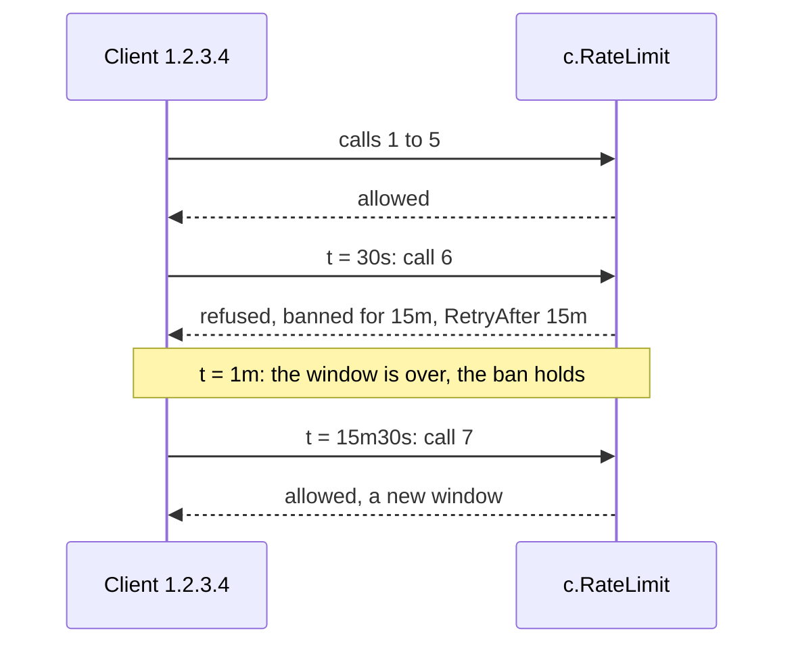

# Rate limiting { #rate-limits }

This page shows how you refuse calls over a limit, counted across all processes. In this section,
we will go through [`Cache.RateLimit`](#cratelimit) and [its requests and responses](#try-it-with-curl).

## `Cache.RateLimit` { #cratelimit }

A client calls far too often. With `Cache.RateLimit`, you count its calls across all processes and
refuse the ones over the limit.

??? api "API documentation"

    [`Cache.RateLimit`](../reference/gashe.md#Cache.RateLimit)<br>
    [`gashe.FixedWindow`](../reference/gashe.md#FixedWindow)<br>
    [`gashe.SlidingWindow`](../reference/gashe.md#SlidingWindow)<br>
    [`gashe.RateLimitError`](../reference/gashe.md#RateLimitError)<br>

```go hl_lines="23-31 33-37"
--8<-- "examples/docs/rate-limits/login/main.go"
```

**Options** (`gashe.SlidingWindow` and `gashe.FixedWindow`; `PerSecond(n)`, `PerMinute(n)` and
`PerHour(n)` make a `SlidingWindow`):

| Field | Default | What it does |
|---|---|---|
| `Calls` | required | `SlidingWindow`: about this many calls in any span of `Per`. `FixedWindow`: this many calls per window |
| `Per` | required | the span; for `FixedWindow`, the window, which starts with the first call |
| `BanFor` | 0: `Per` | `FixedWindow` only: how long the first call over the limit blocks the key |

- Every call names its limit; there is no default.
- Bursts: `SlidingWindow` is an estimate and can let slightly more through; `FixedWindow` can let
  twice `Calls` through at the border of two windows.
- `FixedWindow` counts with one counter per key that starts with the first call and lives `Per`;
  the first call over `Calls` blocks the key for `BanFor`, counted from that call.
- Over the limit, it returns a `*RateLimitError`: it is `ErrRateLimited` and has `RetryAfter`,
  which assumes no other calls come. A limit that cannot work gives `ErrInvalidOptions`.

With the `FixedWindow` above, the sixth call within a minute bans the key for 15 minutes, past the
end of the window:



!!! tip
    Call it before the work it guards, with a key of who calls: `"login:"+ip` for logins,
    `"api-key:"+key` for an API. Use `FixedWindow` with `BanFor` against password guessing, and
    `SlidingWindow` for a steady quota.

!!! warning
    When the backend fails, the call is let through, and the error goes to `OnError`: a limit does
    not hold while the backend is down.

??? note "Technical details"
    - `SlidingWindow` keeps a counter per span of `Per`. A call passes while the current counter
      plus the last one, weighted by how much of the last span still falls inside the last `Per`,
      stays within `Calls`. A refused call is not counted.
    - In Redis: `FixedWindow` runs `INCRBY __rate:fixed:<key>` with the TTL `Per`, then `PEXPIRE`
      to `BanFor` or `PTTL`. `SlidingWindow` runs `INCRBY` of the current span, `GET` of the last
      one, and `INCRBY -1` when the call is refused.

```go hl_lines="26 31 34"
--8<-- "examples/ratelimit/main.go"
```


```text title="In the backend"
--8<-- "docs/snippets/backend/ratelimit.txt"
```

---

### Requests and responses { #try-it-with-curl }

This server allows two calls a minute per client to `/login`, with
`FixedWindow{Calls: 2, Per: time.Minute, BanFor: 15 * time.Minute}`:

```go hl_lines="21-25"
--8<-- "examples/httpapi/login/main.go"
```

Three calls:

| Call | Counter | Response |
|---|---|---|
| 1 | 1 of 2 | `200` |
| 2 | 2 of 2 | `200` |
| 3 | over the limit: banned for 15 minutes | `429`, `Retry-After: 900` |

```bash title="Request"
--8<-- "docs/snippets/http/login-1.curl"
```

```http title="Response"
--8<-- "docs/snippets/http/login-1.http"
```

The third call:

```bash title="Request"
--8<-- "docs/snippets/http/login-3.curl"
```

```http title="Response"
--8<-- "docs/snippets/http/login-3.http"
```

```text title="In the backend"
--8<-- "docs/snippets/backend/login.txt"
```

One counter per client, under `__rate:fixed:`, one of the [own keys](../internals/storage.md#what-each-strategy-stores) of gashe.
