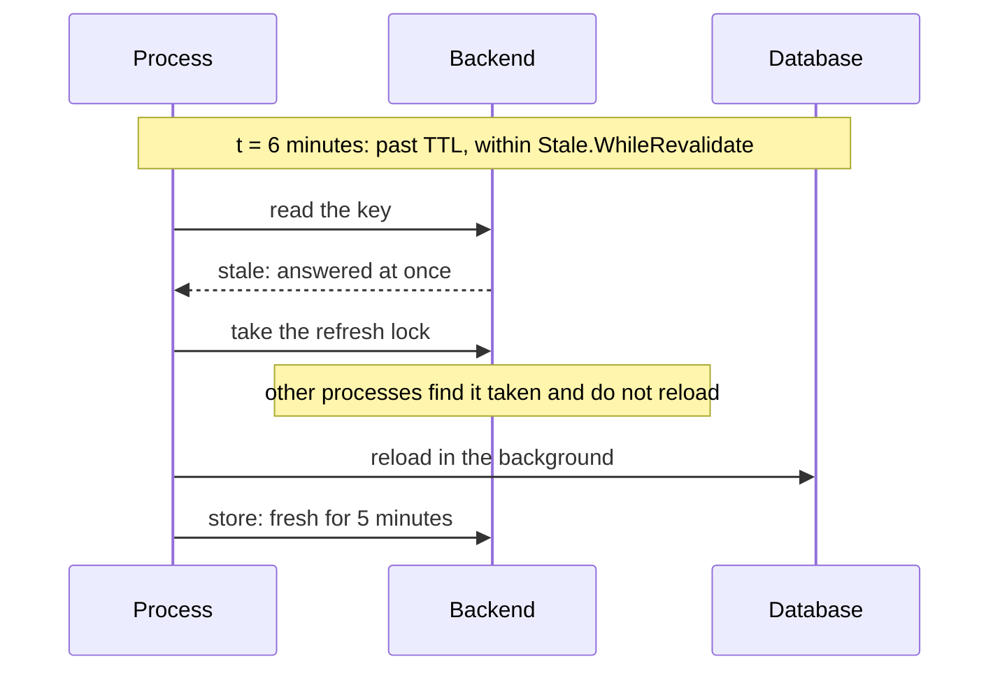

# Stale data { #stale }

This page shows how to answer a stale result while the source reloads, fails or is slow. In this
section, we will go through the [`Stale`](#stale-options) field of [`Policy`](../reference/gashe.md#Policy) and its three windows:
[`WhileRevalidate`](#stalewhilerevalidate), [`IfError`](#staleiferror-staleifslow) and
[`IfSlow`](#stale-ifslow).

## The windows of a stale result { #stale-options }

A result has just expired, and the call has to wait for the source, or fail with it. With [`Stale`](../reference/gashe.md#Stale),
you say when a result past its `TTL`, the stale result, still answers: at once while it reloads,
instead of a failing loader, or instead of a slow one. Each has its own window after `TTL`.

--8<-- "docs/snippets/lifecycle.html"

```go hl_lines="24-35"
--8<-- "examples/docs/stale/policy/main.go"
```

With the policy above, a call to a key goes through these windows, counted from when it was stored:

| Time | The entry is | A call gets |
|---|---|---|
| up to `TTL`, 1 minute | fresh | the stored result, a `hit` |
| up to `TTL + WhileRevalidate`, 11 minutes | stale | the stale result at once, `stale-while-revalidate`; one process reloads in the background. Checked first: within it, [`IfError`](../reference/gashe.md#StaleIfError) and [`IfSlow`](../reference/gashe.md#StaleIfSlow) do not apply |
| up to `TTL + IfSlow.For`, 1 hour 1 minute | stale | the loader runs: slower than [`IfSlow.After`](../reference/gashe.md#Stale), the stale result, `stale-if-slow`; a failure, the stale result, `stale-if-error` |
| up to `TTL + IfError.For`, 6 hours 1 minute | stale | the loader runs and is waited for: a failure, the stale result, `stale-if-error` |
| past the longest window | gone | a `miss`: the loader runs, and its error is returned |

- The entry is kept for `TTL` plus the longest of [`WhileRevalidate`](../reference/gashe.md#Stale), [`IfError.For`](../reference/gashe.md#Stale) and [`IfSlow.For`](../reference/gashe.md#Stale).
- [`IfError`](../reference/gashe.md#Stale) and [`IfSlow`](../reference/gashe.md#Stale) each work only within their own window: here, between 1 and 6 hours after
  `TTL` a slow loader is waited for, and only its error is answered by the stale result.
- [`GetOrLoadMany`](../reference/gashe.md#GetOrLoadMany) returns [`ErrInvalidOptions`](../reference/gashe.md#variables) for a policy with [`Stale`](../reference/gashe.md#Stale).

!!! tip
    Start with [`IfError`](../reference/gashe.md#Stale): it is what keeps your pages up while the source is down. Add
    [`WhileRevalidate`](../reference/gashe.md#Stale) for popular keys, and [`IfSlow`](../reference/gashe.md#Stale) when the source can hang.

One key past its TTL, while the database is slow and while it is down. The comments say what each
call returns; the versions differ in the lines highlighted.

=== "WhileRevalidate"

    ```go hl_lines="25"
    --8<-- "examples/stale/while-revalidate/main.go"
    ```

    Past the TTL the stale result answers at once, also while the database is slow or down; the reload runs in the background.

    ```text title="In the backend"
    --8<-- "docs/snippets/backend/stale-while-revalidate.txt"
    ```

=== "IfError"

    ```go hl_lines="25"
    --8<-- "examples/stale/if-error/main.go"
    ```

    Past the TTL a call waits for the slow loader, and the stale result answers its error.

    ```text title="In the backend"
    --8<-- "docs/snippets/backend/stale-if-error.txt"
    ```

=== "IfSlow"

    ```go hl_lines="25-28"
    --8<-- "examples/stale/if-slow/main.go"
    ```

    Past the TTL the stale result answers a loader slower than 100ms, which goes on in the background, and a loader error.

    ```text title="In the backend"
    --8<-- "docs/snippets/backend/stale-if-slow.txt"
    ```

=== "TTL only"

    ```go
    --8<-- "examples/stale/ttl-only/main.go"
    ```

    Past the TTL every call waits for the loader, and fails with it.

    ```text title="In the backend"
    --8<-- "docs/snippets/backend/stale-ttl-only.txt"
    ```

---

## Refresh in the background { #stalewhilerevalidate }

A popular key expires, and every request waits for the loader. With [`Stale.WhileRevalidate`](../reference/gashe.md#Stale), you
answer the stale result at once while one process reloads it in the background
([RFC 5861](https://www.rfc-editor.org/rfc/rfc5861#section-3)).

```go hl_lines="24"
--8<-- "examples/docs/stale/while-revalidate/main.go"
```

With the policy above, past 5 minutes every process answers the stale result at once, and only the
one that takes the refresh lock reloads.

| Time after the store | In the backend | A call gets |
|---|---|---|
| up to 5 minutes | the entry, fresh | `hit` |
| 5 to 35 minutes | the same entry, stale; `__refresh:<key>` while one process reloads | the stale result at once, `stale-while-revalidate`; the reload stores a new entry, fresh for 5 minutes again |
| past 35 minutes | nothing: Redis dropped the entry | `miss`: the call waits for the loader |



- It is checked first: within it, the call never waits for the loader, so [`IfError`](../reference/gashe.md#Stale) and [`IfSlow`](../reference/gashe.md#Stale)
  apply only past it.
- The reload can run after the request has ended, with the deadline
  `min(WhileRevalidate, 1 minute)`.
- When [`Stampede.MaxLoads`](../reference/gashe.md#Stampede) is full, the reload is skipped; the next call tries again.

!!! tip
    Make [`WhileRevalidate`](../reference/gashe.md#Stale) as long as old data is still fine to show: past `TTL` plus the longest
    window, the entry is gone, and the next call waits for the loader.

!!! warning
    Do not use an open transaction or other request-scoped resources in the loader: the reload
    outlives the request.

??? note "Technical details"

    In Redis, the refresh lock is `SET __refresh:<key> NX EX or PX`, held for
    `min(WhileRevalidate, 1 minute)`.

---

## Answer instead of an error { #staleiferror-staleifslow }

The source fails, and your users get errors. With [`Stale.IfError`](../reference/gashe.md#Stale), the stale result answers a
failing loader for `For` after `TTL`
([RFC 5861](https://www.rfc-editor.org/rfc/rfc5861#section-4)).

```go hl_lines="25-30"
--8<-- "examples/docs/stale/if-error/main.go"
```

With the policy above:

| Time after the store | In the backend | A call gets |
|---|---|---|
| up to 1 minute | the entry, fresh | `hit` |
| 1 minute to 6 hours 1 minute | the same entry, stale | the loader runs and is waited for: its result, `miss`, stored as a new entry; a failure, the stale result, `stale-if-error`, and the entry stays as it is |
| past 6 hours 1 minute | nothing: Redis dropped the entry | `miss`: the loader runs, and its error is returned |

- A failure is answered by the stale result, and the error goes to [`OnError`](../reference/gashe.md#Hooks).
- A "not found", an error [`Negative.IsNotFound`](../reference/gashe.md#Negative) accepts, is never a failure: it is returned as
  [`gashe.ErrNotFound`](../reference/gashe.md#ErrNotFound) and stored, never hidden by the stale result.
- When [`Stampede.MaxLoads`](../reference/gashe.md#Stampede) is full, the call does not wait for a slot: the stale result answers
  it, whatever `IsFailure` says.

!!! tip
    Add [`IfSlow`](#stale-ifslow) when the source can hang, not only fail: without it, every call
    waits for the loader before the stale result answers its error.

!!! warning
    A result can be up to `TTL + IfError.For` old. Do not use it where stale is wrong rather than
    late: permissions, balances, prices at checkout.

`IsFailure` picks which errors the stale result answers. Without it, every error does, so a row that
was deleted keeps showing until `TTL + IfError.For`.

---

## Answer instead of a slow loader { #stale-ifslow }

The source hangs, and every call waits for it. With [`Stale.IfSlow`](../reference/gashe.md#Stale), a call waits for the loader at
most [`After`](../reference/gashe.md#StaleIfSlow), then gets the stale result, for `For` after `TTL`; the load goes on in the background
and stores what it gets.

```go hl_lines="23-26"
--8<-- "examples/docs/stale/if-slow/main.go"
```

With the policy above:

| Time after the store | In the backend | A call gets |
|---|---|---|
| up to 1 minute | the entry, fresh | `hit` |
| 1 minute to 1 hour 1 minute | the same entry, stale; `__refresh:<key>` while a slow load goes on | a loader within 200ms: its result, `miss`, or its error; a slower one: the stale result, `stale-if-slow`, and the load stores its result in the background |
| past 1 hour 1 minute | nothing: Redis dropped the entry | `miss`: the call waits for the loader |

- Set both or neither: one without the other returns [`ErrInvalidOptions`](../reference/gashe.md#variables).
- It needs no [`IfError`](../reference/gashe.md#Stale), but answers only slowness: a loader that fails within [`After`](../reference/gashe.md#StaleIfSlow) gets its error
  returned, unless [`IfError`](../reference/gashe.md#Stale) covers it. `IsFailure` does not apply: there is no error yet.
- The slow load goes on in the background with a 1 minute deadline and stores its result;
  meanwhile other calls of the key get the stale result at once.

!!! tip
    Set [`After`](../reference/gashe.md#StaleIfSlow) a little above how long the source takes when it is fine, such as its p99: a slower
    call is a sign it hangs.

??? note "Technical details"

    In Redis, the slow load holds `__refresh:<key>`, taken with `SET __refresh:<key> NX EX or PX`.
