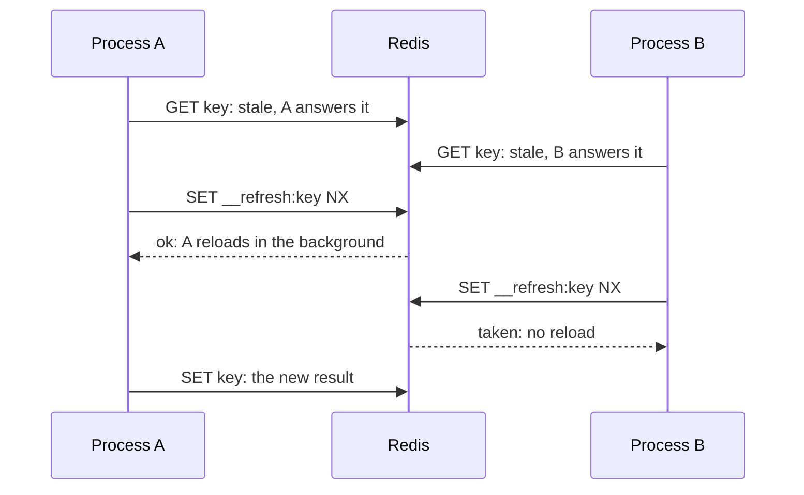
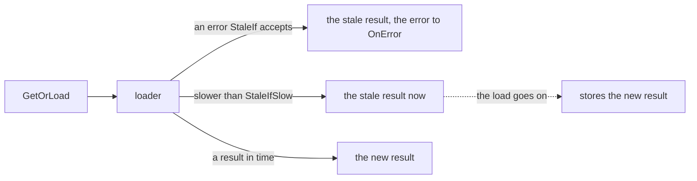

# Stale data { #stale }

Answer the stale result while the source reloads, fails or is slow.

## `StaleWhileRevalidate`: answer the stale result while reloading { #stalewhilerevalidate-answer-old-data-while-reloading }

For this long after `TTL`, every call gets the stale result at once, and one process reloads it in
the background ([RFC 5861](https://www.rfc-editor.org/rfc/rfc5861#section-3)).

API: [`gashe.Policy`](https://pkg.go.dev/github.com/eugeneliukindev/gashe#Policy)

```go
feedCache := gashe.For(c, gashe.Policy[[]Item]{TTL: 5 * time.Minute, StaleWhileRevalidate: 30 * time.Minute})
```



| Field | Type | Default | What it does |
|---|---|---|---|
| `StaleWhileRevalidate` | `time.Duration` | 0: off | how long after `TTL` the stale result is answered at once while one process reloads it in the background |

| What | How |
|---|---|
| Why | without it, every request for an expired popular key waits for the loader |
| Redis | `SET __refresh:<key> NX EX or PX` for the reload, for `min(StaleWhileRevalidate, 1 minute)` |
| The reload | runs after the request has ended, with the deadline `min(StaleWhileRevalidate, 1 minute)` |
| `MaxConcurrentLoads` full | the reload is skipped; the next call tries again |

!!! warning
    Do not use an open transaction or other request-scoped resources in the loader: the reload
    outlives the request.

- **Example:** [examples/stale](https://github.com/eugeneliukindev/gashe/tree/main/examples/stale)

???+ example "examples/stale: TTL only and each stale option"

    One key past its TTL, while the database is slow and while it is down. The versions differ
    in the lines highlighted.

    === "StaleWhileRevalidate"

        ```go hl_lines="28"

        --8<-- "examples/stale/while-revalidate/main.go"

        ```

        Output: past the TTL the stale result answers at once, also while the database is slow or down; the reload runs in the background.

        ```text
        --8<-- "docs/snippets/examples/stale-while-revalidate.txt"
        ```

    === "StaleIfError"

        ```go hl_lines="28"

        --8<-- "examples/stale/if-error/main.go"

        ```

        Output: past the TTL a call waits for the slow loader, and the stale result answers its error.

        ```text
        --8<-- "docs/snippets/examples/stale-if-error.txt"
        ```

    === "StaleIfSlow"

        ```go hl_lines="28 29"

        --8<-- "examples/stale/if-slow/main.go"

        ```

        Output: past the TTL the stale result answers a loader slower than 100ms, which goes on in the background, and a loader error.

        ```text
        --8<-- "docs/snippets/examples/stale-if-slow.txt"
        ```

    === "TTL only"

        ```go

        --8<-- "examples/stale/ttl-only/main.go"

        ```

        Output: past the TTL every call waits for the loader, and fails with it.

        ```text
        --8<-- "docs/snippets/examples/stale-ttl-only.txt"
        ```

---

## `StaleIfError`, `StaleIfSlow`: answer the stale result while the source fails { #staleiferror-staleifslow-answer-old-data-while-the-source-fails }

For `StaleIfError` after `TTL`, the stale result answers a failing or slow loader
([RFC 5861](https://www.rfc-editor.org/rfc/rfc5861#section-4)).

API: [`gashe.Policy`](https://pkg.go.dev/github.com/eugeneliukindev/gashe#Policy)

```go
rateCache := gashe.For(c, gashe.Policy[Rates]{
	TTL:          time.Minute,
	StaleIfError: 6 * time.Hour,
	StaleIf:      func(err error) bool { return errors.Is(err, ErrAPIDown) }, // nil = any error
	StaleIfSlow:  200 * time.Millisecond,                                     // needs StaleIfError
})
```



| Field | Type | Default | What it does |
|---|---|---|---|
| `StaleIfError` | `time.Duration` | 0: off | how long after `TTL` the stale result answers a loader error |
| `StaleIf` | `func(error) bool` | nil: any error | which loader errors `StaleIfError` covers |
| `StaleIfSlow` | `time.Duration` | 0: wait for the loader | how long a call waits for the loader before the stale result answers; needs `StaleIfError` |

| What | How |
|---|---|
| A "not found" | an error `Negative.If` accepts is an answer, not a failure: it is returned and stored, never hidden by the stale result |
| `StaleIfSlow`, the slow load | holds the `__refresh:<key>` lock and goes on in the background with a 1 minute deadline; meanwhile other calls get the stale result at once |
| `MaxConcurrentLoads` full | the call does not wait for a slot: its `ErrOverloaded` is answered by the stale result, unless `StaleIf` rejects it |

!!! warning
    A result can be up to `TTL + StaleIfError` old. Do not use it where stale is wrong rather than
    late: permissions, balances, prices at checkout.

- **Example:** [examples/stale](https://github.com/eugeneliukindev/gashe/tree/main/examples/stale)

???+ example "examples/stale: TTL only and each stale option"

    One key past its TTL, while the database is slow and while it is down. The versions differ
    in the lines highlighted.

    === "StaleWhileRevalidate"

        ```go hl_lines="28"

        --8<-- "examples/stale/while-revalidate/main.go"

        ```

        Output: past the TTL the stale result answers at once, also while the database is slow or down; the reload runs in the background.

        ```text
        --8<-- "docs/snippets/examples/stale-while-revalidate.txt"
        ```

    === "StaleIfError"

        ```go hl_lines="28"

        --8<-- "examples/stale/if-error/main.go"

        ```

        Output: past the TTL a call waits for the slow loader, and the stale result answers its error.

        ```text
        --8<-- "docs/snippets/examples/stale-if-error.txt"
        ```

    === "StaleIfSlow"

        ```go hl_lines="28 29"

        --8<-- "examples/stale/if-slow/main.go"

        ```

        Output: past the TTL the stale result answers a loader slower than 100ms, which goes on in the background, and a loader error.

        ```text
        --8<-- "docs/snippets/examples/stale-if-slow.txt"
        ```

    === "TTL only"

        ```go

        --8<-- "examples/stale/ttl-only/main.go"

        ```

        Output: past the TTL every call waits for the loader, and fails with it.

        ```text
        --8<-- "docs/snippets/examples/stale-ttl-only.txt"
        ```
