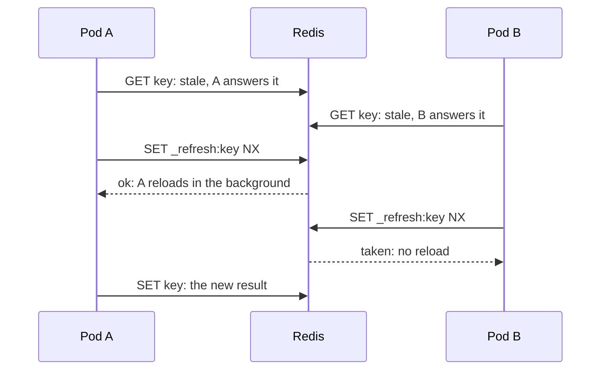

# Stale data { #stale }

Answer the last result while the source reloads, fails or is slow.

## `StaleWhileRevalidate`: answer old data while reloading { #stalewhilerevalidate-answer-old-data-while-reloading }

```go
feedCache := gashe.For(c, gashe.Policy[[]Item]{TTL: 5 * time.Minute, StaleWhileRevalidate: 30 * time.Minute})
```

For this long after `TTL`, every call gets the old result at once, and one pod reloads it in the
background ([RFC 5861](https://www.rfc-editor.org/rfc/rfc5861#section-3)).



| What | How |
|---|---|
| Why | without it, every request for an expired popular key waits for the loader |
| Redis | `SET _refresh:<key> NX PX` for the reload |
| The reload | runs after the request has ended, with a one-minute deadline |

- **Example:** [examples/stale](https://github.com/eugeneliukindev/gashe/blob/main/examples/stale/main.go)

??? example "examples/stale/main.go"

    ```go
    --8<-- "examples/stale/main.go"
    ```

    Output:

    ```text
    --8<-- "docs/snippets/examples/stale.txt"
    ```

!!! danger
    Do not use an open transaction or other request-scoped resources in the loader: the reload
    outlives the request.

---

## `StaleIfError`, `StaleIfSlow`: answer old data while the source fails { #staleiferror-staleifslow-answer-old-data-while-the-source-fails }

```go
rateCache := gashe.For(c, gashe.Policy[Rates]{
	TTL:          time.Minute,
	StaleIfError: 6 * time.Hour,
	StaleIf:      func(err error) bool { return errors.Is(err, ErrAPIDown) }, // nil = any error
	StaleIfSlow:  200 * time.Millisecond,                                     // needs StaleIfError
})
```

For `StaleIfError` after `TTL`, the old result answers a failing or slow loader
([RFC 5861](https://www.rfc-editor.org/rfc/rfc5861#section-4)).


| Field | Default | What it does |
|---|---|---|
| `StaleIfError` | 0: off | how long after `TTL` the old result may answer a failure |
| `StaleIf` | nil: any error | which loader errors count as a failure |
| `StaleIfSlow` | 0: wait for the loader | how long to wait for the loader before the old result answers; while the load runs, other calls get the old result too |

- **Example:** [examples/stale](https://github.com/eugeneliukindev/gashe/blob/main/examples/stale/main.go)

??? example "examples/stale/main.go"

    ```go
    --8<-- "examples/stale/main.go"
    ```

    Output:

    ```text
    --8<-- "docs/snippets/examples/stale.txt"
    ```

!!! warning
    A result can be up to `TTL + StaleIfError` old. Do not use it where old is wrong rather than late:
    permissions, balances, prices at checkout.
