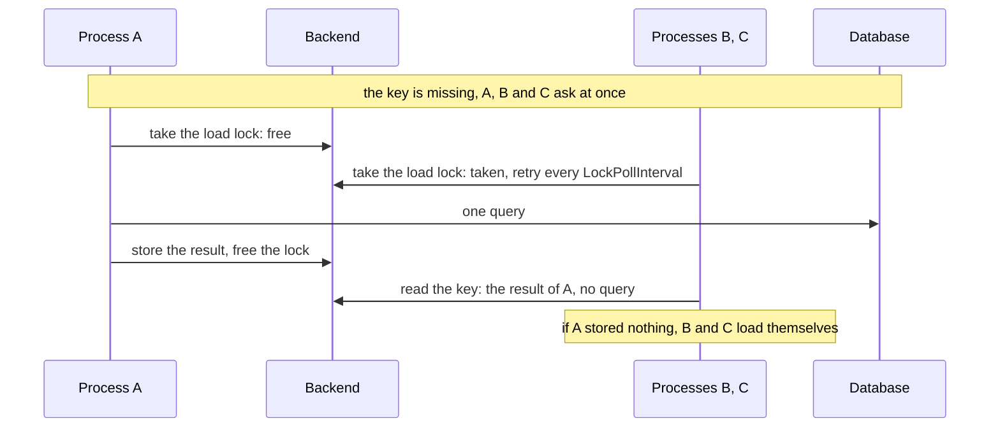

# Stampedes { #stampedes }

This page shows how to keep many calls for cold or expiring keys from reaching the source at once.
In this section, we will go through the [`Stampede`](#stampede) field of `Policy` and its three
parts: [`SingleFlight`](#singleflight), [`LockFor`](#lockonmiss) and
[`MaxLoads`](#maxconcurrentloads), then [`TTL.Jitter`](#jitter).

## `Policy.Stampede` { #stampede }

A cold key is asked for by a thousand calls in ten processes at once, and each would send its own
query. With `Stampede`, you say how calls share loads: within the process, across processes, and
how many run at once.

??? api "API documentation"

    [`gashe.Stampede`](../reference/gashe.md#Stampede)<br>

```go hl_lines="22-26"
--8<-- "examples/docs/stampedes/policy/main.go"
```

| Field | Default | What it does |
|---|---|---|
| [`SingleFlight`](#singleflight) | false: off | concurrent calls for one key in this process share one lookup and one load |
| [`LockFor`](#lockonmiss) | 0: off | one process loads a missing key under a lock held at most this long, the others wait for its result |
| [`MaxLoads`](#maxconcurrentloads) | 0: no limit | how many loads of this kind of data run at once in this process |

- They work together: with `SingleFlight`, the calls of a process share one load first, and only
  that load takes the lock of `LockFor`; that load takes one slot of `MaxLoads`.
- `GetOrLoadMany` takes one slot of `MaxLoads` per batch. It never shares a load, so
  `SingleFlight` changes nothing there, and `LockFor` returns `ErrInvalidOptions`.

---

## `Stampede.SingleFlight` { #singleflight }

A thousand requests ask for one key at once, and each would send its own query. With
`Stampede.SingleFlight`, concurrent calls for one key and type in a process share one lookup and
one load, and all of them get its result. Across processes, [`LockFor`](#lockonmiss) does the same.

??? api "API documentation"

    [`gashe.Stampede`](../reference/gashe.md#Stampede)<br>

```go hl_lines="20"
--8<-- "examples/stampede/main.go"
```

| Field | Default | What it does |
|---|---|---|
| `SingleFlight` | false: every call loads | concurrent calls for one key in this process share one lookup and one load |

- The shared load runs with the `ctx` values of the call that started it, but not with its
  deadline: it ends once the last waiting call has left.
- A call that leaves by its `ctx` gets the `ctx` error; the others keep waiting.
- `GetOrLoadMany` never shares a load.

!!! warning
    If the loader reads from `ctx` what the key does not name, such as the user of the request,
    every caller gets the result loaded for the first one: put it in the key, or leave
    `Stampede.SingleFlight` off.

---

## `Stampede.LockFor` { #lockonmiss }

A key misses in ten processes at once, and each sends the same query to the database. With
`Stampede.LockFor`, one process loads and the others wait for its result.

??? api "API documentation"

    [`gashe.Stampede`](../reference/gashe.md#Stampede)<br>

```go hl_lines="22"
--8<-- "examples/docs/stampedes/lock-for/main.go"
```

Three processes miss one key at once: A takes the lock and sends the one query, B and C
wait, then read the result of A.



| Field | Default | What it does |
|---|---|---|
| `LockFor` | 0: off | the longest the load lock is held: one process loads a miss, the others wait |

- Waiting processes try again every `LockPollInterval`, as long as their `ctx` allows. With the lock,
  they read the key once: a result or a "not found" the holder stored answers, otherwise they load.
- If the backend cannot lock, the call loads without the lock, and the error goes to `OnError`.
- Without it, every process loads. Set `Stampede.SingleFlight` with it, so the calls of a process
  share one load and only that load takes the lock.

!!! tip
    Make `Stampede.LockFor` longer than your slowest load: once the lock runs out, the next process loads
    as well.

??? note "Technical details"

    In Redis, the load lock is `SET __load:<key> NX EX or PX`, tried again every
    `LockPollInterval`.

One process of a service, run three times at once; each has its own memory, only Redis is shared.

=== "With Stampede.LockFor"

    ```go hl_lines="28"
    --8<-- "examples/lockfor/with/main.go"
    ```

    One process loads, the other two read its result, 1 query in all.


=== "Without Stampede.LockFor"

    ```go
    --8<-- "examples/lockfor/without/main.go"
    ```

    Every process loads, 3 queries in all.


---

## `Stampede.MaxLoads` { #maxconcurrentloads }

!!! version "Added in v0.5"
A thousand cold keys after a deploy, or with the cache down, send a thousand queries at once;
sharing a load and `Fallback` only help with one key. With `Stampede.MaxLoads`, at most this many
loads of one kind of data, its type and `Prefix`, run at once in one `*gashe.Cache`.

??? api "API documentation"

    [`gashe.Policy`](../reference/gashe.md#Policy)<br>
    [`gashe.ErrOverloaded`](../reference/gashe.md#variables)<br>

```go hl_lines="23"
--8<-- "examples/docs/stampedes/max-loads/main.go"
```

1. At most 20 loads of users at once in this process.

| Field | Default | What it does |
|---|---|---|
| `MaxLoads` | 0: no limit | how many loads of this kind of data run at once in one `*gashe.Cache` |

- The slots live in the `*gashe.Cache`: two caches in one process have separate limits, and 10
  processes let up to 10 times as many loads reach the source.
- With every slot taken, a call with a stale result within any window of `Stale` (`IfError.For` or
  `IfSlow.For`, whatever `IsFailure` says) gets it at once; any other call waits for a slot, and gets
  `ErrOverloaded` if its `ctx` ends first.
- A background reload over the limit is skipped; the next call tries again.
- `httpcache` answers a request held back with `503`.

!!! tip
    Set `Stale.IfError` or `Stale.IfSlow` with it, as above: a call over the limit then gets the stale
    result at once instead of waiting for a slot.

!!! warning
    The slots are made with the value of the first load of the kind: a second policy for the same
    type and `Prefix` with another value does not change the limit. Use the same value everywhere.

!!! warning
    The wait has no limit but `ctx`: a call without a deadline waits until a slot frees, however long
    the queue, and every waiting call holds its request and memory. Give requests a deadline, such as
    `http.TimeoutHandler` or `context.WithTimeout`, so calls over the limit get `ErrOverloaded`
    instead of piling up; `http.Server.WriteTimeout` does not end the `ctx` of a request.

---

## `TTL.Jitter` { #jitter }

Keys stored together expire together, and their loads hit the source at the same second. With
`TTL.Jitter`, every TTL is spread randomly by up to this share.

??? api "API documentation"

    [`gashe.Policy`](../reference/gashe.md#Policy)<br>

```go hl_lines="21"
--8<-- "examples/docs/stampedes/jitter/main.go"
```

| Field | Default | What it does |
|---|---|---|
| `TTL.Jitter` | 0: off | spreads every TTL randomly by up to this share: 0.1 is +-10% |

- With 1000 keys stored at once and a TTL of 1h, `Jitter: 0` makes all of them expire at 60m: 1000
  loads in a second. `Jitter: 0.2` spreads them from 48m to 72m: about one load every 1.5 seconds.
