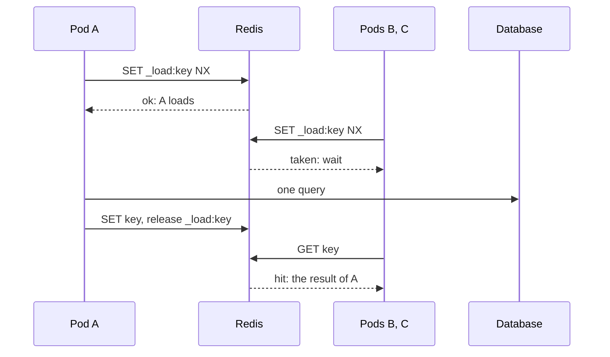

# Stampedes { #stampedes }

Keep many calls for cold or expiring keys from reaching the source at once.

## `LockOnMiss`: one load for all pods { #lockonmiss-one-load-for-all-pods }

```go
statsCache := gashe.For(c, gashe.Policy[Stats]{TTL: 10 * time.Minute, LockOnMiss: time.Minute})
```

On a miss, one pod loads and the others wait for its result.



| What | How |
|---|---|
| Value | the longest the lock is held; make it longer than the slowest load |
| Waiting pods | read the key every `LockPollInterval`, as long as their `ctx` allows |
| Without it | every pod loads; calls within one pod share a load anyway |

- **Example:** [examples/stampede](https://github.com/eugeneliukindev/gashe/blob/main/examples/stampede/main.go)

??? example "examples/stampede/main.go"

    ```go
    --8<-- "examples/stampede/main.go"
    ```

    Output:

    ```text
    --8<-- "docs/snippets/examples/stampede.txt"
    ```

---

## `MaxConcurrentLoads`: protect the source from too many loads at once { #maxconcurrentloads-protect-the-source-from-too-many-loads-at-once }

```go
userCache := gashe.For(c, gashe.Policy[User]{
	TTL:                time.Hour,
	StaleIfError:       time.Hour,
	MaxConcurrentLoads: 20, // at most 20 loads of users at once in this process
})
```

At most this many loads of one kind of data, its type and `Prefix`, run at once in a process.


| What | How |
|---|---|
| Why | a thousand cold keys after a deploy, or with the cache down, send a thousand queries at once; sharing a load and `Fallback` only help with one key |
| A background reload over the limit | is skipped; the next call tries again |
| Per process | with 10 pods, up to 10 times as many loads reach the source; use one value per kind of data |
| `httpcache` | answers a request held back with `503` |

!!! warning
    The wait has no limit but `ctx`: a call without a deadline waits until a slot frees, however long
    the queue, and every waiting call holds its request and memory. Give requests a deadline, such as
    `http.Server.WriteTimeout` or `context.WithTimeout`, so calls over the limit get `ErrOverloaded`
    instead of piling up.

---

## `Jitter`: spread expiry { #jitter-spread-expiry }

```go
gashe.Policy[Product]{TTL: time.Hour, Jitter: 0.2} // 48 to 72 minutes each
```

Spreads every TTL randomly by up to this share, so keys stored together do not expire together.

| 1000 keys stored at once, TTL 1h | Expire | Loads |
|---|---|---|
| `Jitter: 0` | all at 60m | 1000 in a second |
| `Jitter: 0.2` | spread from 48m to 72m | about one every 1.5 seconds |
