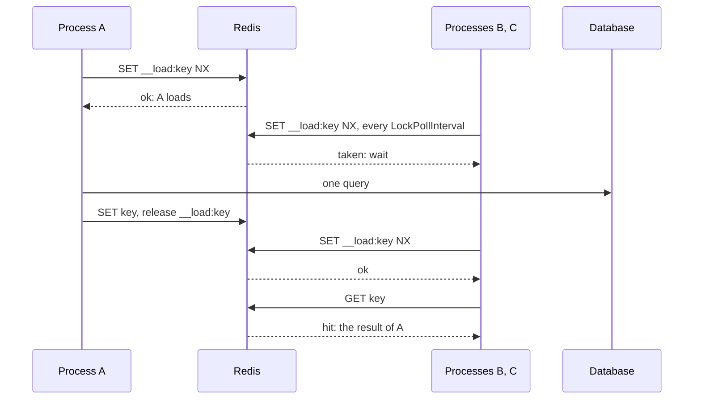
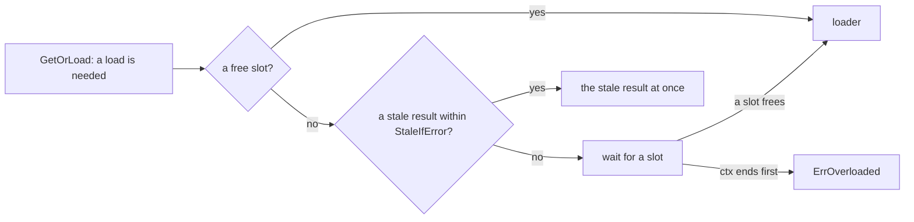

# Stampedes { #stampedes }

Keep many calls for cold or expiring keys from reaching the source at once.

## `LockOnMiss`: one load for all processes { #lockonmiss-one-load-for-all-processes }

On a miss, one process loads and the others wait for its result.

API: [`gashe.Policy`](https://pkg.go.dev/github.com/eugeneliukindev/gashe#Policy)

```go
statsCache := gashe.For(c, gashe.Policy[Stats]{TTL: 10 * time.Minute, LockOnMiss: time.Minute})
```



| Field | Type | Default | What it does |
|---|---|---|---|
| `LockOnMiss` | `time.Duration` | 0: off | the longest the load lock is held: one process loads a miss, the others wait |

| What | How |
|---|---|
| Value | make it longer than the slowest load |
| Waiting processes | retry `SET __load:<key> NX` every `LockPollInterval`, as long as their `ctx` allows; with the lock, they read the key once: a result or a "not found" the holder stored answers, otherwise they load |
| The backend cannot lock | the call loads without the lock; the error goes to `OnError` |
| Without it | every process loads; calls within one process share a load anyway |

- **Example:** [examples/lockonmiss](https://github.com/eugeneliukindev/gashe/tree/main/examples/lockonmiss):
  one process of a service, run three times at once; each has its own memory, only Redis is shared.

???+ example "examples/lockonmiss"

    === "With LockOnMiss"

        ```go hl_lines="30"
        --8<-- "examples/lockonmiss/with/main.go"
        ```

        Output: one process loads, the other two read its result, 1 query in all.

        ```text
        --8<-- "docs/snippets/examples/lockonmiss-with.txt"
        ```

    === "Without LockOnMiss"

        ```go
        --8<-- "examples/lockonmiss/without/main.go"
        ```

        Output: every process loads, 3 queries in all.

        ```text
        --8<-- "docs/snippets/examples/lockonmiss-without.txt"
        ```

---

## `MaxConcurrentLoads`: protect the source from too many loads at once { #maxconcurrentloads-protect-the-source-from-too-many-loads-at-once }

<span class="version-badge">Added in v0.5</span>

At most this many loads of one kind of data, its type and `Prefix`, run at once in one
`*gashe.Cache`.

API: [`gashe.Policy`](https://pkg.go.dev/github.com/eugeneliukindev/gashe#Policy), [`gashe.ErrOverloaded`](https://pkg.go.dev/github.com/eugeneliukindev/gashe#ErrOverloaded)

```go hl_lines="4"
userCache := gashe.For(c, gashe.Policy[User]{
	TTL:                time.Hour,
	StaleIfError:       time.Hour,
	MaxConcurrentLoads: 20, // at most 20 loads of users at once in this process
})
```



| Field | Type | Default | What it does |
|---|---|---|---|
| `MaxConcurrentLoads` | `int` | 0: no limit | how many loads of this kind of data run at once in one `*gashe.Cache` |

| What | How |
|---|---|
| Why | a thousand cold keys after a deploy, or with the cache down, send a thousand queries at once; sharing a load and `Fallback` only help with one key |
| A background reload over the limit | is skipped; the next call tries again |
| Per `*gashe.Cache` | its slots live in the `Cache`: two caches in one process have separate limits, and 10 processes let up to 10 times as many loads reach the source |
| One value per kind | the slots are made with the value of the first load of the kind; use the same value everywhere |
| `httpcache` | answers a request held back with `503` |

!!! warning
    The wait has no limit but `ctx`: a call without a deadline waits until a slot frees, however long
    the queue, and every waiting call holds its request and memory. Give requests a deadline, such as
    `http.TimeoutHandler` or `context.WithTimeout`, so calls over the limit get `ErrOverloaded`
    instead of piling up; `http.Server.WriteTimeout` does not end the `ctx` of a request.

---

## `Jitter`: spread expiry { #jitter-spread-expiry }

Spreads every TTL randomly by up to this share, so keys stored together do not expire together.

API: [`gashe.Policy`](https://pkg.go.dev/github.com/eugeneliukindev/gashe#Policy)

```go
gashe.Policy[Product]{TTL: time.Hour, Jitter: 0.2} // 48 to 72 minutes each
```

| Field | Type | Default | What it does |
|---|---|---|---|
| `Jitter` | `float64`, 0 to less than 1 | 0: off | spreads every TTL randomly by up to this share: 0.1 is +-10% |

| 1000 keys stored at once, TTL 1h | Expire | Loads |
|---|---|---|
| `Jitter: 0` | all at 60m | 1000 in a second |
| `Jitter: 0.2` | spread from 48m to 72m | about one every 1.5 seconds |
