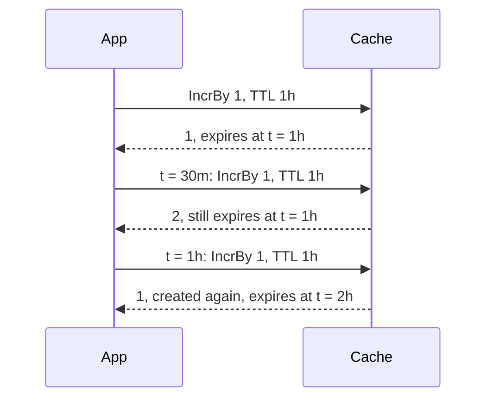

# Values and counters { #values-keys-and-counters }

This page shows how you store and read plain values by key, walk keys by pattern and keep
counters, without a `Policy`. In this section, we will go through [values by key](#values-by-key)
and [keys and counters](#keys-and-counters).

## Values by key { #values-by-key }

The basic API takes plain values and a TTL in every call, with no `Policy`.

!!! warning
    It does not read entries of `GetOrLoad`: keep one key on one side.

```go hl_lines="18 21"
--8<-- "examples/basic/main.go"
```

| Method | What it does |
|---|---|
| [`Cache.Set`](../reference/gashe.md#Cache.Set) | stores a value with a TTL, replacing the entry and its TTL |
| [`Cache.SetIfAbsent`](../reference/gashe.md#Cache.SetIfAbsent) | stores only if the key has no entry, so the first of two processes wins; returns whether it stored |
| [`Cache.SetIfPresent`](../reference/gashe.md#Cache.SetIfPresent) | stores only if the key has an entry, so an expired or deleted key does not come back |
| [`Cache.SetMany`](../reference/gashe.md#Cache.SetMany) | stores many values with one TTL in one call |
| [`Cache.Get`](../reference/gashe.md#Cache.Get) | decodes the stored value into `dst`: `ErrNotFound` on a miss |
| [`Cache.GetMany`](../reference/gashe.md#Cache.GetMany) | reads many keys in one call: one `Value` per key, in order, not found for a missing key |
| [`Cache.Delete`](../reference/gashe.md#Cache.Delete) | deletes the key as it is, without `Policy.Prefix`; returns whether it existed |
| [`Cache.DeleteMany`](../reference/gashe.md#Cache.DeleteMany) | deletes many keys in one call; missing keys are fine |

- A TTL of 0 means no expiry; a negative TTL returns `ErrInvalidTTL`.
- `ErrWrongType`: a Redis key that is not a string, such as a hash.

!!! tip
    To delete an entry of `GetOrLoad` under its `Policy.Prefix`, use
    [`Cached.Delete`](invalidation.md#cacheddelete).

---

## Keys and counters { #keys-and-counters }

Patterns are Redis globs: `*`, `?`, `[abc]`, `[^a]`, `[a-z]`, `\` to escape.

```go hl_lines="24 30"
--8<-- "examples/docs/values/keys-counters/main.go"
```

| Method | What it does |
|---|---|
| [`Cache.Keys`](../reference/gashe.md#Cache.Keys) | walks every key that matches the pattern, without `Options.Prefix`; it may yield a key twice |
| [`Cache.All`](../reference/gashe.md#Cache.All) | walks every live value whose key matches the pattern |
| [`Cache.DeleteMatch`](../reference/gashe.md#Cache.DeleteMatch) | deletes every key that matches the pattern, never past `Options.Prefix` |
| [`Cache.IncrBy`](../reference/gashe.md#Cache.IncrBy) | adds `by` to the integer under the key, created from 0, and returns the new value |
| [`Cache.Exists`](../reference/gashe.md#Cache.Exists) | whether the key has a live entry |
| [`Cache.Expire`](../reference/gashe.md#Cache.Expire) | gives the key a new TTL from now; returns whether it existed |
| [`Cache.TTL`](../reference/gashe.md#Cache.TTL) | the time the key has left, `gashe.NoExpiry` without a TTL, `ErrNotFound` for a missing key |

!!! warning
    `Cache.Keys`, `Cache.All` and `Cache.DeleteMatch` walk the whole database: on large backends, use tags.

The TTL of `Cache.IncrBy` applies only when the counter is created: with one hour, the counter lives one
hour from its first call, however often it is raised.



- `Cache.IncrBy` returns `ErrWrongType` when the value is not an integer, and an error on int64
  overflow.
- A failure of `Cache.Keys` or `Cache.All` is yielded once, and the scan stops.

??? note "Technical details"
    | Method | In Redis |
    |---|---|
    | `Cache.Set`, `Cache.SetMany` | `SET`, with `EX` or `PX` for a TTL; one pipeline for many |
    | `Cache.SetIfAbsent` | `SET ... NX EX or PX`; `SETNX` without a TTL |
    | `Cache.SetIfPresent` | `SET ... XX`, with `EX` or `PX` for a TTL |
    | `Cache.Get`, `Cache.GetMany` | `GET`; one pipeline for many |
    | `Cache.Delete`, `Cache.DeleteMany` | `UNLINK`; one pipeline for many |
    | `Cache.Keys` | `SCAN MATCH` on every Cluster master |
    | `Cache.All` | `SCAN`, then `GET` of the found keys in pipelines of 100 |
    | `Cache.DeleteMatch` | `SCAN`, then `UNLINK` in pipelines of 100 |
    | `Cache.IncrBy` | `INCRBY`; with a TTL, `SET key 0 NX EX or PX` and `INCRBY` in one `MULTI` |
    | `Cache.Exists` | `EXISTS` |
    | `Cache.Expire` | `PEXPIRE` |
    | `Cache.TTL` | `PTTL` |
