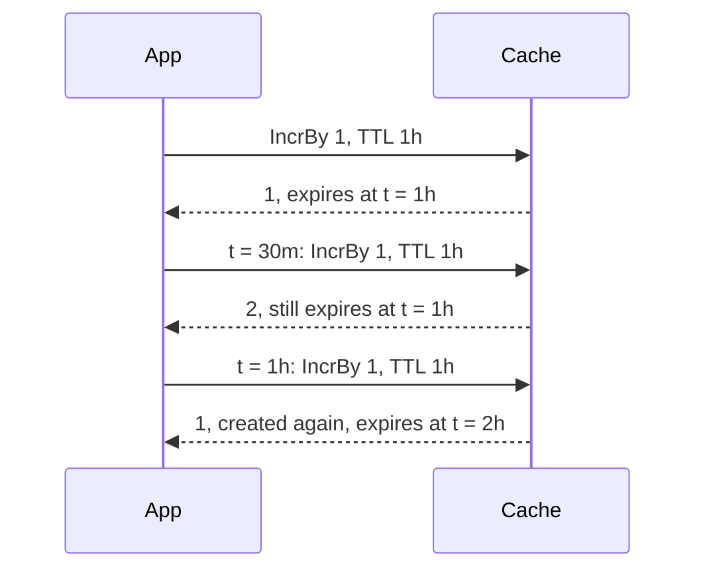

# Values and counters { #values-keys-and-counters }

This page shows how you store and read plain values by key, walk keys by pattern and keep
counters, without a [`Policy`](../reference/gashe.md#Policy). In this section, we will go through [values by key](#values-by-key)
and [keys and counters](#keys-and-counters).

## Values by key { #values-by-key }

The basic API takes plain values and a TTL in every call, with no [`Policy`](../reference/gashe.md#Policy).

!!! warning
    It does not read entries of [`GetOrLoad`](../reference/gashe.md#GetOrLoad): keep one key on one side.

```go hl_lines="1 4"
--8<-- "examples/basic/main.go:example"
```

??? example "Full program"

    ```go
    --8<-- "examples/basic/main.go"
    ```

The methods: [`Cache.Set`](../reference/gashe.md#Cache.Set), [`Cache.SetIfAbsent`](../reference/gashe.md#Cache.SetIfAbsent), [`Cache.SetIfPresent`](../reference/gashe.md#Cache.SetIfPresent), [`Cache.SetMany`](../reference/gashe.md#Cache.SetMany), [`Cache.Get`](../reference/gashe.md#Cache.Get), [`Cache.GetMany`](../reference/gashe.md#Cache.GetMany), [`Cache.Delete`](../reference/gashe.md#Cache.Delete), [`Cache.DeleteMany`](../reference/gashe.md#Cache.DeleteMany).

- A TTL of 0 means no expiry; a negative TTL returns [`ErrInvalidTTL`](../reference/gashe.md#variables).
- [`ErrWrongType`](../reference/gashe.md#variables): a Redis key that is not a string, such as a hash.

!!! tip
    To delete an entry of [`GetOrLoad`](../reference/gashe.md#GetOrLoad) under its [`Policy.Prefix`](../reference/gashe.md#Policy), use
    [`Cached.Delete`](invalidation.md#cacheddelete).

---

## Keys and counters { #keys-and-counters }

Patterns are Redis globs: `*`, `?`, `[abc]`, `[^a]`, `[a-z]`, `\` to escape.

```go hl_lines="24 30"
--8<-- "examples/docs/values/keys-counters/main.go"
```

The methods: [`Cache.Keys`](../reference/gashe.md#Cache.Keys), [`Cache.All`](../reference/gashe.md#Cache.All), [`Cache.DeleteMatch`](../reference/gashe.md#Cache.DeleteMatch), [`Cache.IncrBy`](../reference/gashe.md#Cache.IncrBy), [`Cache.Exists`](../reference/gashe.md#Cache.Exists), [`Cache.Expire`](../reference/gashe.md#Cache.Expire), [`Cache.TTL`](../reference/gashe.md#Cache.TTL).

!!! warning
    [`Cache.Keys`](../reference/gashe.md#Cache.Keys), [`Cache.All`](../reference/gashe.md#Cache.All) and [`Cache.DeleteMatch`](../reference/gashe.md#Cache.DeleteMatch) walk the whole database: on large backends, use tags.

The TTL of [`Cache.IncrBy`](../reference/gashe.md#Cache.IncrBy) applies only when the counter is created: with one hour, the counter lives one
hour from its first call, however often it is raised.



- [`Cache.IncrBy`](../reference/gashe.md#Cache.IncrBy) returns [`ErrWrongType`](../reference/gashe.md#variables) when the value is not an integer, and an error on int64
  overflow.
- A failure of [`Cache.Keys`](../reference/gashe.md#Cache.Keys) or [`Cache.All`](../reference/gashe.md#Cache.All) is yielded once, and the scan stops.

??? note "Technical details"
    | Method | In Redis |
    |---|---|
    | [`Cache.Set`](../reference/gashe.md#Cache.Set), [`Cache.SetMany`](../reference/gashe.md#Cache.SetMany) | `SET`, with `EX` or `PX` for a TTL; one pipeline for many |
    | [`Cache.SetIfAbsent`](../reference/gashe.md#Cache.SetIfAbsent) | `SET ... NX EX or PX`; `SETNX` without a TTL |
    | [`Cache.SetIfPresent`](../reference/gashe.md#Cache.SetIfPresent) | `SET ... XX`, with `EX` or `PX` for a TTL |
    | [`Cache.Get`](../reference/gashe.md#Cache.Get), [`Cache.GetMany`](../reference/gashe.md#Cache.GetMany) | `GET`; one pipeline for many |
    | [`Cache.Delete`](../reference/gashe.md#Cache.Delete), [`Cache.DeleteMany`](../reference/gashe.md#Cache.DeleteMany) | `UNLINK`; one pipeline for many |
    | [`Cache.Keys`](../reference/gashe.md#Cache.Keys) | `SCAN MATCH` on every Cluster master |
    | [`Cache.All`](../reference/gashe.md#Cache.All) | `SCAN`, then `GET` of the found keys in pipelines of 100 |
    | [`Cache.DeleteMatch`](../reference/gashe.md#Cache.DeleteMatch) | `SCAN`, then `UNLINK` in pipelines of 100 |
    | [`Cache.IncrBy`](../reference/gashe.md#Cache.IncrBy) | `INCRBY`; with a TTL, `SET key 0 NX EX or PX` and `INCRBY` in one `MULTI` |
    | [`Cache.Exists`](../reference/gashe.md#Cache.Exists) | `EXISTS` |
    | [`Cache.Expire`](../reference/gashe.md#Cache.Expire) | `PEXPIRE` |
    | [`Cache.TTL`](../reference/gashe.md#Cache.TTL) | `PTTL` |
