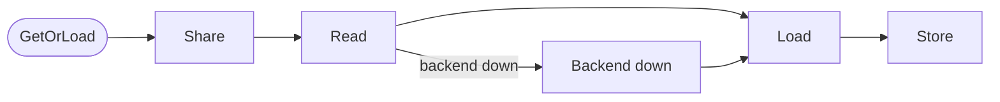
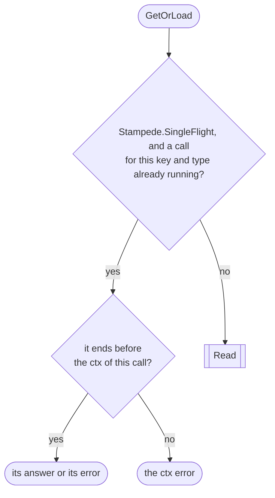
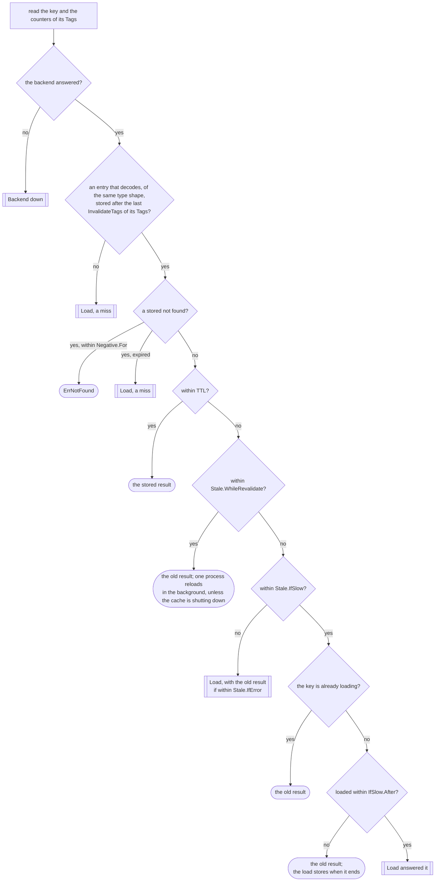
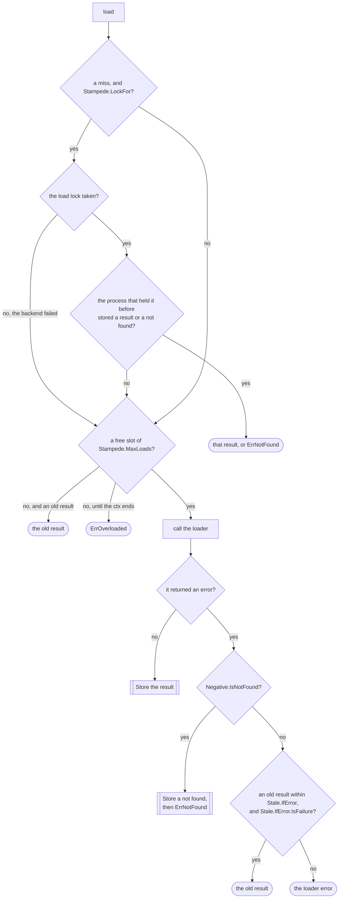
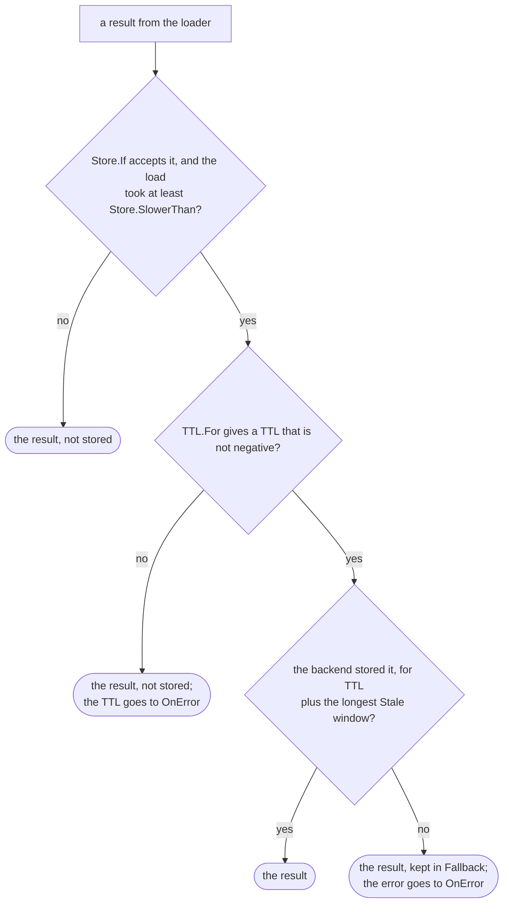
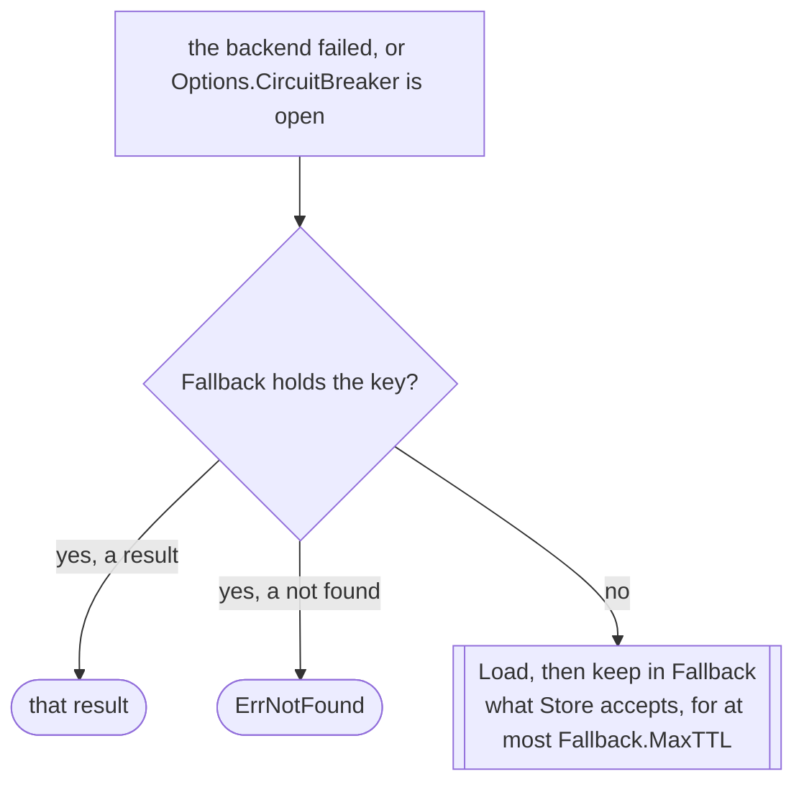

# How GetOrLoad decides { #how-getorload-decides }

Every branch a call of [`GetOrLoad`](../reference/gashe.md#Cached[V].GetOrLoad) can take, in five
steps. Each step has a chart of its own; a box with double sides goes on to the step of that name. A
field you leave out answers "no". The fields and their defaults are in [Settings](../settings.md).

## Share { #share }

The shared call runs apart from the ctx of every caller; it is cancelled once every caller has left.

## Read { #read }

- An open `Options.CircuitBreaker` is a backend that did not answer.
- An entry that does not decode is reported to `OnError` and read as a miss.
- A result past `TTL` and its longest `Stale` window is gone from the backend: a miss.
- While the cache shuts down, `IfSlow` waits for the loader: nothing runs in the background.

## Load { #load }

- `LockFor` locks a missing key only: an old result within `IfError` or `IfSlow` can answer if the
  load fails, so it is reloaded without the lock.
- A call waiting for the load lock gives up when its ctx ends, with the ctx error.

## Store { #store }

A result the codec cannot encode is not stored, and the error goes to `OnError`. A not found is
stored the same way, for `Negative.For`, with no `Store` rules.

## Backend down { #backend-down }

Without `Fallback`, every call loads, and the result is not stored. What each step keeps in the
backend is in [How gashe stores data](storage.md).
