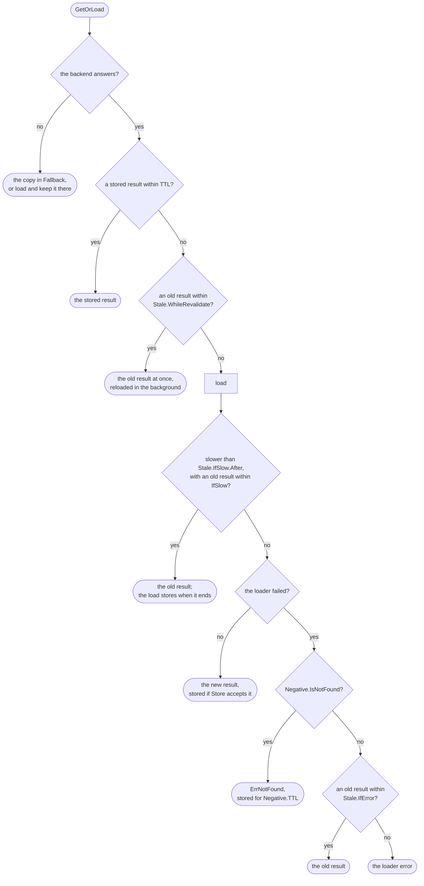

# How GetOrLoad decides { #how-getorload-decides }

Every branch a call of [`GetOrLoad`](../reference/gashe.md#Cached[V].GetOrLoad) can take, with the field of
[`Policy`](../settings.md#policy) or [`Options`](../settings.md#options) that opens it. A field you leave
out keeps its branch on "no".

Under the boxes:

- **The backend answers:** a backend that fails, or an open `Options.CircuitBreaker`, is a no.
- **A stored result:** of the same type shape, stored after the last `InvalidateTags` of its
  `Tags`. A stored "not found" within `Negative.TTL` answers `ErrNotFound` there.
- **Load:** `Stampede.SingleFlight` shares the whole call within a process; `Stampede.LockFor`
  shares a load of a missing key across processes; `Stampede.MaxLoads` limits loads at once, and
  when it is full an old result answers at once, otherwise the call waits and may get
  `ErrOverloaded`.
- **An old result within IfError:** only for errors `Stale.IfError.IsFailure` accepts. Every call
  past `TTL` tries the loader first, so once the source is back the next call stores a fresh
  result.
- A result older than `TTL` plus its longest `Stale` window is gone from the backend, so the call
  loads it as a miss.

The fields and their defaults are in [Settings](../settings.md); what each branch stores is in
[How gashe stores data](storage.md).
