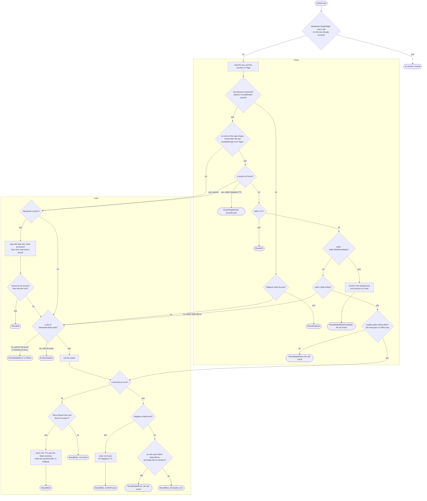

# How GetOrLoad decides { #how-getorload-decides }

Every branch a call of [`GetOrLoad`](../reference/gashe.md#Cached[V].GetOrLoad) can take, with the field of
[`Policy`](../settings.md#policy) or [`Options`](../settings.md#options) that opens it. A field you leave
out keeps its branch on "no". Each end is the [`Result`](../reference/gashe.md#Result) that
[`OnResult`](../reference/gashe.md#Hooks) gets.

- **Read:** one backend call answers most calls. Only a miss, an entry past `TTL` outside
  `WhileRevalidate`, or a backend that is down reach Load.
- **Load:** `LockFor` applies to a missing key only; an old result within `IfError` or `IfSlow` is
  reloaded without the lock, since it can answer if the load fails.
- An entry outside every window is gone from the backend: the backend keeps an entry for `TTL`
  plus its longest `Stale` window, so such a call is a miss.

The fields and their defaults are in [Settings](../settings.md); what each branch stores is in
[How gashe stores data](storage.md).
